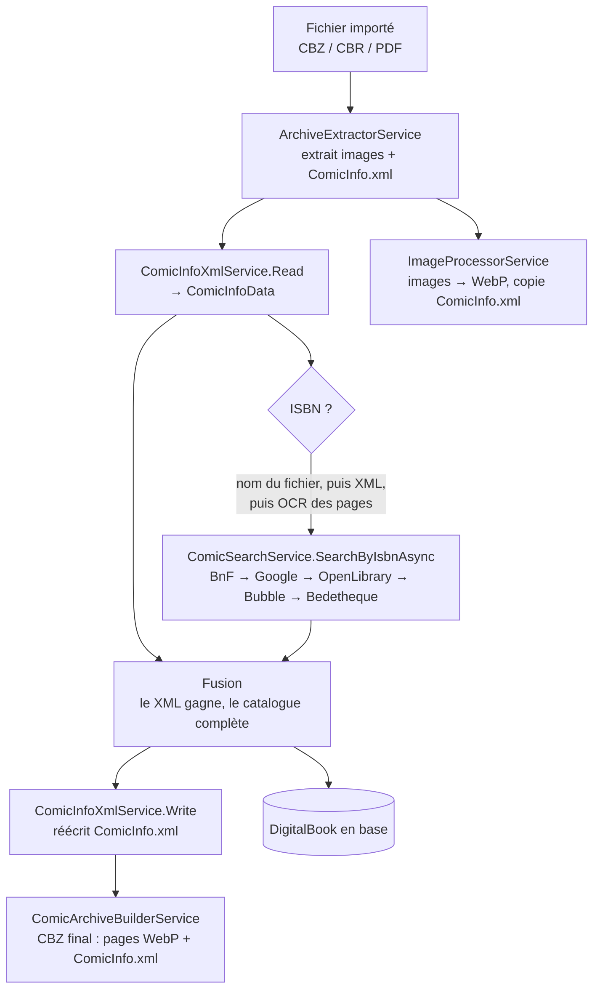

# Métadonnées d'un livre : ComicInfo.xml et catalogues

Ce document décrit d'où viennent les métadonnées d'un livre (série, titre, tome, auteurs…), comment elles
sont fusionnées, et ce qui finit dans la base et dans le `ComicInfo.xml` de l'archive. Deux parcours sont
couverts : **l'import d'un fichier** (CBZ/CBR/PDF) et **l'édition d'un livre** existant.

> Le tome lu en priorité dans `<Volume>` (section 2.2) arrive avec la PR #1191.

## 1. Vue d'ensemble



Fichiers principaux :

| Rôle | Fichier |
|---|---|
| Orchestration de l'import | `Application/ImportJobs/Process/ProcessImportJobCommandHandler.cs` |
| Extraction de l'archive | `Persistence/Services/ArchiveExtractorService.cs` |
| Lecture / écriture du XML | `Persistence/Services/ComicInfoXmlService.cs` (contrat : `Application/Interfaces/IComicInfoXmlService.cs`) |
| ISBN dans le nom de fichier | `Application/Helpers/FileNameIsbnExtractor.cs` |
| Recherche par ISBN (agrégée) | `Application/ComicInfoSearch/ComicSearchService.cs` |
| Catalogues | `Application/ComicInfoSearch/{BnfCatalogue,GoogleBooks,OpenLibrary,Bubble,Bedetheque}Service.cs` |
| Construction du CBZ | `Persistence/Services/ComicArchiveBuilderService.cs` |
| Édition manuelle | `Application/Books/Update/UpdateBookCommandHandler.cs`, `Web/Components/Pages/Books/EditBook.razor.cs` |
| Import depuis le web (édition) | `Web/Components/Pages/Books/FindBookDetails.razor.cs`, `Web/Models/BookDetailsComparison.cs` |

## 2. Lecture du ComicInfo.xml

### 2.1 Extraction

`ArchiveExtractorService.ExtractAsync` ouvre l'archive (SharpCompress : ZIP, RAR) et extrait à plat les images
(`.jpg`, `.jpeg`, `.png`, `.gif`, `.webp`) et les `.xml`. Le fichier nommé `ComicInfo.xml` (casse ignorée,
quel que soit son dossier dans l'archive) est retenu comme `ComicInfoXmlPath`. Un PDF n'a jamais de ComicInfo.xml.

Garde-fous : 5 000 entrées et 5 Go décompressés au maximum, chemins hors du dossier de travail rejetés.

### 2.2 Désérialisation

`ComicInfoXmlService.Read` désérialise le XML (DTD interdite, 1 million de caractères au maximum) dans `ComicInfoDocument`, puis le
convertit en `ComicInfoData`. Seules ces balises sont lues ; toutes les autres sont ignorées :

| Balise XML | `ComicInfoData` | Règle de lecture |
|---|---|---|
| `<Title>` | `Title` | texte brut |
| `<Series>` | `Series` | texte brut |
| `<Volume>` puis `<Number>` | `Number` (le tome) | `<Volume>` s'il contient un entier > 0 ; sinon `<Number>` s'il contient un entier ou un décimal entier (`3`, `03`, `3.0`) ; `1.5`, `HS` → aucun tome |
| `<Summary>` | `Summary` | texte brut (lu mais pas utilisé par l'import) |
| `<Year>`, `<Month>`, `<Day>` | `Year`, `Month`, `Day` | entier > 0, sinon `null` (`-1` et `0` = inconnu dans le schéma) |
| `<Writer>` | `Writer` | texte brut |
| `<Penciller>` | `Penciller` | texte brut (lu mais pas utilisé par l'import) |
| `<Publisher>` | `Publisher` | texte brut |
| `<ISBN>` | `Isbn` | texte brut (balise non standard, écrite par MCM) |
| `<PageCount>` | `PageCount` | entier > 0, sinon `null` |

Les champs numériques sont lus comme du texte : une valeur illisible devient `null` au lieu de faire échouer
la lecture. Si le XML lui-même est invalide, la lecture échoue et l'import continue **sans** ComicInfo.

## 3. Résolution de l'ISBN (import)

`ResolveIsbnAsync` cherche l'ISBN dans cet ordre et s'arrête au premier trouvé :

1. **Le nom du fichier** (`FileNameIsbnExtractor`) : `ISBN-xxx` / `ISBN_xxx` / `ISBN xxx`, puis `(xxx)`, `[xxx]`,
   une suite de 13 chiffres commençant par 978/979, une suite de 10 chiffres.
2. **`<ISBN>` du ComicInfo.xml.**
3. **L'OCR des pages converties** (`IsbnScanner.ScanPagesAsync`) :
   - un seul ISBN lu → il est utilisé ;
   - plusieurs ISBN lus → aucun n'est utilisé, ils sont gardés comme candidats sur le livre pour que
     l'utilisateur choisisse ;
   - aucun → pas d'ISBN, le scan est enregistré.

Le nom du fichier passe avant le XML.

## 4. Les catalogues

### 4.1 Les sources

| Source | Accès | Forme du résultat | Série / tome |
|---|---|---|---|
| **BnF** | API SRU, notice Dublin Core | `IBookSearchResult` | déduits du titre (voir 4.3) ; pas de couverture |
| **Google Books** | API Books (détail via `selfLink`) | `IBookSearchResult` | déduits du titre |
| **OpenLibrary** | API ISBN | `IBookSearchResult` | déduits du titre |
| **Bubble** | index Algolia de bubblebd.com, puis page de l'album | `IStructuredBookResult` | fournis séparément (`SerieTitle`, `Tome`) |
| **Bedetheque** | page trouvée via SerpApi, lue via Cloudflare Browser Run | `IStructuredBookResult` | fournis séparément (fiche album, `Tome`) |

Chaque source peut être désactivée dans *Settings → Features* (`IsEnabled`). Une source désactivée répond
« non trouvé ». Bubble exige aussi une clé d'API.

### 4.2 `ComicSearchService.SearchByIsbnAsync` (import, ajout d'un livre papier)

Nettoie l'ISBN (tirets, espaces), puis interroge les sources **une par une** et garde **la première qui connaît
le livre** :

```
BnF → Google Books → OpenLibrary → Bubble → Bedetheque
```

- La BnF n'ayant pas de couverture, la couverture est cherchée ensuite dans Google Books, OpenLibrary, puis Bubble.
- La couverture trouvée est envoyée sur Cloudinary (`ImageUrl`).
- Aucune source → résultat `Found = false`. Une exception inattendue donne aussi `Found = false`.

Le résultat est un `ComicSearchResult` : `Title`, `Serie`, `VolumeNumber`, `Authors` et `Publishers` (listes
jointes par `", "`), `PublishDate`, `NumberOfPages`, `ImageUrl`, `Source`.

### 4.3 Découpage du titre (BnF, Google Books, OpenLibrary)

Ces trois sources ne donnent qu'un titre (et parfois un sous-titre) qui mélange série, tome et titre.
`ComicSearchService.ParseTitleInfo` essaie ces formats, dans l'ordre :

| Format | Exemple |
|---|---|
| `X, tome N` | `Soda, tome 1` |
| `X - tome N` | `Soda - tome 1` |
| `X tome N` | `Fullmetal Alchemist Tome 23` |
| `X, vol. N` | `Soda, vol. 1` |
| `X - vol. N` | `Soda - vol. 1` |
| `X vol. N` | `Soda vol 1` |
| `X #N` | `Soda #1` |

- La série est `X` et le tome est `N`.
- Le titre est le sous-titre s'il existe, sinon la série.
- **Si aucun format ne correspond, le titre complet devient la série ET le titre, et le tome vaut 1.**
  C'est fréquent avec la BnF, d'où la règle de fusion de la section 5.

Bubble et Bedetheque donnent série, tome et titre séparément et ne passent pas par ce découpage.

## 5. Fusion des données à l'import

`SearchMetadataStepAsync` combine le ComicInfo.xml et le catalogue. **Le ComicInfo.xml gagne** : le
catalogue ne remplit que les champs que le XML laisse vides (absents ou ne contenant que des espaces).

| Champ du livre | 1. ComicInfo.xml | 2. Catalogue (si ISBN trouvé) | 3. Valeur par défaut |
|---|---|---|---|
| Série | `Series` | `Serie` | nom du fichier sans extension |
| Titre | `Title` | `Title` | la série |
| Tome | `Volume` / `Number` | `VolumeNumber` | 1 |
| Auteurs | `Writer` | `Authors` | vide |
| Éditeur | `Publisher` | `Publishers` | vide |
| Date de parution | `Year` (+ `Month`, `Day`, 1 par défaut) | `PublishDate` | aucune |
| ISBN | — | — | ISBN résolu (section 3) |
| Nombre de pages | — | — | pages converties + pages déjà en WebP |

Points à connaître :

- Une année seule est stockée au 1er janvier de cette année (convention de l'application).
- **La couverture** du livre importé est la **première page** de l'archive, envoyée sur Cloudinary
  (`digital-covers/<isbn>` ou `digital-<jobId>`). La couverture du catalogue n'est pas utilisée ici, même si
  `SearchByIsbnAsync` l'envoie quand même sur Cloudinary.
- Le livre n'est créé que si la série et le titre ne sont pas vides et que l'archive pèse plus de 0 octet.

## 6. Le ComicInfo.xml écrit dans l'archive

### 6.1 Écriture

`ImageProcessorService` copie le ComicInfo.xml d'origine à côté des pages WebP. `SearchMetadataStepAsync`
**l'écrase** ensuite avec `ComicInfoXmlService.Write`, à partir des valeurs fusionnées :

| Balise écrite | Valeur |
|---|---|
| `<Title>` | titre |
| `<Series>` | série |
| `<Number>` et `<Volume>` | tome (les deux balises, pour les lecteurs qui ne lisent que `<Number>`) |
| `<Year>`, `<Month>`, `<Day>` | date de parution |
| `<Writer>` | auteurs |
| `<Publisher>` | éditeur |
| `<ISBN>` | ISBN résolu |
| `<PageCount>` | nombre de pages |

Les champs `null` ne sont pas écrits. `<Summary>` et `<Penciller>` sont toujours `null`.

> **Perte d'informations :** le XML d'origine est remplacé, pas complété. `<Summary>`, `<Penciller>` et toutes
> les balises non lues (`<Genre>`, `<Colorist>`, `<LanguageISO>`, `<Web>`, `<Characters>`…) disparaissent du
> CBZ final.

### 6.2 Construction du CBZ

`ComicArchiveBuilderService.BuildAsync` crée un ZIP contenant les pages WebP, puis `ComicInfo.xml` à la racine.
Le fichier est nommé `<isbn>.cbz` si l'ISBN est valide, sinon `<jobId>.cbz`, puis déplacé dans le dossier de la
bibliothèque.

## 7. Édition d'un livre

### 7.1 Édition manuelle (`EditBook`)

Le formulaire envoie les valeurs saisies à `UpdateBookCommandHandler`. Celui-ci :

- refuse un titre ou une série vide ;
- valide et normalise l'ISBN ;
- refuse un ISBN déjà porté par un autre livre ;
- met à jour le livre **en base uniquement**.

### 7.2 Import depuis le web (`FindBookDetails`)

1. L'ISBN utilisé est celui passé dans l'URL s'il est valide (lu sur une page, par exemple), sinon celui du livre.
2. **Toutes** les sources activées sont interrogées **en parallèle**, directement (pas via `ComicSearchService`).
   Chaque résultat s'affiche dès qu'il arrive ; une source en erreur affiche un avertissement sans bloquer les autres.
3. BnF, Google Books et OpenLibrary passent par le découpage du titre (section 4.3) ; Bubble et Bedetheque
   donnent leurs champs tels quels.
4. `BookDetailsComparison` compare, champ par champ, la valeur actuelle à celles des sources :
   - **Matches** : toutes les sources qui connaissent le champ donnent la valeur actuelle ;
   - **Differs** : au moins une source propose autre chose, et l'utilisateur choisit ;
   - **Unknown** : aucune source ne connaît le champ.

   Les sources qui donnent la même valeur sont regroupées sur une seule option. Un tome à 0 compte comme inconnu.
5. À l'enregistrement, les valeurs choisies remplacent les valeurs actuelles. Une couverture externe est
   d'abord envoyée sur Cloudinary. La mise à jour passe par le même `UpdateBookCommandHandler` (section 7.1).

### 7.3 Pas de mise à jour de l'archive

Aucune des deux éditions ne touche au fichier : le `ComicInfo.xml` du CBZ garde les valeurs de l'import.
Après une correction, **la base et le ComicInfo.xml de l'archive peuvent diverger.**

## 8. Pièges connus

- **Catalogue au titre non découpable** (BnF surtout) : série = titre et tome = 1. À l'import, le XML est
  désormais prioritaire ; sans XML, ce résultat est encore utilisé tel quel.
- **`<Volume>` contenant une année** (comics US, par exemple `2016`) : cette valeur passe avant `<Number>` et
  devient le tome.
- **ISBN du nom de fichier prioritaire** sur celui du XML : un nom de fichier contenant un autre nombre à
  10 ou 13 chiffres peut donner un mauvais ISBN, donc de mauvaises métadonnées pour les champs vides du XML.
- **Réécriture du ComicInfo.xml** : les balises non gérées sont perdues (section 6.1).
- **Édition sans répercussion sur le CBZ** (section 7.3).
