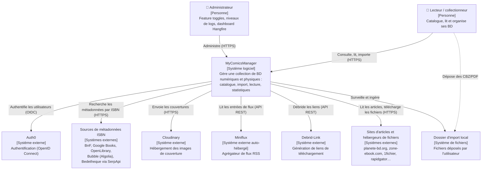

# Vue 1 — Diagramme de contexte

**Portée** : le système MyComicsManager vu de l'extérieur : qui l'utilise, de quels systèmes il dépend.

## Éléments

| Élément | Preuves (observé) |
|---|---|
| Utilisateur / Admin | Pages Blazor (`Web/Components/Pages`), `Admin/FeatureTogglesCard`, `LogLevels`, `HangfireAuthorizationFilter` (rôle `Admin`, ADR-0016) |
| Auth0 | `Web/Configuration/Auth0Configuration.cs`, ADR-0008 |
| Sources ISBN | `Application/ComicInfoSearch/*Service.cs`, `appsettings.json` (BnF, GoogleBooks, OpenLibrary, Bubble, SerpApi) |
| Cloudinary | `Persistence/Services/CloudinaryService.cs`, `Web/Infrastructure/CloudinaryHealthCheck.cs` |
| Miniflux / Debrid-Link / sites | `Web/Infrastructure/MinifluxClient.cs`, `DebridLinkClient.cs`, `ArticlePageFetcher.cs`, `docs/FEED-IMPORT.md`, ADR-0019 |

Inféré : « lecteur » et « administrateur » sont probablement deux casquettes de la même personne (voir questions ouvertes).
