# Vue 2 — Diagramme de conteneurs

**Portée** : unités exécutables du système et leurs stockages. Un « conteneur » C4 n'est pas forcément un conteneur Docker.

```mermaid
flowchart TB
    user["👤 Lecteur / Admin<br/>[Personne]"]

    subgraph pi["Hôte auto-hébergé (Raspberry Pi 4, arm64 — ADR-0001)"]
        subgraph web["Image Docker unique : processus .NET 10, port 8080"]
            blazor["Interface Blazor Server<br/>[ASP.NET Core + MudBlazor]<br/>Pages interactives (SignalR),<br/>endpoints /api/books, /account, /health"]
            hf["Serveur Hangfire<br/>[Hangfire, 1 worker, files import + default]<br/>Import de fichiers, scan OCR d'ISBN,<br/>sync et téléchargement des flux"]
            fw["FileWatcherService<br/>[IHostedService, polling]<br/>Détecte les fichiers à importer"]
            ocr["Tesseract OCR<br/>[binaire local]<br/>Lit l'ISBN imprimé dans les pages"]
        end
        db[("PostgreSQL 18<br/>[auto-hébergé]<br/>Livres, bibliothèques, utilisateurs, jobs d'import,<br/>décisions de flux, toggles, clés Data Protection,<br/>file de jobs Hangfire")]
        fs[("Système de fichiers local<br/>LocalStorage, ImportDirectory, TempDirectory<br/>CBZ des bibliothèques et dépôt d'import")]
        mini["Miniflux<br/>[externe, même réseau — inféré]"]
    end

    auth0["Auth0"]
    isbn["Sources ISBN<br/>BnF, Google Books, OpenLibrary,<br/>Bubble, SerpApi/Bedetheque"]
    cloud["Cloudinary"]
    debrid["Debrid-Link"]
    sites["Sites d'articles et hébergeurs"]

    user -->|"HTTPS + WebSocket (SignalR)"| blazor
    blazor -->|"Authentifie (OIDC)"| auth0
    blazor -->|"Lit/écrit (EF Core, Npgsql)"| db
    blazor -->|"Lit/écrit les fichiers de BD"| fs
    blazor -->|"Recherche ISBN (HTTPS)"| isbn
    blazor -->|"Envoie les couvertures (HTTPS)"| cloud
    blazor -->|"Enfile des jobs"| db
    fw -->|"Scrute le dossier d'import"| fs
    fw -->|"Enfile un job d'import"| db
    hf -->|"Récupère les jobs (polling SQL)"| db
    hf -->|"Extrait, convertit en WebP, produit le CBZ"| fs
    hf -->|"Scanne les pages (processus)"| ocr
    hf -->|"Lit les entrées (REST)"| mini
    hf -->|"Débride les liens (REST)"| debrid
    hf -->|"Lit articles, télécharge (HTTPS)"| sites
    hf -->|"Persiste l'état des jobs"| db
```

## Conteneurs

| Conteneur | Technologie | Responsabilité | Preuves |
|---|---|---|---|
| Interface Blazor Server | ASP.NET Core 10, MudBlazor, Auth0 | UI interactive, endpoints de téléchargement/pages, health check, dashboard `/hangfire` | `Web/Program.cs`, `Web/EndPoints/*`, ADR-0006/0007 |
| Serveur Hangfire | Hangfire 1.8, stockage PostgreSQL | Exécution séquentielle (`WorkerCount = 1`) des traitements longs | `Web/Program.cs` (AddHangfire/AddHangfireServer), ADR-0016 |
| FileWatcherService | `IHostedService`, `PeriodicTimer` | Détection des fichiers déposés, création des jobs d'import | `Web/Services/FileWatcherService.cs` |
| PostgreSQL | PostgreSQL 18, EF Core 10 | Persistance unique (métier, jobs, clés) | `Persistence/`, ADR-0003, `cd.yml` |
| Système de fichiers | Volume local | Stockage des BD, import, espace temporaire | `Persistence/LocalStorage/*` |
| Tesseract | Binaire installé dans l'image | OCR des pages pour retrouver l'ISBN | `Web/Dockerfile`, `TesseractPageTextRecognizer` |

## Remarques

- **Observé** : Blazor, Hangfire et `FileWatcherService` s'exécutent dans le **même processus**. Je les dessine séparément pour montrer les responsabilités ; en déploiement c'est une seule unité.
- **Observé** : un seul serveur PostgreSQL est partagé par staging et production (bases distinctes), `docs/MIGRATION-POSTGRESQL.md`.
- **Observé** : la CI/CD (`ci.yml`, `cd.yml`) construit, teste (avec un `postgres:18` éphémère), analyse (SonarCloud) et publie l'image sur `ghcr.io`.
- **Risque** : un seul worker dans un seul processus ; un import long retarde la synchronisation des flux.
