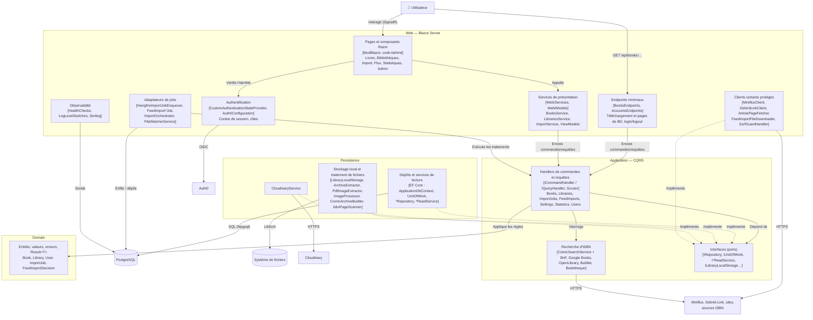

# Vue 3 — Diagramme de composants du conteneur Web (Blazor Server)

**Portée** : l'application `Web` et les couches `Application`, `Domain`, `Persistence` qu'elle compose (racine de composition : `Web/Program.cs`, `AddApplication()`, `AddInfrastructure()`). Découpage par responsabilité, pas par dossier.

## Composants

| Composant | Responsabilité | Emplacement |
|---|---|---|
| Pages et composants Razor | UI, code-behind + CSS isolé (ADR-0011) ; pas de logique métier | `Web/Components/**` |
| Authentification | Cookie de session 7 jours, clés Data Protection en base, rôles dont `Admin` | `Web/Configuration/Auth0Configuration.cs`, `CustomAuthenticationStateProvider.cs` |
| Endpoints minimaux | `GET /api/books/{id}/download`, `/api/books/{id}/pages/{n}`, comptes ; sous autorisation | `Web/EndPoints/` |
| Services de présentation | Façade entre l'UI et les handlers, ViewModels pré-calculés | `Web/Services/`, `Web/Models/` |
| Adaptateurs de jobs | Mise en file Hangfire, orchestrateurs ouvrant un scope DI par job, surveillance du dossier d'import | `Web/Services/Hangfire*`, `*Orchestrator`, `FileWatcherService` |
| Clients sortants protégés | Clients HTTP vers Miniflux, Debrid-Link, sites, filtrés par liste d'hôtes (anti-SSRF, ADR-0015) | `Web/Infrastructure/` |
| Observabilité | `/health` (Npgsql, Cloudinary, Miniflux, Debrid-Link, dossier d'import), niveaux de log modifiables à chaud (ADR-0020) | `Web/Infrastructure/*HealthCheck.cs`, `LogLevelSwitches.cs` |
| Handlers CQRS | Cas d'usage, validation, `Result<T>` (ADR-0002, 0004) ; CQRS maison sans MediatR | `Application/*/` |
| Recherche d'ISBN | Interroge BnF → Google Books → OpenLibrary → Bubble → Bedetheque, garde le premier résultat ; chaque source désactivable | `Application/ComicInfoSearch/` |
| Domain | Entités, hiérarchie Book en TPT (ADR-0005), erreurs, `Result<T>` | `Domain/` |
| Dépôts / lecture | Écriture via `IRepository`/`IUnitOfWork`, lecture via `I*ReadService` | `Persistence/Repositories`, `Persistence/Queries` |
| Stockage et traitement de fichiers | Rangement, extraction d'archives et PDF, conversion WebP, CBZ, ComicInfo.xml, OCR | `Persistence/LocalStorage`, `Persistence/Services` |

## Règles de dépendances (observé, `tests/Architecture.Tests`)

`Web → Application → Domain` ; `Persistence → Application, Domain` ; `Domain` sans dépendance. Les types EF Core ne remontent pas.

## Écarts à noter

- Les clients Miniflux, Debrid-Link et la récupération d'articles vivent dans `Web/Infrastructure`, tandis que Cloudinary et les fichiers sont dans `Persistence`, et les services de recherche d'ISBN dans `Application/ComicInfoSearch`. Voir questions ouvertes.
- Le diagramme regroupe les adaptateurs « implémente » par flèche pointillée ; l'enregistrement DI exact est dans `Persistence/ProjectDependencyInjection.cs` et `Web/Program.cs`.
