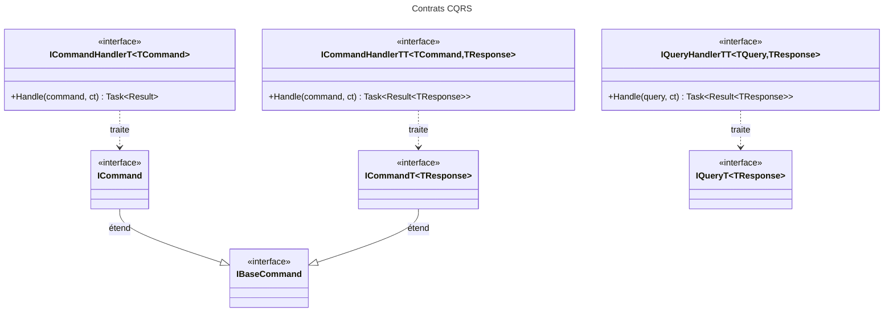

# C4 Code Level : Application.Abstractions.Messaging

## Vue d'ensemble

- **Nom** : Application.Abstractions.Messaging : contrats CQRS
- **Description** : Marqueurs de commandes et de requêtes, et interfaces des handlers qui les traitent. Ce sont les seules abstractions que les handlers implémentent et que le conteneur scanne.
- **Emplacement** : [Application/Abstractions/Messaging/](../Application/Abstractions/Messaging/)
- **Langage** : C# (.NET 10)
- **Objectif** : Définir le contrat CQRS (commande, requête, handler) sur lequel repose toute la couche Application. Les résultats s'expriment avec `Result` et `Result<T>` du namespace `Domain.Primitives`.

## Éléments de code

### Interfaces de marquage

#### IBaseCommand

- **Type** : interface publique vide, marqueur commun aux commandes
- **Signature** : `public interface IBaseCommand;`
- **Description** : Racine commune de `ICommand` et `ICommand<TResponse>`.
- **Emplacement** : [ICommand.cs](../Application/Abstractions/Messaging/ICommand.cs) ligne 12

#### ICommand

- **Type** : interface publique vide, commande sans valeur de retour
- **Signature** : `public interface ICommand : IBaseCommand;`
- **Description** : Commande qui ne renvoie qu'un `Result` (succès ou erreur).
- **Emplacement** : [ICommand.cs](../Application/Abstractions/Messaging/ICommand.cs) ligne 6
- **Dépendances** : `IBaseCommand`

#### ICommand&lt;TResponse&gt;

- **Type** : interface publique vide, commande renvoyant une valeur de type `TResponse`
- **Signature** : `public interface ICommand<TResponse> : IBaseCommand;`
- **Description** : Commande dont le handler renvoie `Result<TResponse>`. Le paramètre `TResponse` n'est utilisé que par le typage des handlers.
- **Emplacement** : [ICommand.cs](../Application/Abstractions/Messaging/ICommand.cs) ligne 9
- **Dépendances** : `IBaseCommand`

#### IQuery&lt;TResponse&gt;

- **Type** : interface publique vide, requête en lecture seule
- **Signature** : `public interface IQuery<TResponse>;`
- **Description** : Requête renvoyant `Result<TResponse>`. Elle ne modifie aucun état.
- **Emplacement** : [IQuery.cs](../Application/Abstractions/Messaging/IQuery.cs) ligne 6

### Interfaces de handlers

#### ICommandHandler&lt;TCommand&gt;

- **Type** : interface publique, `in TCommand` contravariante, contrainte `where TCommand : ICommand`
- **Signature** :

```csharp
public interface ICommandHandler<in TCommand> where TCommand : ICommand
{
    Task<Result> Handle(TCommand command, CancellationToken cancellationToken);
}
```

- **Description** : Traite une commande sans valeur de retour.
- **Emplacement** : [ICommandHandler.cs](../Application/Abstractions/Messaging/ICommandHandler.cs) lignes 5-8
- **Dépendances** : `Domain.Primitives.Result`, `ICommand`

#### ICommandHandler&lt;TCommand, TResponse&gt;

- **Type** : interface publique, `in TCommand` contravariante, contrainte `where TCommand : ICommand<TResponse>`
- **Signature** :

```csharp
public interface ICommandHandler<in TCommand, TResponse> where TCommand : ICommand<TResponse>
{
    Task<Result<TResponse>> Handle(TCommand command, CancellationToken cancellationToken);
}
```

- **Description** : Traite une commande et renvoie la valeur créée ou modifiée.
- **Emplacement** : [ICommandHandler.cs](../Application/Abstractions/Messaging/ICommandHandler.cs) lignes 10-13
- **Dépendances** : `Domain.Primitives.Result<TValue>`, `ICommand<TResponse>`

#### IQueryHandler&lt;TQuery, TResponse&gt;

- **Type** : interface publique, `in TQuery` contravariante, contrainte `where TQuery : IQuery<TResponse>`
- **Signature** :

```csharp
public interface IQueryHandler<in TQuery, TResponse> where TQuery : IQuery<TResponse>
{
    Task<Result<TResponse>> Handle(TQuery query, CancellationToken cancellationToken);
}
```

- **Description** : Traite une requête et renvoie `Result<TResponse>`.
- **Emplacement** : [IQueryHandler.cs](../Application/Abstractions/Messaging/IQueryHandler.cs) lignes 5-8
- **Dépendances** : `Domain.Primitives.Result<TValue>`, `IQuery<TResponse>`

## Dépendances

### Internes

- `Domain.Primitives` : `Result`, `Result<TValue>` (types de retour de tous les handlers).
- Usages : tous les handlers des sous-répertoires (`Application/Books`, `Application/FeedImports`, `Application/Settings`, `Application/Statistics`, `Application/Users`, ...) implémentent ces interfaces.

### Externes

- `System.Threading.Tasks` (`Task`) et `System.Threading` (`CancellationToken`) : fournis par les implicit usings.
- Le scan d'enregistrement est fait par Scrutor dans [ApplicationDependencyInjection.cs](../Application/ApplicationDependencyInjection.cs) lignes 19-23.

## Relations



## Notes

- Les interfaces de marquage utilisent `#pragma warning disable CA1040` et `S2326` : le paramètre `TResponse` de `IQuery<TResponse>` et de `ICommand<TResponse>` n'est pas utilisé dans le corps de l'interface.
- Les handlers sont retrouvés par le conteneur grâce à ces interfaces génériques (voir la racine `Application`).
- Aucune interface ne prend de `CancellationToken` optionnel : le token est obligatoire dans `Handle`.
