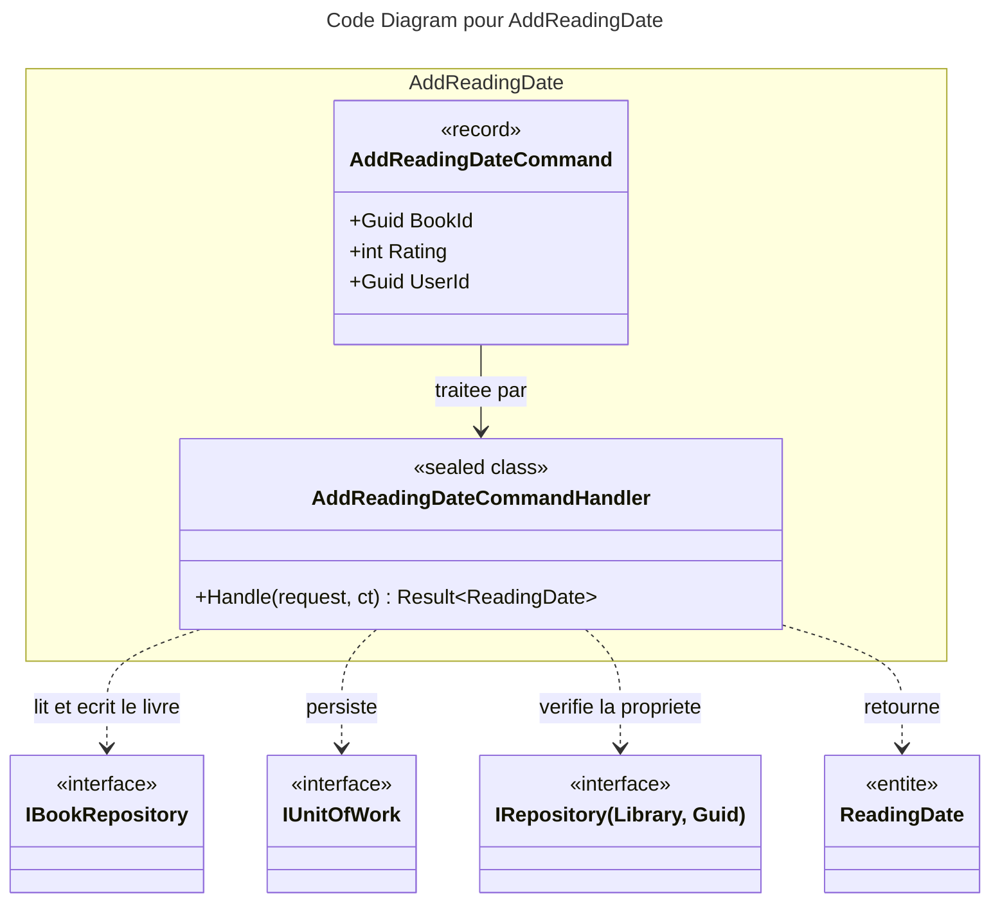

# C4 Code : Application/Books/AddReadingDate

## 1. Vue d'ensemble

- **Nom** : `Application.Books.AddReadingDate`
- **Description** : Cas d'usage « ajouter une date de lecture » : enregistre une nouvelle lecture datée d'aujourd'hui, avec une note de 1 à 5, sur un livre appartenant à l'utilisateur.
- **Emplacement relatif** : [`Application/Books/AddReadingDate/`](../Application/Books/AddReadingDate/)
- **Langage** : C# (.NET 10)
- **Objectif** : Journaliser une lecture (date UTC courante et note) sur un livre et persister l'agrégat.

## 2. Éléments de code

### Commandes

- `public record AddReadingDateCommand(Guid BookId, int Rating, Guid UserId) : ICommand<ReadingDate>;`
  - **Description** : Commande demandant l'ajout d'une date de lecture. Retourne l'entité `ReadingDate` créée.
  - **Emplacement** : [AddReadingDateCommand.cs:6](../Application/Books/AddReadingDate/AddReadingDateCommand.cs#L6)
  - **Dépendances** : `Application.Abstractions.Messaging.ICommand<TResponse>`, `Domain.Books.ReadingDate`.

### Handlers

- `public sealed class AddReadingDateCommandHandler(IBookRepository bookRepository, IUnitOfWork unitOfWork, IRepository<Library, Guid> libraryRepository) : ICommandHandler<AddReadingDateCommand, ReadingDate>`
  - `public async Task<Result<ReadingDate>> Handle(AddReadingDateCommand request, CancellationToken cancellationToken)`
  - **Description** : Valide les entrées, vérifie que le livre existe et appartient à l'utilisateur, ajoute la date de lecture à l'agrégat `Book`, puis persiste.
  - **Emplacement** : [AddReadingDateCommandHandler.cs:10-52](../Application/Books/AddReadingDate/AddReadingDateCommandHandler.cs#L10-L52)
  - **Déroulement** :
    1. `Guard.Against.Null(request)` (ligne 17).
    2. `BookId` ou `UserId` égal à `Guid.Empty` : `BooksError.BadRequest` (lignes 19-22).
    3. `Rating` hors de 1..5 : `BooksError.InvalidRating` (lignes 24-27).
    4. Livre introuvable : `BooksError.NotFound` (lignes 29-33).
    5. Bibliothèque absente ou appartenant à un autre utilisateur : `BooksError.NotFound` (lignes 35-39), pour ne pas divulguer l'existence du livre.
    6. `book.AddReadingDate(DateTime.UtcNow, request.Rating)` (ligne 41).
    7. `bookRepository.AddReadingDate(readingDate)`, `bookRepository.Update(book)`, puis `unitOfWork.SaveChangesAsync` (lignes 43-49) ; l'erreur de sauvegarde est propagée.
  - **Dépendances** : `IBookRepository`, `IUnitOfWork`, `IRepository<Library, Guid>`, `Book.AddReadingDate`, `BooksError`.

## 3. Dépendances

### Internes

- `Application.Interfaces.IBookRepository` (lecture et écriture des livres, ajout de `ReadingDate`).
- `Application.Interfaces.IUnitOfWork` (persistance transactionnelle).
- `Application.Interfaces.IRepository<Library, Guid>` (contrôle de propriété de la bibliothèque).
- `Domain.Books` : `Book`, `ReadingDate`, `BooksError`.
- `Domain.Libraries.Library`, `Domain.Primitives.Result`.

### Externes

- `Ardalis.GuardClauses` (`Guard.Against.Null`).
- Bibliothèque standard : `Guid`, `DateTime`, `CancellationToken`.

## 4. Relations

## Notes

- La validation des entrées (lignes 19-27) précède tout appel au dépôt, conformément à la règle du CLAUDE.md.
- La note est limitée à 1..5 dans ce cas d'usage, alors que la création d'un livre (`CreateBookCommand`) accepte 0 pour « non lu ».
- Les deux appels `bookRepository.AddReadingDate` et `book.AddReadingDate` sont distincts : le premier ajoute l'entité de lecture au dépôt, le second l'ajoute à l'agrégat.
