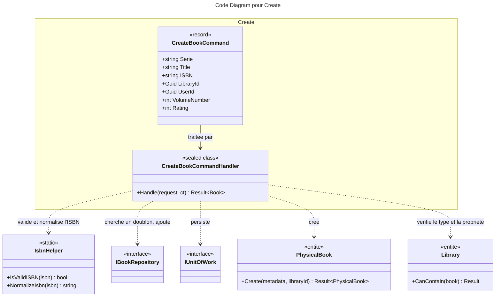

# C4 Code : Application/Books/Create

## 1. Vue d'ensemble

- **Nom** : `Application.Books.Create`
- **Description** : Cas d'usage « créer un livre physique » dans une bibliothèque de l'utilisateur. Valide les métadonnées, normalise l'ISBN, refuse les doublons, vérifie la compatibilité avec le type de la bibliothèque et enregistre une lecture si le livre est déjà noté.
- **Emplacement relatif** : [`Application/Books/Create/`](../Application/Books/Create/)
- **Langage** : C# (.NET 10)
- **Objectif** : Ajouter un nouveau `PhysicalBook` à une bibliothèque, avec toutes les garanties métier.

## 2. Éléments de code

### Commandes

- `public record CreateBookCommand(string Serie, string Title, string ISBN, Guid LibraryId, Guid UserId, int VolumeNumber = 1, string ImageLink = "", int Rating = 1, string Authors = "", string Publishers = "", DateOnly? PublishDate = null, int? NumberOfPages = null) : ICommand<Book>;`
  - **Description** : Métadonnées du livre à créer. `Rating = 0` signifie « non lu » ; une valeur de 1 à 5 crée aussi une date de lecture datée d'aujourd'hui.
  - **Emplacement** : [CreateBookCommand.cs:6-19](../Application/Books/Create/CreateBookCommand.cs#L6-L19)
  - **Dépendances** : `ICommand<TResponse>`, `Domain.Books.Book`.

### Handlers

- `public sealed class CreateBookCommandHandler(IBookRepository bookRepository, IUnitOfWork unitOfWork, IRepository<Library, Guid> libraryRepository) : ICommandHandler<CreateBookCommand, Book>`
  - `public async Task<Result<Book>> Handle(CreateBookCommand request, CancellationToken cancellationToken)`
  - **Description** : Enchaîne les contrôles puis crée le livre physique et le persiste.
  - **Emplacement** : [CreateBookCommandHandler.cs:11-91](../Application/Books/Create/CreateBookCommandHandler.cs#L11-L91)
  - **Déroulement** :
    1. `Guard.Against.Null(request)` (ligne 15).
    2. Titre, ISBN ou série vides, ou `LibraryId == Guid.Empty` : `BooksError.BadRequest` (lignes 18-22).
    3. ISBN invalide (`IsbnHelper.IsValidISBN`) : `BooksError.InvalidISBN` (lignes 25-28).
    4. `Rating` hors de 0..5 : `BooksError.InvalidRating` (lignes 31-34).
    5. Normalisation de l'ISBN (ligne 36) puis recherche d'un doublon : `BooksError.Duplicate` (lignes 39-43).
    6. Bibliothèque introuvable : `LibrariesError.NotFound` (lignes 46-50) ; propriétaire différent : `LibrariesError.NotFound` (lignes 53-56).
    7. Création du `BookMetadata` puis `PhysicalBook.Create(metadata, request.LibraryId)` (lignes 59-66).
    8. `library.CanContain(book)` vérifie la compatibilité de type (lignes 71-75).
    9. Si `Rating > 0` : `book.AddReadingDate(DateTime.UtcNow, request.Rating)` (lignes 78-81).
    10. `bookRepository.Add(book)` puis `unitOfWork.SaveChangesAsync` (lignes 83-88).
  - **Dépendances** : `IBookRepository`, `IUnitOfWork`, `IRepository<Library, Guid>`, `IsbnHelper` (`Application.Helpers`), `BookMetadata`, `PhysicalBook.Create`, `Library.CanContain`.

## 3. Dépendances

### Internes

- `Application.Interfaces` : `IBookRepository`, `IUnitOfWork`, `IRepository<Library, Guid>`.
- `Application.Helpers.IsbnHelper` (validation et normalisation de l'ISBN).
- `Domain.Books` : `Book`, `PhysicalBook`, `BookMetadata`, `BooksError`.
- `Domain.Libraries` : `Library`, `LibrariesError`.
- `Domain.Primitives.Result`.

### Externes

- `Ardalis.GuardClauses`.
- Bibliothèque standard : `DateOnly`, `DateTime`, `Guid`, `CancellationToken`.

## 4. Relations

## Notes

- Le handler est un exemple du flux « validations puis persistance » : aucune écriture n'a lieu avant la fin des contrôles métier.
- Incohérence relevée : une bibliothèque d'un autre utilisateur renvoie `LibrariesError.NotFound`, alors que les autres handlers du dossier `Books` renvoient `BooksError.NotFound` dans le même cas.
- Seuls des `PhysicalBook` sont créés ici ; les livres numériques passent par un autre flux d'import (hors périmètre).
