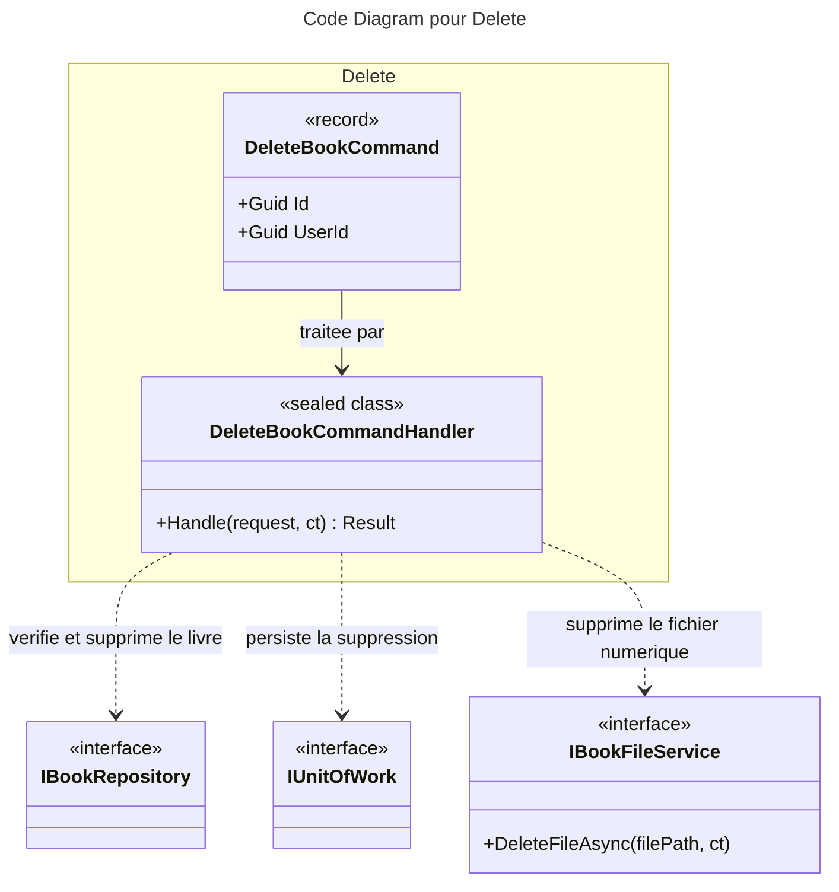

# C4 Code : Application/Books/Delete

## 1. Vue d'ensemble

- **Nom** : `Application.Books.Delete`
- **Description** : Cas d'usage « supprimer un livre ». Supprime l'enregistrement en base puis, pour un livre numérique, le fichier associé sur le disque.
- **Emplacement relatif** : [`Application/Books/Delete/`](../Application/Books/Delete/)
- **Langage** : C# (.NET 10)
- **Objectif** : Retirer un livre appartenant à l'utilisateur et nettoyer son fichier numérique éventuel.

## 2. Éléments de code

### Commandes

- `public record DeleteBookCommand(Guid Id, Guid UserId) : ICommand;`
  - **Description** : Identifiant du livre à supprimer et de l'utilisateur demandeur.
  - **Emplacement** : [DeleteBookCommand.cs:5](../Application/Books/Delete/DeleteBookCommand.cs#L5)
  - **Dépendances** : `ICommand` (sans valeur de retour).

### Handlers

- `public sealed class DeleteBookCommandHandler(IBookRepository bookRepository, IUnitOfWork unitOfWork, IRepository<Library, Guid> libraryRepository, IBookFileService bookFileService) : ICommandHandler<DeleteBookCommand>`
  - `public async Task<Result> Handle(DeleteBookCommand request, CancellationToken cancellationToken)`
  - **Description** : Vérifie l'existence et la propriété du livre, supprime l'entité, sauvegarde, puis supprime le fichier s'il s'agit d'un `DigitalBook`.
  - **Emplacement** : [DeleteBookCommandHandler.cs:10-46](../Application/Books/Delete/DeleteBookCommandHandler.cs#L10-L46)
  - **Déroulement** :
    1. `Guard.Against.Null(request)` (ligne 18).
    2. Livre introuvable : `BooksError.NotFound` (lignes 20-24).
    3. Bibliothèque absente ou non propriétaire : `BooksError.NotFound` (lignes 26-30).
    4. `bookRepository.Remove(book)` puis `unitOfWork.SaveChangesAsync` (lignes 32-37).
    5. Si `book is DigitalBook digitalBook` : `bookFileService.DeleteFileAsync(digitalBook.FilePath, ct)` (lignes 39-42).
    6. Retour `Result.Success()` (ligne 44).
  - **Dépendances** : `IBookRepository`, `IUnitOfWork`, `IRepository<Library, Guid>`, `IBookFileService`.

## 3. Dépendances

### Internes

- `Application.Interfaces` : `IBookRepository`, `IUnitOfWork`, `IRepository<Library, Guid>`, `IBookFileService`.
- `Domain.Books` : `Book`, `DigitalBook`, `BooksError`.
- `Domain.Libraries.Library`, `Domain.Primitives.Result`.

### Externes

- `Ardalis.GuardClauses`.

## 4. Relations

## Notes

- Ordre des opérations : la suppression du fichier intervient après la sauvegarde de la base, pour qu'une base qui échoue ne laisse pas un livre sans fichier.
- Le résultat de `DeleteFileAsync` n'est pas examiné : un échec de suppression de fichier n'est pas remonté à l'appelant.
- Les identifiants ne sont pas contrôlés contre `Guid.Empty` avant l'appel au dépôt, contrairement à la règle de validation d'entrée du CLAUDE.md (le contrôle de propriété retourne toutefois `NotFound` pour un identifiant inconnu).
