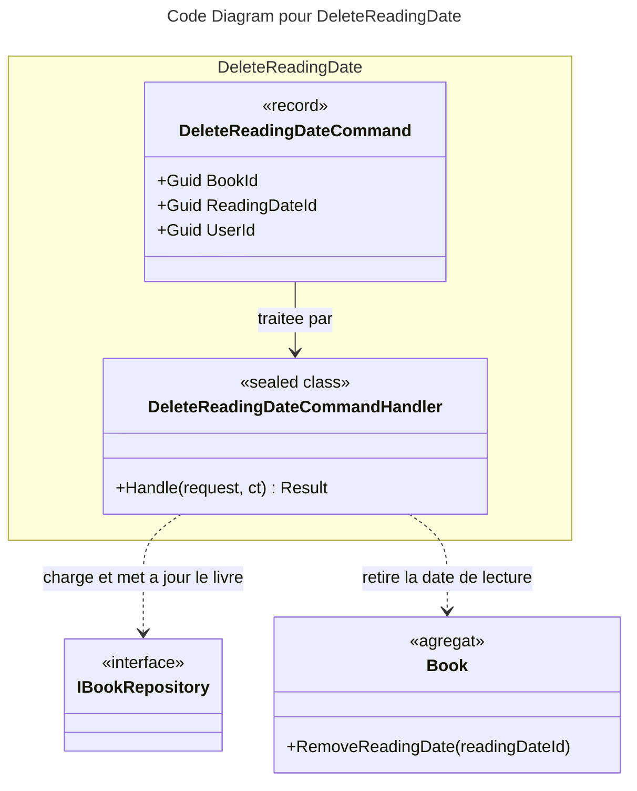

# C4 Code : Application/Books/DeleteReadingDate

## 1. Vue d'ensemble

- **Nom** : `Application.Books.DeleteReadingDate`
- **Description** : Cas d'usage « supprimer une date de lecture » d'un livre appartenant à l'utilisateur.
- **Emplacement relatif** : [`Application/Books/DeleteReadingDate/`](../Application/Books/DeleteReadingDate/)
- **Langage** : C# (.NET 10)
- **Objectif** : Retirer une entrée de l'historique de lecture d'un livre.

## 2. Éléments de code

### Commandes

- `public record DeleteReadingDateCommand(Guid BookId, Guid ReadingDateId, Guid UserId) : ICommand;`
  - **Description** : Identifie la date de lecture à retirer, son livre et l'utilisateur demandeur.
  - **Emplacement** : [DeleteReadingDateCommand.cs:5](../Application/Books/DeleteReadingDate/DeleteReadingDateCommand.cs#L5)
  - **Dépendances** : `ICommand` (sans valeur de retour).

### Handlers

- `public sealed class DeleteReadingDateCommandHandler(IBookRepository bookRepository, IUnitOfWork unitOfWork, IRepository<Library, Guid> libraryRepository) : ICommandHandler<DeleteReadingDateCommand>`
  - `public async Task<Result> Handle(DeleteReadingDateCommand request, CancellationToken cancellationToken)`
  - **Description** : Charge le livre, vérifie la propriété, délègue le retrait à l'agrégat `Book` puis persiste.
  - **Emplacement** : [DeleteReadingDateCommandHandler.cs:10-42](../Application/Books/DeleteReadingDate/DeleteReadingDateCommandHandler.cs#L10-L42)
  - **Déroulement** :
    1. `Guard.Against.Null(request)` (ligne 17).
    2. Livre introuvable : `BooksError.NotFound` (lignes 19-23).
    3. Bibliothèque absente ou non propriétaire : `BooksError.NotFound` (lignes 25-29).
    4. `book.RemoveReadingDate(request.ReadingDateId)` (ligne 31).
    5. `bookRepository.Update(book)` puis `unitOfWork.SaveChangesAsync` (lignes 33-38).
    6. Retour `Result.Success()` (ligne 40).
  - **Dépendances** : `IBookRepository`, `IUnitOfWork`, `IRepository<Library, Guid>`, `Book.RemoveReadingDate`.

## 3. Dépendances

### Internes

- `Application.Interfaces` : `IBookRepository`, `IUnitOfWork`, `IRepository<Library, Guid>`.
- `Domain.Books` : `Book`, `BooksError`.
- `Domain.Libraries.Library`, `Domain.Primitives.Result`.

### Externes

- `Ardalis.GuardClauses`.

## 4. Relations

## Notes

- L'existence de `ReadingDateId` n'est pas vérifiée dans le handler : le comportement en cas d'identifiant inconnu dépend de `Book.RemoveReadingDate` (domaine, hors périmètre).
- Les identifiants ne sont pas contrôlés contre `Guid.Empty` avant l'accès au dépôt, à la différence de `AddReadingDateCommandHandler`.
