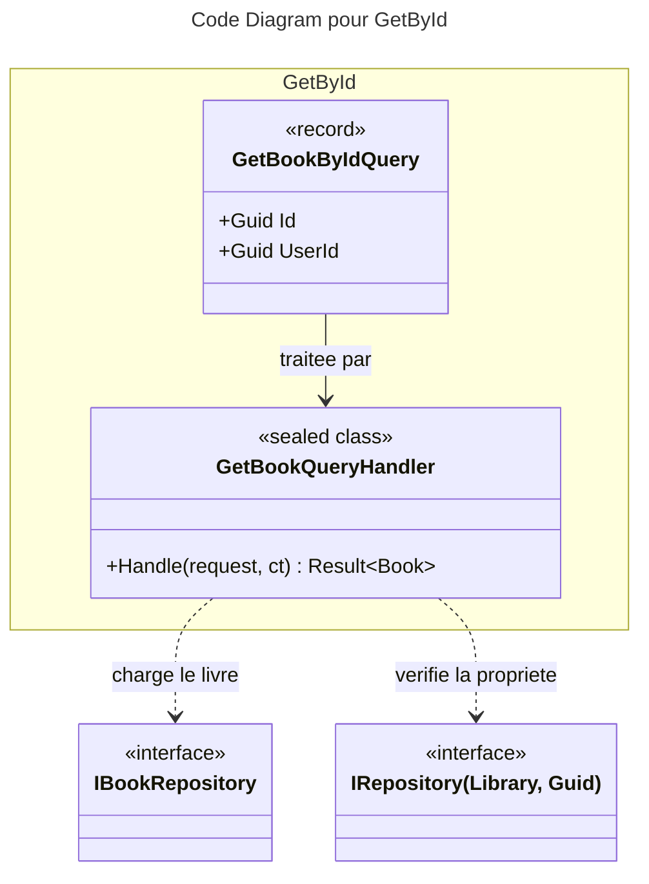

# C4 Code : Application/Books/GetById

## 1. Vue d'ensemble

- **Nom** : `Application.Books.GetById`
- **Description** : Requête « obtenir un livre par identifiant », restreinte à la bibliothèque de l'utilisateur demandeur.
- **Emplacement relatif** : [`Application/Books/GetById/`](../Application/Books/GetById/)
- **Langage** : C# (.NET 10)
- **Objectif** : Renvoyer l'entité `Book` d'un utilisateur, ou `NotFound` si le livre n'existe pas ou n'appartient pas à l'utilisateur.

## 2. Éléments de code

### Requêtes

- `public record GetBookByIdQuery(Guid Id, Guid UserId) : IQuery<Book>;`
  - **Description** : Identifiant du livre et utilisateur demandeur. Le type est défini dans le fichier `GetBookQuery.cs`.
  - **Emplacement** : [GetBookQuery.cs:6](../Application/Books/GetById/GetBookQuery.cs#L6)
  - **Dépendances** : `IQuery<TResponse>`, `Domain.Books.Book`.

### Handlers

- `public sealed class GetBookQueryHandler(IBookRepository bookRepository, IRepository<Library, Guid> libraryRepository) : IQueryHandler<GetBookByIdQuery, Book>`
  - `public async Task<Result<Book>> Handle(GetBookByIdQuery request, CancellationToken cancellationToken)`
  - **Description** : Valide l'identifiant, charge le livre et sa bibliothèque, puis contrôle la propriété.
  - **Emplacement** : [GetBookQueryHandler.cs:9-39](../Application/Books/GetById/GetBookQueryHandler.cs#L9-L39)
  - **Déroulement** :
    1. `request is null` : `BooksError.BadRequest` (lignes 15-18).
    2. `request.Id == Guid.Empty` : `BooksError.BadRequest` (lignes 20-23).
    3. Livre introuvable : `BooksError.NotFound` (lignes 25-29).
    4. Bibliothèque absente ou non propriétaire : `BooksError.NotFound` (lignes 31-35).
    5. Retour du livre (ligne 37).
  - **Dépendances** : `IBookRepository`, `IRepository<Library, Guid>`, `BooksError`.

## 3. Dépendances

### Internes

- `Application.Interfaces` : `IBookRepository`, `IRepository<Library, Guid>`.
- `Domain.Books` : `Book`, `BooksError`.
- `Domain.Libraries.Library`, `Domain.Primitives.Result`.

### Externes

- Aucune (BCL .NET uniquement).

## 4. Relations

## Notes

- Le nom du fichier (`GetBookQuery.cs`) ne correspond pas au nom du type (`GetBookByIdQuery`) ; le handler, lui, se nomme `GetBookQueryHandler`.
- Cette requête est une vérification d'accès à un livre. Les listes et les lectures spécialisées sont dans les dossiers `List` et `Read`.
