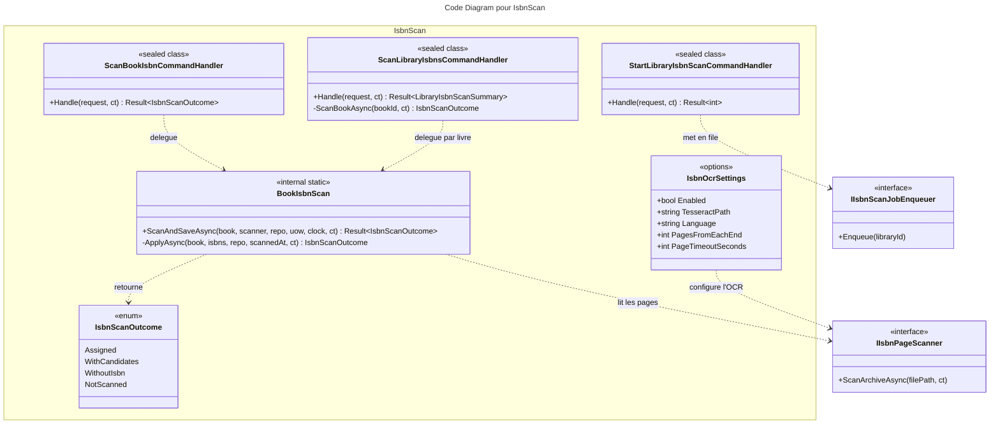

# C4 Code : Application/Books/IsbnScan

## 1. Vue d'ensemble

- **Nom** : `Application.Books.IsbnScan`
- **Description** : Ensemble des cas d'usage de lecture de l'ISBN imprimé sur les pages des livres numériques (BD, comics) par OCR côté serveur. Couvre le scan d'un livre, le scan d'une bibliothèque en arrière-plan, le démarrage de ce scan et la configuration OCR.
- **Emplacement relatif** : [`Application/Books/IsbnScan/`](../Application/Books/IsbnScan/)
- **Langage** : C# (.NET 10)
- **Objectif** : Attribuer automatiquement un ISBN unique aux livres numériques qui n'en ont pas, et soumettre les autres cas (plusieurs ISBN, doublon, rien trouvé) au choix de l'utilisateur.

## 2. Éléments de code

### Outils internes

- `internal static class BookIsbnScan`
  - **Description** : Logique partagée entre les trois handlers de scan. Lance la lecture des pages, applique le résultat au livre et persiste.
  - **Emplacement** : [BookIsbnScan.cs:7-51](../Application/Books/IsbnScan/BookIsbnScan.cs#L7-L51)
  - **Méthodes** :
    - `public static async Task<Result<IsbnScanOutcome>> ScanAndSaveAsync(DigitalBook book, IIsbnPageScanner scanner, IBookRepository bookRepository, IUnitOfWork unitOfWork, TimeProvider clock, CancellationToken ct)`
      - **Emplacement** : lignes 13-31.
      - **Déroulement** : si `scan.Completed` est faux, retourne `NotScanned` sans rien écrire. Sinon applique le résultat (`ApplyAsync`), appelle `bookRepository.Update(book)` puis `SaveChangesAsync`, et retourne l'erreur de sauvegarde le cas échéant.
    - `private static async Task<IsbnScanOutcome> ApplyAsync(DigitalBook book, IReadOnlyList<string> isbns, IBookRepository bookRepository, DateTime scannedAtUtc, CancellationToken ct)`
      - **Emplacement** : lignes 33-50.
      - **Déroulement** : si un seul ISBN est lu et qu'aucun autre livre ne le porte, enregistre le scan puis assigne l'ISBN (`Assigned`). Sinon enregistre les ISBN comme candidats et retourne `WithCandidates` (ou `WithoutIsbn` si la liste est vide).

- `public class IsbnOcrSettings`
  - **Description** : Options de configuration de l'OCR (activation, binaire Tesseract, langue, nombre de pages à lire, délai par page).
  - **Emplacement** : [IsbnOcrSettings.cs:6-18](../Application/Books/IsbnScan/IsbnOcrSettings.cs#L6-L18)
  - **Propriétés** :
    - `bool Enabled` (défaut `true`, ligne 8).
    - `string TesseractPath` (défaut `"tesseract"`, ligne 11 ; binaire installé dans l'image Docker).
    - `string Language` (défaut `"eng"`, ligne 13).
    - `int PagesFromEachEnd` (défaut `IsbnScanPages.DefaultPagesFromEachEnd`, ligne 15).
    - `int PageTimeoutSeconds` (défaut `30`, ligne 17).

- `public enum IsbnScanOutcome`
  - **Description** : Résultat d'un scan. Valeurs : `Assigned` (un ISBN attribué), `WithCandidates` (plusieurs ISBN ou un ISBN déjà utilisé, choix laissé à l'utilisateur), `WithoutIsbn` (rien trouvé), `NotScanned` (pages illisibles, OCR désactivé ou indisponible).
  - **Emplacement** : [IsbnScanOutcome.cs:3-12](../Application/Books/IsbnScan/IsbnScanOutcome.cs#L3-L12)

### Commandes

- `public record ScanBookIsbnCommand(Guid BookId, Guid UserId) : ICommand<IsbnScanOutcome>;`
  - **Description** : Demande de scan immédiat d'un livre, même déjà scanné.
  - **Emplacement** : [ScanBookIsbnCommand.cs:6](../Application/Books/IsbnScan/ScanBookIsbnCommand.cs#L6)

- `public record ScanLibraryIsbnsCommand(Guid LibraryId) : ICommand<LibraryIsbnScanSummary>;`
  - **Description** : Demande de scan de tous les livres numériques d'une bibliothèque qui n'ont pas d'ISBN et n'ont jamais été scannés. Exécutée en arrière-plan.
  - **Emplacement** : [ScanLibraryIsbnsCommand.cs:6](../Application/Books/IsbnScan/ScanLibraryIsbnsCommand.cs#L6)

- `public record StartLibraryIsbnScanCommand(Guid LibraryId, Guid UserId) : ICommand<int>;`
  - **Description** : Démarre le scan d'une bibliothèque : contrôle la propriété et le type, puis met le travail en file d'attente. Retourne le nombre de livres concernés.
  - **Emplacement** : [StartLibraryIsbnScanCommand.cs:6](../Application/Books/IsbnScan/StartLibraryIsbnScanCommand.cs#L6)

### Résumé

- `public sealed record LibraryIsbnScanSummary(int Assigned, int WithCandidates, int WithoutIsbn, int NotScanned)`
  - **Description** : Compte des résultats d'un scan de bibliothèque.
  - **Emplacement** : [ScanLibraryIsbnsCommand.cs:8](../Application/Books/IsbnScan/ScanLibraryIsbnsCommand.cs#L8)

### Handlers

- `public sealed class ScanBookIsbnCommandHandler(IBookRepository bookRepository, IRepository<Library, Guid> libraryRepository, IIsbnPageScanner scanner, IUnitOfWork unitOfWork, TimeProvider clock) : ICommandHandler<ScanBookIsbnCommand, IsbnScanOutcome>`
  - `public async Task<Result<IsbnScanOutcome>> Handle(ScanBookIsbnCommand request, CancellationToken cancellationToken)`
  - **Emplacement** : [ScanBookIsbnCommandHandler.cs:10-38](../Application/Books/IsbnScan/ScanBookIsbnCommandHandler.cs#L10-L38)
  - **Déroulement** :
    1. `request` nul ou identifiants vides : `BooksError.BadRequest` (lignes 19-22).
    2. `OwnedDigitalBook.GetAsync` (ligne 24) : erreur propagée si le livre est absent, non possédé ou non numérique.
    3. ISBN déjà renseigné : `BooksError.BadRequest` (lignes 31-34).
    4. `BookIsbnScan.ScanAndSaveAsync` (ligne 36).
  - **Dépendances** : `OwnedDigitalBook` (`Application.Books.Read`), `BookIsbnScan`, `IIsbnPageScanner`, `TimeProvider`.

- `public sealed class ScanLibraryIsbnsCommandHandler(IBookRepository bookRepository, IIsbnPageScanner scanner, IUnitOfWork unitOfWork, TimeProvider clock, ILogger<ScanLibraryIsbnsCommandHandler> logger) : ICommandHandler<ScanLibraryIsbnsCommand, LibraryIsbnScanSummary>`
  - `public async Task<Result<LibraryIsbnScanSummary>> Handle(ScanLibraryIsbnsCommand request, CancellationToken cancellationToken)`
  - **Emplacement** : [ScanLibraryIsbnsCommandHandler.cs:14-61](../Application/Books/IsbnScan/ScanLibraryIsbnsCommandHandler.cs#L14-L61)
  - **Déroulement** :
    1. `LibraryId` vide : `LibrariesError.BadRequest` (lignes 23-26).
    2. `ListIdsToScanForIsbnAsync(LibraryId)` (ligne 28), puis `ScanBookAsync` pour chaque identifiant (lignes 30-33).
    3. Construction du résumé par comptage des `IsbnScanOutcome` (lignes 35-39).
  - `private async Task<IsbnScanOutcome> ScanBookAsync(Guid bookId, CancellationToken ct)` (lignes 43-60) : recharge le livre et ignore s'il n'est plus un `DigitalBook` non scanné ou s'il a désormais un ISBN (`NotScanned`). En cas d'échec de sauvegarde, journalise via `logger.LogError` et retourne `NotScanned`.

- `public sealed class StartLibraryIsbnScanCommandHandler(IRepository<Library, Guid> libraryRepository, IBookRepository bookRepository, IIsbnScanJobEnqueuer enqueuer) : ICommandHandler<StartLibraryIsbnScanCommand, int>`
  - `public async Task<Result<int>> Handle(StartLibraryIsbnScanCommand request, CancellationToken cancellationToken)`
  - **Emplacement** : [StartLibraryIsbnScanCommandHandler.cs:8-40](../Application/Books/IsbnScan/StartLibraryIsbnScanCommandHandler.cs#L8-L40)
  - **Déroulement** :
    1. Identifiants vides : `LibrariesError.BadRequest` (lignes 15-18).
    2. Bibliothèque absente ou non possédée : `LibrariesError.NotFound` (lignes 21-25).
    3. Bibliothèque non numérique : `LibrariesError.BookTypeMismatch` (lignes 27-30).
    4. Si des livres sont concernés, `enqueuer.Enqueue(library.Id)` (lignes 32-36).
    5. Retour du nombre de livres (ligne 38).

## 3. Dépendances

### Internes

- `Application.Interfaces` : `IBookRepository`, `IRepository<Library, Guid>`, `IUnitOfWork`, `IIsbnPageScanner`, `IIsbnScanJobEnqueuer`.
- `Application.Books.Read.OwnedDigitalBook` (chargement d'un livre numérique possédé).
- `Application.Helpers.IsbnScanPages` (valeur par défaut de `PagesFromEachEnd`).
- `Domain.Books` : `DigitalBook`, `IsbnScanState`, `BooksError`.
- `Domain.Libraries` : `Library`, `LibraryBookType`, `LibrariesError`.
- `Domain.Primitives.Result`.

### Externes

- `Microsoft.Extensions.Logging.ILogger<T>` (journalisation des échecs de sauvegarde).
- `System.TimeProvider` (horloge injectée pour la date de scan).
- `Ardalis.GuardClauses` : non utilisé dans ce dossier.

## 4. Relations

## Notes

- Règle d'attribution : un ISBN unique non utilisé ailleurs est assigné automatiquement ; tout autre cas (plusieurs ISBN, ISBN déjà présent sur un autre livre) est conservé comme candidat, sans modifier les autres métadonnées.
- `ScanLibraryIsbnsCommand` n'effectue pas de contrôle de propriété : il s'appuie sur le contrôle fait par `StartLibraryIsbnScanCommandHandler` au démarrage, comme indiqué dans le commentaire du fichier.
- `ScanLibraryIsbnsCommandHandler` sauvegarde livre par livre : un scan interrompu conserve les résultats déjà obtenus.
- La requête `GetByIdAsync` de `ScanBookAsync` ne reçoit pas le `CancellationToken`, contrairement aux autres appels asynchrones du même handler.
