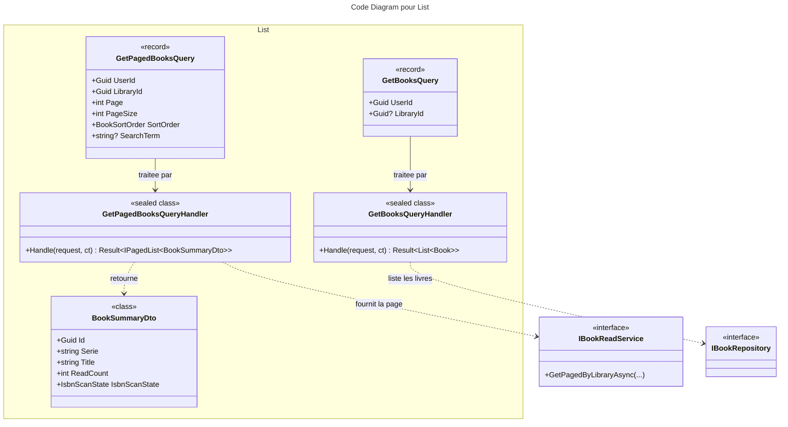

# C4 Code : Application/Books/List

## 1. Vue d'ensemble

- **Nom** : `Application.Books.List`
- **Description** : Requêtes de consultation de la liste des livres : soit la liste complète (entités) de l'utilisateur ou d'une bibliothèque, soit une page de résumés (`BookSummaryDto`) filtrée et triée pour l'affichage.
- **Emplacement relatif** : [`Application/Books/List/`](../Application/Books/List/)
- **Langage** : C# (.NET 10)
- **Objectif** : Fournir les données de liste aux écrans de la bibliothèque, avec contrôle de propriété.

## 2. Éléments de code

### DTO

- `public sealed class BookSummaryDto`
  - **Description** : Résumé d'un livre pour l'affichage en liste. Contient les métadonnées, la dernière lecture, le nombre de lectures et l'état du scan ISBN.
  - **Emplacement** : [BookSummaryDto.cs:5-22](../Application/Books/List/BookSummaryDto.cs#L5-L22)
  - **Propriétés** : `Guid Id`, `string Serie`, `string Title`, `string? ISBN`, `int VolumeNumber`, `string ImageLink`, `string Authors`, `string Publishers`, `DateTime? LastRead`, `int? LastRating`, `int ReadCount`, `int? IsbnCandidateCount`, `DateTime? IsbnScannedAt` (toutes en `init`).
  - **Propriété calculée** : `IsbnScanState IsbnScanState => IsbnScanStates.Of(ISBN, IsbnCandidateCount ?? 0, IsbnScannedAt)` (ligne 21).

### Requêtes

- `public record GetBooksQuery(Guid UserId, Guid? LibraryId = null) : IQuery<List<Book>>;`
  - **Description** : Liste des livres de l'utilisateur, ou d'une bibliothèque donnée si `LibraryId` est renseigné.
  - **Emplacement** : [GetBooksQuery.cs:6](../Application/Books/List/GetBooksQuery.cs#L6)

- `public record GetPagedBooksQuery(Guid UserId, Guid LibraryId, int Page, int PageSize, BookSortOrder SortOrder, string? SearchTerm = null) : IQuery<IPagedList<BookSummaryDto>>;`
  - **Description** : Page de résumés d'une bibliothèque, avec tri et recherche texte facultative.
  - **Emplacement** : [GetPagedBooksQuery.cs:7-13](../Application/Books/List/GetPagedBooksQuery.cs#L7-L13)

### Handlers

- `public sealed class GetBooksQueryHandler(IBookRepository bookRepository, IRepository<Library, Guid> libraryRepository) : IQueryHandler<GetBooksQuery, List<Book>>`
  - `public async Task<Result<List<Book>>> Handle(GetBooksQuery request, CancellationToken cancellationToken)`
  - **Emplacement** : [GetBooksQueryHandler.cs:10-31](../Application/Books/List/GetBooksQueryHandler.cs#L10-L31)
  - **Déroulement** :
    1. `Guard.Against.Null(request)` (ligne 16).
    2. Sans `LibraryId` : `bookRepository.ListByUserIdAsync(UserId)` (lignes 18-21).
    3. Avec `LibraryId` : bibliothèque absente ou non possédée donne `LibrariesError.NotFound` (lignes 23-27), sinon `bookRepository.ListByLibraryIdAsync` (ligne 29).
  - **Dépendances** : `IBookRepository`, `IRepository<Library, Guid>`.

- `public sealed class GetPagedBooksQueryHandler(IBookReadService bookReadService, IRepository<Library, Guid> libraryRepository) : IQueryHandler<GetPagedBooksQuery, IPagedList<BookSummaryDto>>`
  - `public async Task<Result<IPagedList<BookSummaryDto>>> Handle(GetPagedBooksQuery request, CancellationToken cancellationToken)`
  - **Emplacement** : [GetPagedBooksQueryHandler.cs:10-40](../Application/Books/List/GetPagedBooksQueryHandler.cs#L10-L40)
  - **Déroulement** :
    1. `Guard.Against.Null(request)` (ligne 16).
    2. `Page <= 0` ou `PageSize <= 0` : `BooksError.BadRequest` (lignes 18-21).
    3. Bibliothèque absente ou non possédée : `LibrariesError.NotFound` (lignes 23-27).
    4. `bookReadService.GetPagedByLibraryAsync(LibraryId, UserId, Page, PageSize, SortOrder, SearchTerm, ct)` (lignes 29-36), puis enveloppe dans `Result.Success` (ligne 38).
  - **Dépendances** : `IBookReadService` (lecture optimisée), `IRepository<Library, Guid>`.

## 3. Dépendances

### Internes

- `Application.Interfaces` : `IBookRepository`, `IBookReadService`, `IRepository<Library, Guid>`, `IPagedList<T>`.
- `Domain.Books` : `Book`, `IsbnScanState`, `IsbnScanStates`, `BooksError`.
- `Domain.Libraries` : `Library`, `BookSortOrder`, `LibrariesError`.
- `Domain.Primitives.Result`.

### Externes

- `Ardalis.GuardClauses` (dans les deux handlers qui le déclarent).

## 4. Relations

## Notes

- `GetBooksQuery` renvoie les entités `Book` ; `GetPagedBooksQuery` renvoie des `BookSummaryDto` aplatis, destinés à l'affichage paginé.
- `GetPagedBooksQueryHandler` ne borne pas `PageSize` par un maximum.
- L'ordre de tri déterministe (clé de départage unique, par exemple `Id`) doit être garanti par `IBookReadService.GetPagedByLibraryAsync`, qui est hors de ce dossier ; ce point reste à vérifier au regard de la règle de pagination du CLAUDE.md.
- L'état de scan ISBN (`IsbnScanState`) est calculé dans le DTO à partir de trois champs, sans requête supplémentaire.
