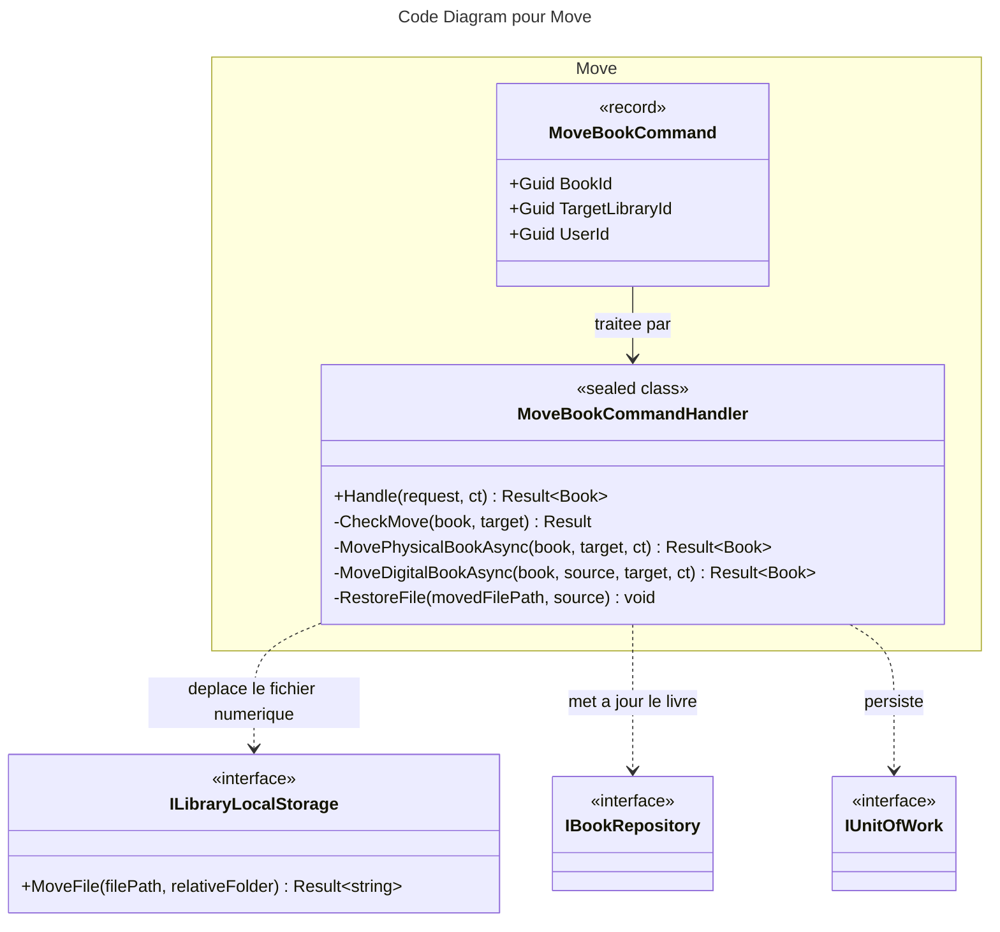
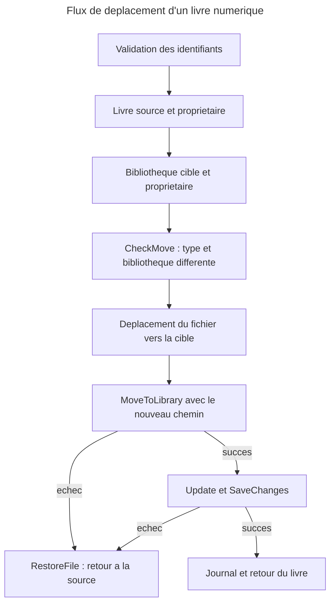

# C4 Code : Application/Books/Move

## 1. Vue d'ensemble

- **Nom** : `Application.Books.Move`
- **Description** : Cas d'usage « déplacer un livre vers une autre bibliothèque » du même type. Pour un livre numérique, le fichier est déplacé dans le dossier de la bibliothèque cible, avec une compensation si l'enregistrement échoue.
- **Emplacement relatif** : [`Application/Books/Move/`](../Application/Books/Move/)
- **Langage** : C# (.NET 10)
- **Objectif** : Changer la bibliothèque d'un livre en garantissant la cohérence entre la base de données et le système de fichiers.

## 2. Éléments de code

### Commandes

- `public record MoveBookCommand(Guid BookId, Guid TargetLibraryId, Guid UserId) : ICommand<Book>;`
  - **Description** : Livre à déplacer, bibliothèque de destination et utilisateur demandeur.
  - **Emplacement** : [MoveBookCommand.cs:6](../Application/Books/Move/MoveBookCommand.cs#L6)

### Handlers

- `public sealed class MoveBookCommandHandler(IBookRepository bookRepository, IRepository<Library, Guid> libraryRepository, ILibraryLocalStorage libraryLocalStorage, IUnitOfWork unitOfWork, ILogger<MoveBookCommandHandler> logger) : ICommandHandler<MoveBookCommand, Book>`
  - `public async Task<Result<Book>> Handle(MoveBookCommand request, CancellationToken cancellationToken)`
  - **Emplacement** : [MoveBookCommandHandler.cs:14-109](../Application/Books/Move/MoveBookCommandHandler.cs#L14-L109)
  - **Déroulement** :
    1. `Guard.Against.Null(request)` et identifiants vides : `BooksError.BadRequest` (lignes 23-27).
    2. Livre ou bibliothèque source absents, ou source non possédée : `BooksError.NotFound` (lignes 29-34).
    3. Bibliothèque cible absente ou non possédée : `LibrariesError.NotFound` (lignes 36-40).
    4. `CheckMove(book, target)` (ligne 42).
    5. Dispatch (lignes 48-50) : `MoveDigitalBookAsync` si `DigitalBook`, sinon `MovePhysicalBookAsync`.

  - `private static Result CheckMove(Book book, Library target)` (lignes 53-57) : le type de la bibliothèque cible doit correspondre au type du livre (`LibrariesError.BookTypeMismatch`), puis `book.CanMoveToLibrary(target.Id)` (refus si déjà dans cette bibliothèque : `BooksError.AlreadyInLibrary`).

  - `private async Task<Result<Book>> MovePhysicalBookAsync(PhysicalBook book, Library target, CancellationToken ct)` (lignes 59-70) : `book.MoveToLibrary(target.Id)`, `bookRepository.Update`, `SaveChangesAsync`.

  - `private async Task<Result<Book>> MoveDigitalBookAsync(DigitalBook book, Library source, Library target, CancellationToken ct)` (lignes 72-97) :
    1. `libraryLocalStorage.MoveFile(book.FilePath, target.RelativePath)` (ligne 74) : échec retourné immédiatement.
    2. `book.MoveToLibrary(target.Id, newFilePath)` (ligne 80) : en cas d'échec, `RestoreFile` puis retour de l'erreur (lignes 81-85).
    3. `bookRepository.Update`, `SaveChangesAsync` (lignes 87-88) : en cas d'échec, `RestoreFile` puis retour de l'erreur (lignes 89-93).
    4. Journalisation `LogInformation` (ligne 95) puis retour du livre.

  - `private void RestoreFile(string movedFilePath, Library source)` (lignes 100-108) : déplace le fichier vers le dossier source (compensation) ; un échec est journalisé via `LogError` sans être remonté.

- **Dépendances** : `IBookRepository`, `IRepository<Library, Guid>`, `ILibraryLocalStorage`, `IUnitOfWork`, `ILogger<MoveBookCommandHandler>`.

## 3. Dépendances

### Internes

- `Application.Interfaces` : `IBookRepository`, `IRepository<Library, Guid>`, `IUnitOfWork`.
- `Application.Libraries.ILibraryLocalStorage` (méthode `MoveFile(string, string)`, retourne un `Result` avec le nouveau chemin).
- `Domain.Books` : `Book`, `DigitalBook`, `PhysicalBook`, `BooksError`.
- `Domain.Libraries` : `Library`, `LibraryBookType`, `LibrariesError`.
- `Domain.Primitives.Result`.

### Externes

- `Ardalis.GuardClauses`.
- `Microsoft.Extensions.Logging.ILogger<T>`.

## 4. Relations

## Notes

- Compensation : si la sauvegarde échoue, la base pointe encore vers la bibliothèque source, donc le fichier est ramené dans le dossier source.
- Écart à la règle du CLAUDE.md (validations avant tout effet de bord fichier) : le commentaire de la classe affirme que « every check runs before the file is moved », mais `book.MoveToLibrary(target.Id, newPath)` (ligne 80) n'est appelé qu'après `MoveFile` (ligne 74). Ses vérifications de changement de bibliothèque sont bien faites en amont par `CheckMove`, mais le contrôle du chemin non vide n'est fait qu'après le déplacement. Le risque est couvert par `RestoreFile`, sans que la règle soit strictement respectée.
- Pour un livre physique, aucun fichier n'est touché : seul l'enregistrement est mis à jour.
