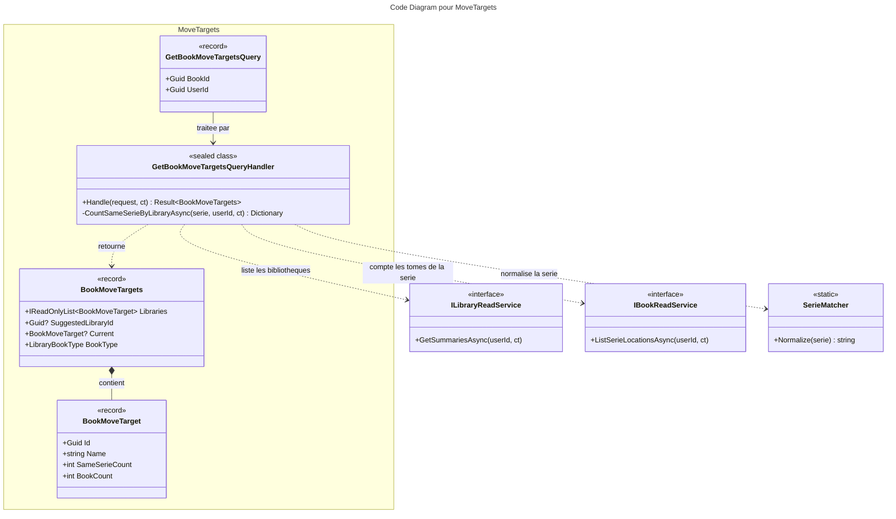

# C4 Code : Application/Books/MoveTargets

## 1. Vue d'ensemble

- **Nom** : `Application.Books.MoveTargets`
- **Description** : Requête qui liste les bibliothèques vers lesquelles un livre peut être déplacé (même type, autre que la bibliothèque actuelle), avec une bibliothèque suggérée : celle qui contient déjà le plus de tomes de la même série.
- **Emplacement relatif** : [`Application/Books/MoveTargets/`](../Application/Books/MoveTargets/)
- **Langage** : C# (.NET 10)
- **Objectif** : Alimenter le choix de destination dans l'interface de déplacement d'un livre.

## 2. Éléments de code

### DTO

- `public sealed record BookMoveTargets(IReadOnlyList<BookMoveTarget> Libraries, Guid? SuggestedLibraryId)`
  - **Description** : Résultat de la requête : les destinations possibles, l'identifiant de la bibliothèque suggérée, et deux propriétés d'initialisation.
  - **Emplacement** : [BookMoveTargets.cs:7-14](../Application/Books/MoveTargets/BookMoveTargets.cs#L7-L14)
  - **Propriétés d'initialisation** :
    - `BookMoveTarget? Current` : bibliothèque actuelle du livre, affichée mais non sélectionnable.
    - `LibraryBookType BookType` : type de la bibliothèque du livre, commun à toutes les destinations.

- `public sealed record BookMoveTarget(Guid Id, string Name, string Color, string Icon, int SameSerieCount, int BookCount = 0)`
  - **Description** : Une bibliothèque de destination, avec le nombre de tomes de la même série et le nombre total de livres.
  - **Emplacement** : [BookMoveTargets.cs:16](../Application/Books/MoveTargets/BookMoveTargets.cs#L16)

### Requêtes

- `public record GetBookMoveTargetsQuery(Guid BookId, Guid UserId) : IQuery<BookMoveTargets>;`
  - **Description** : Demande les destinations possibles pour un livre.
  - **Emplacement** : [GetBookMoveTargetsQuery.cs:5](../Application/Books/MoveTargets/GetBookMoveTargetsQuery.cs#L5)

### Handlers

- `public sealed class GetBookMoveTargetsQueryHandler(IBookRepository bookRepository, IRepository<Library, Guid> libraryRepository, ILibraryReadService libraryReadService, IBookReadService bookReadService) : IQueryHandler<GetBookMoveTargetsQuery, BookMoveTargets>`
  - `public async Task<Result<BookMoveTargets>> Handle(GetBookMoveTargetsQuery request, CancellationToken cancellationToken)`
  - **Emplacement** : [GetBookMoveTargetsQueryHandler.cs:12-74](../Application/Books/MoveTargets/GetBookMoveTargetsQueryHandler.cs#L12-L74)
  - **Déroulement** :
    1. `Guard.Against.Null(request)` et identifiants vides : `BooksError.BadRequest` (lignes 20-24).
    2. Livre ou bibliothèque source absents, ou non possédés : `BooksError.NotFound` (lignes 26-31).
    3. `libraryReadService.GetSummariesAsync(UserId)` (ligne 34) : résumés de toutes les bibliothèques, triés par nom.
    4. Construction de `current` à partir du résumé de la bibliothèque source (lignes 35-37).
    5. Candidates : bibliothèques de même type et différentes de la source (lignes 38-40). Si aucune, retour immédiat avec une liste vide (lignes 41-44).
    6. Comptage des tomes de même série par bibliothèque (ligne 46).
    7. Construction des cibles (lignes 47-49) puis choix de la suggestion : `SameSerieCount` décroissant, puis nom (lignes 50-54).
  - `private async Task<Dictionary<Guid, int>> CountSameSerieByLibraryAsync(string serie, Guid userId, CancellationToken ct)` (lignes 60-73) : normalise la série avec `SerieMatcher.Normalize` (casse, accents, ponctuation et article initial ignorés), puis compte par bibliothèque à partir de `bookReadService.ListSerieLocationsAsync`.
  - **Dépendances** : `IBookRepository`, `IRepository<Library, Guid>`, `ILibraryReadService`, `IBookReadService`, `SerieMatcher`.

## 3. Dépendances

### Internes

- `Application.Interfaces` : `IBookRepository`, `IBookReadService`, `IRepository<Library, Guid>`.
- `Application.Libraries.ILibraryReadService` (résumés de bibliothèques : `Id`, `Name`, `Color`, `Icon`, `BookCount`, `BookType`).
- `Application.Books.BookSerieLocationDto` (racine de `Application.Books`).
- `Domain.FeedImports.SerieMatcher` (normalisation des séries).
- `Domain.Books` : `Book`, `BooksError`.
- `Domain.Libraries` : `Library`, `LibraryBookType`.
- `Domain.Primitives.Result`.

### Externes

- `Ardalis.GuardClauses`.

## 4. Relations

## Notes

- Le comptage de série ne porte que sur les livres de l'utilisateur, grâce à `ListSerieLocationsAsync(userId)`.
- Si la bibliothèque source est absente des résumés, `Current` est construit à partir de l'entité `Library` avec `BookCount = 0`.
- La suggestion est `null` si aucune destination n'a de tome de la même série.
- Le handler importe `Domain.FeedImports` pour `SerieMatcher`, ce qui crée une dépendance du cas d'usage de déplacement vers le module d'import ; à noter pour une éventuelle extraction du helper.
