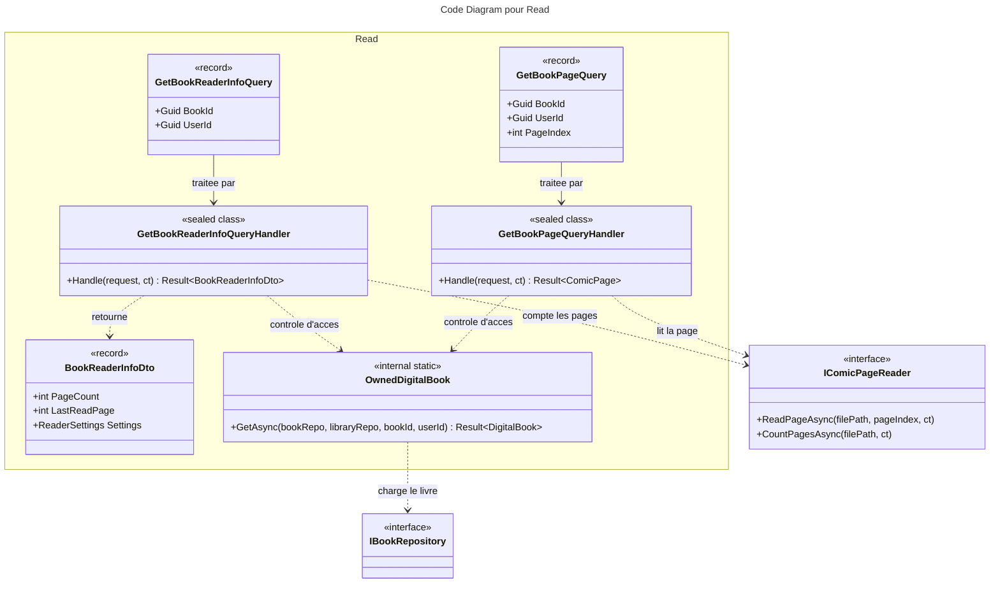

# C4 Code : Application/Books/Read

## 1. Vue d'ensemble

- **Nom** : `Application.Books.Read`
- **Description** : Requêtes de lecture d'un livre numérique : informations du lecteur (nombre de pages, dernière page, réglages) et contenu d'une page d'image. Contient aussi `OwnedDigitalBook`, le contrôle d'accès partagé par les autres dossiers Livres.
- **Emplacement relatif** : [`Application/Books/Read/`](../Application/Books/Read/)
- **Langage** : C# (.NET 10)
- **Objectif** : Fournir au lecteur de BD les données et les pages d'un livre numérique appartenant à l'utilisateur.

## 2. Éléments de code

### DTO

- `public sealed record BookReaderInfoDto(Guid BookId, string Serie, string Title, int VolumeNumber, int PageCount, int LastReadPage, ReaderSettings Settings)`
  - **Description** : Informations nécessaires à l'ouverture du lecteur.
  - **Emplacement** : [BookReaderInfoDto.cs:5-12](../Application/Books/Read/BookReaderInfoDto.cs#L5-L12)
  - **Dépendances** : `Domain.Books.ReaderSettings`.

### Requêtes

- `public record GetBookPageQuery(Guid BookId, Guid UserId, int PageIndex) : IQuery<ComicPage>;`
  - **Description** : Demande une page (index à partir de 0) d'un livre numérique.
  - **Emplacement** : [GetBookPageQuery.cs:6](../Application/Books/Read/GetBookPageQuery.cs#L6)
  - **Dépendances** : `ComicPage` (`Application.Interfaces`).

- `public record GetBookReaderInfoQuery(Guid BookId, Guid UserId) : IQuery<BookReaderInfoDto>;`
  - **Description** : Demande les informations du lecteur pour un livre numérique.
  - **Emplacement** : [GetBookReaderInfoQuery.cs:5](../Application/Books/Read/GetBookReaderInfoQuery.cs#L5)

### Handlers

- `public sealed class GetBookPageQueryHandler(IBookRepository bookRepository, IRepository<Library, Guid> libraryRepository, IComicPageReader pageReader) : IQueryHandler<GetBookPageQuery, ComicPage>`
  - `public async Task<Result<ComicPage>> Handle(GetBookPageQuery request, CancellationToken cancellationToken)`
  - **Emplacement** : [GetBookPageQueryHandler.cs:9-34](../Application/Books/Read/GetBookPageQueryHandler.cs#L9-L34)
  - **Déroulement** :
    1. `request` nul ou identifiants vides : `BooksError.BadRequest` (lignes 16-19).
    2. `PageIndex < 0` : `BooksError.PageNotFound` (lignes 21-24).
    3. `OwnedDigitalBook.GetAsync` (lignes 26-30).
    4. `pageReader.ReadPageAsync(FilePath, PageIndex, ct)` (ligne 32).

- `public sealed class GetBookReaderInfoQueryHandler(IBookRepository bookRepository, IRepository<Library, Guid> libraryRepository, IComicPageReader pageReader) : IQueryHandler<GetBookReaderInfoQuery, BookReaderInfoDto>`
  - `public async Task<Result<BookReaderInfoDto>> Handle(GetBookReaderInfoQuery request, CancellationToken cancellationToken)`
  - **Emplacement** : [GetBookReaderInfoQueryHandler.cs:9-45](../Application/Books/Read/GetBookReaderInfoQueryHandler.cs#L9-L45)
  - **Déroulement** :
    1. Validation des identifiants : `BooksError.BadRequest` (lignes 16-19).
    2. `OwnedDigitalBook.GetAsync` (lignes 21-25).
    3. `pageReader.CountPagesAsync(FilePath, ct)` (lignes 27-32).
    4. Archive vide : `BooksError.PageNotFound` (lignes 34-38).
    5. `lastReadPage = Math.Clamp(book.LastReadPage, 0, pageCount - 1)` (ligne 41) : l'archive peut avoir été remplacée par une plus courte.
    6. Retour du DTO (ligne 43).

### Outils internes

- `internal static class OwnedDigitalBook`
  - **Description** : Contrôle d'accès partagé pour les livres numériques. Utilisé par les lectures, les réglages, la progression et le scan ISBN.
  - **Emplacement** : [OwnedDigitalBook.cs:8-36](../Application/Books/Read/OwnedDigitalBook.cs#L8-L36)
  - `public static async Task<Result<DigitalBook>> GetAsync(IBookRepository bookRepository, IRepository<Library, Guid> libraryRepository, Guid bookId, Guid userId)` (lignes 11-35)
    - Livre absent, bibliothèque absente ou non possédée : `BooksError.NotFound` (lignes 17-27), pour ne pas divulguer l'existence du livre.
    - Livre qui n'est pas un `DigitalBook` : `BooksError.NotDigital` (lignes 29-32).

## 3. Dépendances

### Internes

- `Application.Interfaces` : `IBookRepository`, `IRepository<Library, Guid>`, `IComicPageReader`, `ComicPage`.
- `Domain.Books` : `Book`, `DigitalBook`, `ReaderSettings`, `BooksError`.
- `Domain.Libraries.Library`.
- `Domain.Primitives.Result`.
- Consommateurs de `OwnedDigitalBook` : `Application.Books.IsbnScan`, `Application.Books.ReaderDisplay`, `Application.Books.ReadingProgress`.

### Externes

- Aucune directement (le lecteur d'images est derrière l'interface `IComicPageReader`).

## 4. Relations

## Notes

- `OwnedDigitalBook` est le point de contrôle commun : il retourne `NotFound` pour un livre inconnu ou non possédé, et `NotDigital` pour un livre physique.
- `PageIndex` n'est pas borné par le nombre de pages dans `GetBookPageQueryHandler` ; la borne est appliquée par le lecteur d'archive (hors périmètre).
- Le contenu de `ComicPage` (flux d'octets, type MIME, date de modification UTC) est défini dans `Application/Interfaces/IComicPageReader.cs:5`.
