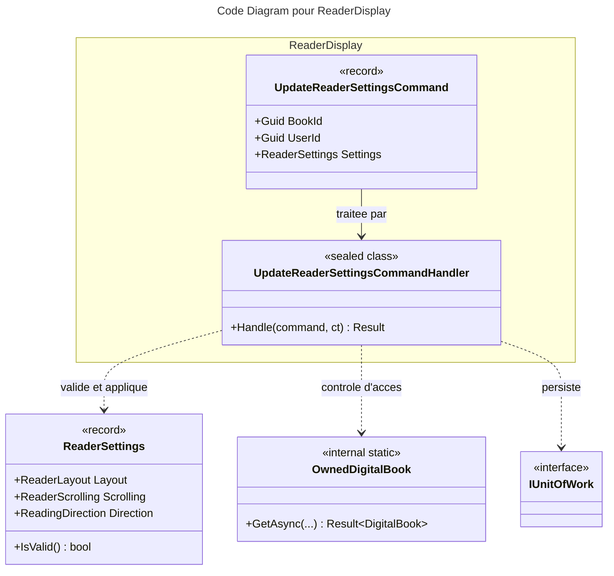

# C4 Code : Application/Books/ReaderDisplay

## 1. Vue d'ensemble

- **Nom** : `Application.Books.ReaderDisplay`
- **Description** : Cas d'usage « modifier les réglages d'affichage du lecteur » d'un livre numérique : disposition, défilement et sens de lecture.
- **Emplacement relatif** : [`Application/Books/ReaderDisplay/`](../Application/Books/ReaderDisplay/)
- **Langage** : C# (.NET 10)
- **Objectif** : Enregistrer les préférences de lecture propres à chaque livre numérique.

## 2. Éléments de code

### Commandes

- `public record UpdateReaderSettingsCommand(Guid BookId, Guid UserId, ReaderSettings Settings) : ICommand;`
  - **Description** : Nouveaux réglages à appliquer à un livre numérique.
  - **Emplacement** : [UpdateReaderSettingsCommand.cs:6](../Application/Books/ReaderDisplay/UpdateReaderSettingsCommand.cs#L6)
  - **Dépendances** : `Domain.Books.ReaderSettings`.

### Handlers

- `public sealed class UpdateReaderSettingsCommandHandler(IBookRepository bookRepository, IRepository<Library, Guid> libraryRepository, IUnitOfWork unitOfWork) : ICommandHandler<UpdateReaderSettingsCommand>`
  - `public async Task<Result> Handle(UpdateReaderSettingsCommand command, CancellationToken cancellationToken)`
  - **Emplacement** : [UpdateReaderSettingsCommandHandler.cs:10-45](../Application/Books/ReaderDisplay/UpdateReaderSettingsCommandHandler.cs#L10-L45)
  - **Déroulement** :
    1. Commande nulle, identifiants vides, `Settings` nul ou `Settings.IsValid()` faux : `BooksError.BadRequest` (lignes 17-20).
    2. `OwnedDigitalBook.GetAsync` (lignes 23-27).
    3. Réglages identiques à ceux en place : retour `Result.Success()` sans sauvegarde (lignes 30-33).
    4. `book.UpdateReaderSettings(settings)` (ligne 35) ; échec retourné tel quel (lignes 36-39).
    5. `bookRepository.Update(book)` puis `SaveChangesAsync` (lignes 41-43).

- **Dépendances** : `IBookRepository`, `IRepository<Library, Guid>`, `IUnitOfWork`, `OwnedDigitalBook`, `ReaderSettings.IsValid()`.

## 3. Dépendances

### Internes

- `Application.Interfaces` : `IBookRepository`, `IRepository<Library, Guid>`, `IUnitOfWork`.
- `Application.Books.Read.OwnedDigitalBook`.
- `Domain.Books` : `ReaderSettings`, `Book`, `DigitalBook`, `BooksError`.
- `Domain.Libraries.Library`, `Domain.Primitives.Result`.

### Externes

- Aucune directement.

## 4. Relations

## Notes

- Si les réglages sont inchangés, aucune écriture n'a lieu et le succès est retourné.
- La validation des valeurs repose sur `ReaderSettings.IsValid()` (domaine, hors périmètre).
