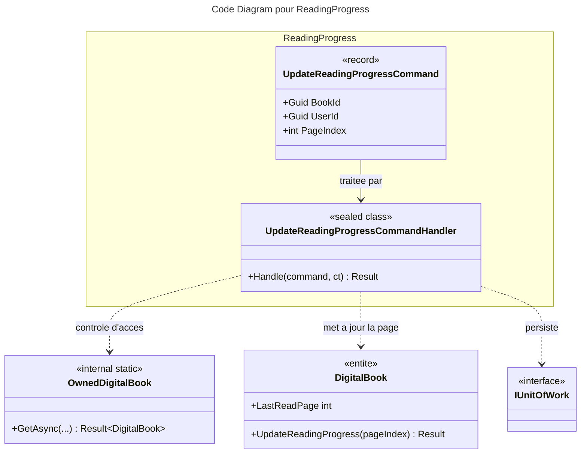

# C4 Code : Application/Books/ReadingProgress

## 1. Vue d'ensemble

- **Nom** : `Application.Books.ReadingProgress`
- **Description** : Cas d'usage « mettre à jour la progression de lecture » d'un livre numérique : mémorise la dernière page consultée.
- **Emplacement relatif** : [`Application/Books/ReadingProgress/`](../Application/Books/ReadingProgress/)
- **Langage** : C# (.NET 10)
- **Objectif** : Sauvegarder la page en cours pour reprendre la lecture au même endroit.

## 2. Éléments de code

### Commandes

- `public record UpdateReadingProgressCommand(Guid BookId, Guid UserId, int PageIndex) : ICommand;`
  - **Description** : Index de la page courante (à partir de 0) pour un livre numérique.
  - **Emplacement** : [UpdateReadingProgressCommand.cs:5](../Application/Books/ReadingProgress/UpdateReadingProgressCommand.cs#L5)

### Handlers

- `public sealed class UpdateReadingProgressCommandHandler(IBookRepository bookRepository, IRepository<Library, Guid> libraryRepository, IUnitOfWork unitOfWork) : ICommandHandler<UpdateReadingProgressCommand>`
  - `public async Task<Result> Handle(UpdateReadingProgressCommand command, CancellationToken cancellationToken)`
  - **Emplacement** : [UpdateReadingProgressCommandHandler.cs:10-44](../Application/Books/ReadingProgress/UpdateReadingProgressCommandHandler.cs#L10-L44)
  - **Déroulement** :
    1. Commande nulle, identifiants vides ou `PageIndex < 0` : `BooksError.BadRequest` (lignes 17-20).
    2. `OwnedDigitalBook.GetAsync` (lignes 22-26).
    3. Page identique à `LastReadPage` : retour `Result.Success()` sans sauvegarde (lignes 29-32).
    4. `book.UpdateReadingProgress(PageIndex)` ; échec retourné (lignes 34-38).
    5. `bookRepository.Update(book)` puis `SaveChangesAsync` (lignes 40-42).

- **Dépendances** : `IBookRepository`, `IRepository<Library, Guid>`, `IUnitOfWork`, `OwnedDigitalBook`, `Book.UpdateReadingProgress`.

## 3. Dépendances

### Internes

- `Application.Interfaces` : `IBookRepository`, `IRepository<Library, Guid>`, `IUnitOfWork`.
- `Application.Books.Read.OwnedDigitalBook`.
- `Domain.Books` : `Book`, `DigitalBook`, `BooksError`.
- `Domain.Libraries.Library`, `Domain.Primitives.Result`.

### Externes

- Aucune directement.

## 4. Relations

## Notes

- Une page identique à la dernière page enregistrée ne déclenche aucune écriture.
- Le handler ne vérifie pas la page par rapport au nombre de pages de l'archive. La lecture (`GetBookReaderInfoQueryHandler`) borne la valeur avec `Math.Clamp`, mais la valeur écrite reste celle reçue, à moins que `DigitalBook.UpdateReadingProgress` ne contrôle la borne (domaine, hors périmètre, à vérifier).
