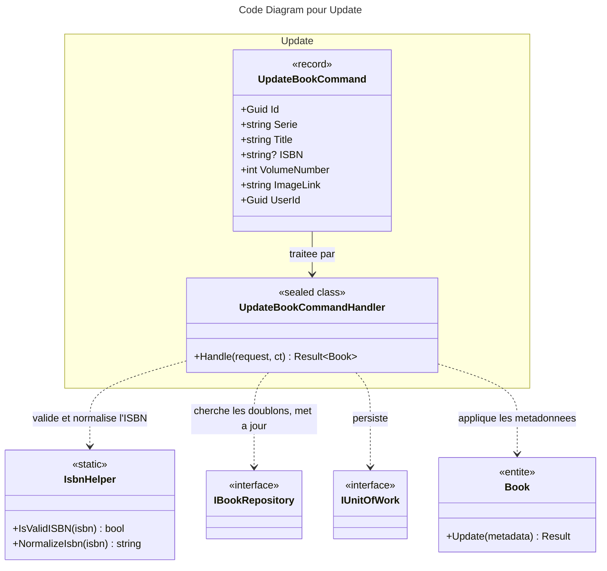

# C4 Code : Application/Books/Update

## 1. Vue d'ensemble

- **Nom** : `Application.Books.Update`
- **Description** : Cas d'usage « modifier les métadonnées d'un livre » (série, titre, ISBN, numéro de tome, image, auteurs, éditeurs, date de publication, nombre de pages). La bibliothèque ne change pas ici : elle passe par `Move`.
- **Emplacement relatif** : [`Application/Books/Update/`](../Application/Books/Update/)
- **Langage** : C# (.NET 10)
- **Objectif** : Mettre à jour les métadonnées d'un livre appartenant à l'utilisateur, avec validation de l'ISBN et contrôle des doublons.

## 2. Éléments de code

### Commandes

- `public record UpdateBookCommand(Guid Id, string Serie, string Title, string? ISBN, int VolumeNumber, string ImageLink, Guid UserId, string Authors = "", string Publishers = "", DateOnly? PublishDate = null, int? NumberOfPages = null) : ICommand<Book>;`
  - **Description** : Nouvelles métadonnées du livre. `ISBN` peut être vide.
  - **Emplacement** : [UpdateBookCommand.cs:6-18](../Application/Books/Update/UpdateBookCommand.cs#L6-L18)
  - **Dépendances** : `ICommand<TResponse>`, `Domain.Books.Book`.

### Handlers

- `public sealed class UpdateBookCommandHandler(IBookRepository bookRepository, IUnitOfWork unitOfWork, IRepository<Library, Guid> libraryRepository) : ICommandHandler<UpdateBookCommand, Book>`
  - `public async Task<Result<Book>> Handle(UpdateBookCommand request, CancellationToken cancellationToken)`
  - **Emplacement** : [UpdateBookCommandHandler.cs:11-72](../Application/Books/Update/UpdateBookCommandHandler.cs#L11-L72)
  - **Déroulement** :
    1. `Guard.Against.Null(request)` (ligne 18).
    2. Série ou titre vides : `BooksError.BadRequest` (lignes 20-23).
    3. Si l'ISBN est renseigné : validation par `IsbnHelper.IsValidISBN` (`BooksError.InvalidISBN`, lignes 25-31), puis normalisation (ligne 32). Ces contrôles précèdent tout accès au dépôt.
    4. Livre introuvable : `BooksError.NotFound` (lignes 35-39).
    5. Bibliothèque absente ou non possédée : `BooksError.NotFound` (lignes 41-45).
    6. ISBN déjà porté par un autre livre : `BooksError.Duplicate` (lignes 47-53).
    7. `book.Update(new BookMetadata(...))` (lignes 55-61), échec retourné.
    8. `bookRepository.Update(book)` puis `SaveChangesAsync` (lignes 63-68).
    9. Retour du livre (ligne 70).

- **Dépendances** : `IBookRepository`, `IUnitOfWork`, `IRepository<Library, Guid>`, `IsbnHelper`, `BookMetadata`, `Book.Update`.

## 3. Dépendances

### Internes

- `Application.Interfaces` : `IBookRepository`, `IUnitOfWork`, `IRepository<Library, Guid>`.
- `Application.Helpers.IsbnHelper` (validation et normalisation de l'ISBN).
- `Domain.Books` : `Book`, `BookMetadata`, `BooksError`.
- `Domain.Libraries.Library`, `Domain.Primitives.Result`.

### Externes

- `Ardalis.GuardClauses`.

## 4. Relations

## Notes

- Les validations d'entrée (série, titre, ISBN) sont faites avant l'accès au dépôt, conformément au CLAUDE.md.
- Le contrôle de doublon exclut le livre lui-même (`existingBook.Id != request.Id`), ce qui permet de conserver son propre ISBN.
- Incohérence relevée : une bibliothèque d'un autre utilisateur renvoie `BooksError.NotFound` ici, alors que `CreateBookCommandHandler` renvoie `LibrariesError.NotFound` dans le même cas.
- Pour un livre numérique, l'ISBN peut aussi être attribué par scan (`IsbnScan`) ; cette commande n'est pas soumise aux règles de ce scan.
