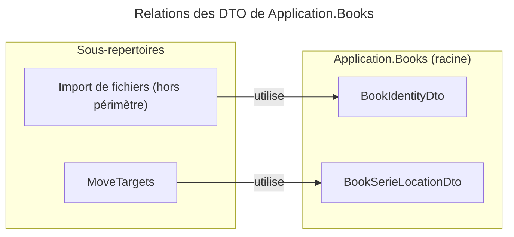

# C4 Code : Application/Books (racine)

## 1. Vue d'ensemble

- **Nom** : `Application.Books` (racine)
- **Description** : Espace de noms racine de la fonctionnalité Livres de la couche Application. Ce niveau ne contient que deux types de transfert de données (DTO) partagés entre les sous-répertoires ; les commandes, requêtes et handlers sont rangés dans les sous-répertoires par cas d'usage.
- **Emplacement relatif** : [`Application/Books/`](../Application/Books/)
- **Langage** : C# (.NET 10), records et classes scellées
- **Objectif** : Fournir les DTO communs aux cas d'usage Livres (détection de doublons à l'import, localisation des séries dans les bibliothèques).

## 2. Éléments de code

### Types de transfert de données (DTO)

- `public sealed record BookIdentityDto(Guid Id, string Serie, string Title, int VolumeNumber, string? Isbn, string LibraryName)`
  - **Description** : Données minimales d'un livre, utilisées pour détecter les doublons avant l'import d'un nouveau fichier.
  - **Emplacement** : [BookIdentityDto.cs:4](../Application/Books/BookIdentityDto.cs#L4)
  - **Dépendances** : aucune (types primitifs uniquement).

- `public sealed record BookSerieLocationDto(Guid LibraryId, string Serie)`
  - **Description** : Couple (bibliothèque, série) indiquant où se trouve une série. Sert à compter les tomes d'une même série par bibliothèque.
  - **Emplacement** : [BookSerieLocationDto.cs:3](../Application/Books/BookSerieLocationDto.cs#L3)
  - **Dépendances** : aucune. Produit par `IBookReadService.ListSerieLocationsAsync` et consommé par `GetBookMoveTargetsQueryHandler`.

## 3. Dépendances

### Internes

- Aucune dépendance de code dans ce niveau : les deux DTO sont autonomes.
- Consommateurs : sous-répertoire `MoveTargets` (`BookSerieLocationDto`), services de détection de doublons à l'import (hors périmètre, `BookIdentityDto`).

### Externes

- Aucune (BCL .NET uniquement).

## 4. Relations

## Notes

- Sous-répertoires documentés à ce même niveau C4 : `AddReadingDate`, `Create`, `Delete`, `DeleteReadingDate`, `GetById`, `IsbnScan`, `List`, `Move`, `MoveTargets`, `Read`, `ReaderDisplay`, `ReadingProgress`, `Update` (un fichier `c4-code-Application-Books-<Sous-répertoire>.md` par dossier).
- Les DTO de ce niveau n'ont aucune logique ; toute validation se trouve dans les handlers des sous-répertoires.
