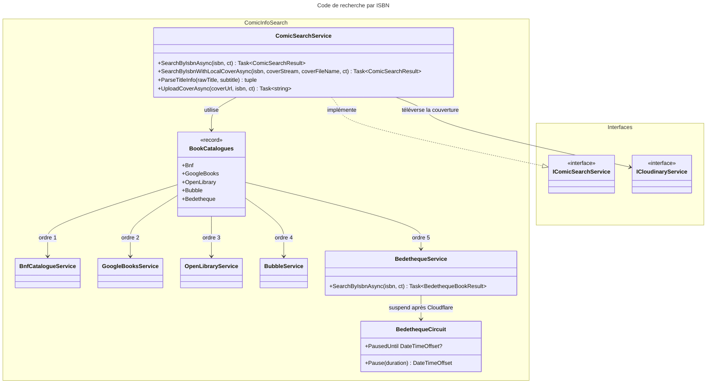

# C4 Code Level : Application.ComicInfoSearch

## Vue d'ensemble

- **Nom** : Application.ComicInfoSearch : recherche de métadonnées de BD par ISBN
- **Description** : Implémentations des catalogues externes (BnF, Google Books, Open Library, Bubble, Bedetheque), la façade `ComicSearchService` qui les interroge dans un ordre de priorité, et les types de configuration (`*Settings`) de chaque source.
- **Emplacement** : [Application/ComicInfoSearch/](../Application/ComicInfoSearch/)
- **Langage** : C# (.NET 10), `HttpClient`, `HtmlAgilityPack`, `System.Xml.Linq`, expressions régulières générées
- **Objectif** : Trouver le titre, la série, le tome, les auteurs, l'éditeur, la date, le nombre de pages et la couverture d'un album à partir de son ISBN, puis envoyer la couverture vers Cloudinary.

## Éléments de code

### Façade et agrégation

#### ComicSearchService

- **Type** : classe publique partielle, implémente `IComicSearchService`
- **Signature** :

```csharp
public partial class ComicSearchService : IComicSearchService
{
    public ComicSearchService(
        BookCatalogues catalogues,
        ICloudinaryService cloudinaryService,
        IOptions<CloudinarySettings> cloudinarySettings,
        ILogger<ComicSearchService> logger);

    public Task<ComicSearchResult> SearchByIsbnAsync(string isbn, CancellationToken cancellationToken = default);
    public (string Title, string Serie, int VolumeNumber) ParseTitleInfo(string rawTitle, string? subtitle);
    public Task<string> UploadCoverAsync(Uri coverUrl, string isbn, CancellationToken cancellationToken = default);
    public Task<ComicSearchResult> SearchByIsbnWithLocalCoverAsync(
        string isbn, Stream? coverStream, string? coverFileName, CancellationToken cancellationToken = default);
}
```

- **Description** :
  - `SearchByIsbnAsync` : nettoie l'ISBN, appelle `FindFirstAsync`, téléverse la couverture et renvoie les métadonnées avec `ImageUrl`. Une exception inattendue (hors annulation demandée) est journalisée et donne un résultat « non trouvé ».
  - `ParseTitleInfo` : sépare la série et le tome à partir d'un titre brut (« Soda, tome 1 », « Soda - vol. 1 », « Soda #1 »...). Le titre affiché est le sous-titre s'il existe, sinon la série.
  - `SearchByIsbnWithLocalCoverAsync` : si l'utilisateur fournit sa propre couverture, elle est téléversée à la place de la couverture distante. Sans métadonnées, seule la couverture locale est envoyée (identifiant `digital-<guid>` si l'ISBN est vide).
  - `UploadCoverAsync` : téléverse une couverture distante vers Cloudinary.
- **Emplacement** : [ComicSearchService.cs](../Application/ComicInfoSearch/ComicSearchService.cs) lignes 9-379 (constructeur lignes 20-34 ; `SearchByIsbnAsync` lignes 36-60 ; `ParseTitleInfo` lignes 62-67 ; `UploadCoverAsync` lignes 69-70 ; `SearchByIsbnWithLocalCoverAsync` lignes 72-99)
- **Membres privés** :
  - `FindFirstAsync` (lignes 106-145) : interroge dans l'ordre BnF, Google Books, Open Library, Bubble, Bedetheque et renvoie le premier résultat trouvé (`ProviderMatch`, record privé ligne 102).
  - `FindCoverAsync` (lignes 148-164) : cherche une couverture chez Google Books, Open Library puis Bubble, car la BnF n'en fournit pas.
  - `MapStructuredResult` (lignes 167-184) et `MapBookResultSync` (lignes 186-202) : transforment les résultats des catalogues en `ComicSearchResult`.
  - `UploadCoverStreamOrRemoteAsync`, `UploadLocalCoverAsync`, `UploadCoverToCloudinaryAsync` (lignes 204-285) : téléversement ; en cas d'échec de Cloudinary, l'URL d'origine est conservée.
  - `ParseVolumeAndSerie` (lignes 316-359) avec sept motifs (lignes 289-314) : analyse du titre.
  - `IsUnexpectedException` (lignes 363-364), `CreateNotFoundResult` (lignes 366-378).
- **Dépendances** : `BookCatalogues`, `ICloudinaryService`, `CloudinarySettings`, `IsbnHelper`, `ILogger<ComicSearchService>`.

#### BookCatalogues

- **Type** : record public sealed
- **Signature** : `public sealed record BookCatalogues(IBnfCatalogueService Bnf, IGoogleBooksService GoogleBooks, IOpenLibraryService OpenLibrary, IBubbleService Bubble, IBedethequeService Bedetheque);`
- **Description** : Regroupe les cinq catalogues interrogés par ISBN, pour que `ComicSearchService` reçoive une seule dépendance.
- **Emplacement** : [BookCatalogues.cs](../Application/ComicInfoSearch/BookCatalogues.cs) lignes 6-11
- **Dépendances** : `Application.Interfaces` (cinq interfaces de catalogue). Enregistré en scoped dans [ApplicationDependencyInjection.cs](../Application/ApplicationDependencyInjection.cs) ligne 25.

### Catalogues

#### BnfCatalogueService

- **Type** : classe publique partielle, implémente `IBnfCatalogueService`
- **Signature** :

```csharp
public partial class BnfCatalogueService : IBnfCatalogueService
{
    public BnfCatalogueService(HttpClient httpClient, IOptions<BnfCatalogueSettings> settings, IFeatureToggles featureToggles, ILogger<BnfCatalogueService> logger);
    public bool IsEnabled { get; }
    public Task<BnfBookResult> SearchByIsbnAsync(string isbn, CancellationToken cancellationToken = default);
}
```

- **Description** : Interroge l'API SRU de la BnF (format Dublin Core) avec la requête `bib.fuzzyISBN`. Le titre est découpé en titre et sous-titre, les auteurs sont remis dans l'ordre « Prénom Nom », l'éditeur perd sa ville entre parenthèses, la date ne garde que l'année (au 1er janvier), le nombre de pages est lu dans le format. Pas de couverture.
- **Emplacement** : [BnfCatalogueService.cs](../Application/ComicInfoSearch/BnfCatalogueService.cs) lignes 18-161 (constructeur lignes 27-33 ; `IsEnabled` ligne 45 ; `SearchByIsbnAsync` lignes 47-96)
- **Membres privés** : `ParseRecord` (lignes 98-111), `Values` (113-114), `ParseYear` (145-149), `ParsePages` (151-155), `CreateFailedResult` (157), `CreateNotFoundResult` (159-160). Membres `internal static` : `ParseTitle` (117-122), `ToPersonName` (125-135), `StripTrailingPlace` (138-142), accessibles aux tests unitaires.
- **Motifs** : `PersonPattern` (ligne 36), `PagesPattern` (ligne 39), `YearPattern` (ligne 42).
- **Dépendances** : `HttpClient`, `IsbnHelper`, `IFeatureToggles`, `FeatureToggle.Bnf`, `System.Xml.Linq`.

#### GoogleBooksService

- **Type** : classe publique, implémente `IGoogleBooksService`
- **Signature** :

```csharp
public class GoogleBooksService : IGoogleBooksService
{
    public GoogleBooksService(HttpClient httpClient, IOptions<GoogleBooksSettings> settings, IFeatureToggles featureToggles, ILogger<GoogleBooksService> logger);
    public bool IsEnabled { get; }
    public Task<GoogleBooksBookResult> SearchByIsbnAsync(string isbn, CancellationToken cancellationToken = default);
}
```

- **Description** : Interroge `volumes?q=isbn:` puis charge le détail du premier volume via son `selfLink` (le titre de la recherche est parfois tronqué). Choisit la plus grande image disponible, force HTTPS et retire le paramètre `edge`. La clé API, si elle est configurée, est ajoutée à l'URL.
- **Emplacement** : [GoogleBooksService.cs](../Application/ComicInfoSearch/GoogleBooksService.cs) lignes 12-261 (constructeur lignes 20-26 ; `IsEnabled` ligne 28 ; `SearchByIsbnAsync` lignes 30-116)
- **Membres privés** : `GetDetailedVolumeInfoAsync` (lignes 118-151), `WithApiKey` (lignes 153-162), `GetBestCoverUrl` (lignes 164-206), `CreateFailedResult` (208), `CreateNotFoundResult` (210-223), DTO JSON (lignes 231-260).
- **Dépendances** : `HttpClient`, `GoogleBooksSettings`, `IFeatureToggles`, `FeatureToggle.GoogleBooks`, `PublishDateHelper`, `System.Text.Json`.

#### OpenLibraryService

- **Type** : classe publique, implémente `IOpenLibraryService`
- **Signature** :

```csharp
public class OpenLibraryService : IOpenLibraryService
{
    public OpenLibraryService(HttpClient httpClient, IOptions<OpenLibrarySettings> settings, IFeatureToggles featureToggles, ILogger<OpenLibraryService> logger);
    public bool IsEnabled { get; }
    public Task<OpenLibraryBookResult> SearchByIsbnAsync(string isbn, CancellationToken cancellationToken = default);
}
```

- **Description** : Interroge `/isbn/{isbn}.json`. Un 404 donne « non trouvé », un autre code d'erreur donne « échec ». Chaque auteur est ensuite chargé séparément (`GetAuthorNamesAsync`). La couverture est `covers/{id}-L.jpg`.
- **Emplacement** : [OpenLibraryService.cs](../Application/ComicInfoSearch/OpenLibraryService.cs) lignes 13-182 (constructeur lignes 20-26 ; `IsEnabled` ligne 28 ; `SearchByIsbnAsync` lignes 30-102)
- **Membres privés** : `GetAuthorNamesAsync` (lignes 104-143), `CreateFailedResult` (145), `CreateNotFoundResult` (147-157), `JsonOptions` (159-162), DTO JSON (lignes 165-181).
- **Dépendances** : `HttpClient`, `OpenLibrarySettings`, `IFeatureToggles`, `FeatureToggle.OpenLibrary`, `PublishDateHelper`, `IsbnHelper`.

#### BubbleService

- **Type** : classe publique partielle, implémente `IBubbleService`
- **Signature** :

```csharp
public partial class BubbleService : IBubbleService
{
    public BubbleService(HttpClient httpClient, IOptions<BubbleSettings> settings, IFeatureToggles featureToggles, ILogger<BubbleService> logger);
    public bool IsEnabled { get; }
    public Task<BubbleBookResult> SearchByIsbnAsync(string isbn, CancellationToken ct = default);
    internal static DateOnly? ParseReleaseDate(string? value);
}
```

- **Description** : Interroge l'index Algolia `Albums` du site Bubble avec l'ISBN. Ne garde que le premier résultat dont les EAN contiennent l'ISBN exact. Puis lit la page de l'album : données schema.org `Book` (éditeur, pages, image), auteurs et « Date de parution » dans les caractéristiques. Une page illisible conserve le résultat de recherche. Une date seule est convertie au 1er du mois, ou au 1er janvier si seule l'année est donnée.
- **Emplacement** : [BubbleService.cs](../Application/ComicInfoSearch/BubbleService.cs) lignes 21-321 (constructeur lignes 47-53 ; `IsEnabled` ligne 63 ; `SearchByIsbnAsync` lignes 65-112 ; `ParseReleaseDate` lignes 264-281)
- **Membres privés** : `SearchAlbumsAsync` (114-124), `HasEan` (127-129), `ToResult` (131-141), `FetchAlbumPageAsync` (143-174), `AlbumUrl` (177-186), `AddPageDetails` (191-203), `ReadSchemaBook` (205-225), `FindSchemaBook` (228-246), `ReadAuthors` (249-254), `ReadCharacteristic` (257-261), `ToUri` (283-284), `CreateFailedResult` (286), `CreateNotFoundResult` (288-289). Motifs `ReleaseDatePattern` (56-57) et `UrlSegmentPattern` (60-61). Constantes `AlbumsIndex = "Albums"`, `MaxHits = 5`, table `s_frenchMonths` (lignes 26-40).
- **DTO** : `AlgoliaQuery`, `AlgoliaResponse`, `AlgoliaHit` (lignes 292-310), `SchemaBook`, `SchemaOrganization` (lignes 312-320).
- **Dépendances** : `HttpClient`, `BubbleSettings`, `IFeatureToggles`, `FeatureToggle.Bubble`, `IsbnHelper`, `HtmlAgilityPack`, `System.Text.Json`.

#### BedethequeService

- **Type** : classe publique partielle, implémente `IBedethequeService`
- **Signature** :

```csharp
public partial class BedethequeService : IBedethequeService
{
    public BedethequeService(IHttpClientFactory httpClientFactory, IIsbnBedethequeCacheRepository cacheRepository, IOptions<BedethequeSettings> settings, BedethequeCircuit circuit, IFeatureToggles featureToggles, ILogger<BedethequeService> logger);
    public bool IsEnabled { get; }
    public Task<BedethequeBookResult> SearchByIsbnAsync(string isbn, CancellationToken ct = default);
}
```

- **Description** : Source la plus fragile. La recherche se fait en trois étapes : cache ISBN vers URL (`IIsbnBedethequeCacheRepository`) ; sinon recherche Google via SerpApi sur trois formes de l'ISBN (brut, hyphéné, court), avec retour sur la page série si nécessaire ; puis lecture de la page album (titre, série, tome, auteurs, éditeur, date, pages, couverture déduite de l'identifiant de la page). Une réponse Cloudflare suspend toutes les recherches via `BedethequeCircuit` pendant `CloudflarePauseHours`. Le cache est alimenté uniquement pour un résultat trouvé.
- **Emplacement** : [BedethequeService.cs](../Application/ComicInfoSearch/BedethequeService.cs) lignes 14-482 (constructeur lignes 27-46 ; `IsEnabled` ligne 48 ; `SearchByIsbnAsync` lignes 50-113)
- **Membres privés** : `ResolveUrlAsync` (115-137), `TrySearchFormatAsync` (139-180), `ResolveSeriePageAsync` (182-227), `BuildSerpApiUrl` (229-233), `FetchPageAsync` (235-257), `IsCloudflareChallenge` (260-263), `ParsePage` (265-292), `GetInfoAlbumFieldText` (295-303), `ParseTitle`, `ParseSerie`, `ParseVolumeNumber`, `ParseAuthors`, `ParsePublishers`, `ParsePublishDate` (380-424), `ParseNumberOfPages` (426-438), `BuildCoverUrl` (443-452), `CreateFailedResult` (454), `CreateNotFoundResult` (456-467).
- **Motifs** : `ParutionDateRegex` (373-374), `MonthYearRegex` (377-378), `PageIdRegex` (440-441).
- **DTO** : `SerpApiResponse`, `SerpApiOrganicResult` (lignes 475-481).
- **Dépendances** : `IHttpClientFactory` (clients nommés `SerpApi` et `Bedetheque`), `IIsbnBedethequeCacheRepository`, `BedethequeSettings`, `BedethequeCircuit`, `IFeatureToggles`, `FeatureToggle.Bedetheque`, `PublishDateHelper`, `IsbnHelper`, `HtmlAgilityPack`.

#### BedethequeCircuit

- **Type** : classe publique sealed (singleton), constructeur primaire avec `TimeProvider clock`
- **Signature** :

```csharp
public sealed class BedethequeCircuit(TimeProvider clock)
{
    public DateTimeOffset? PausedUntil { get; }
    public DateTimeOffset Pause(TimeSpan duration);
}
```

- **Description** : Coupe-circuit qui met Bedetheque en pause après un défi Cloudflare, pour tous les appels de l'application. `PausedUntil` est `null` quand la pause est terminée. La valeur est stockée sous forme de ticks et mise à jour avec `Interlocked`.
- **Emplacement** : [BedethequeCircuit.cs](../Application/ComicInfoSearch/BedethequeCircuit.cs) lignes 7-26
- **Dépendances** : `TimeProvider` (horloge injectable), `System.Threading.Interlocked`.

### Types de configuration

#### CloudinarySettings

- **Type** : classe publique
- **Signature** :

```csharp
public class CloudinarySettings
{
    public string CloudName { get; set; } = string.Empty;
    public string ApiKey { get; set; } = string.Empty;
    public string ApiSecret { get; set; } = string.Empty;
    public string Folder { get; set; } = "covers";
}
```

- **Description** : Identifiants et dossier de téléversement Cloudinary. Les secrets viennent de l'environnement, jamais du dépôt.
- **Emplacement** : [CloudinarySettings.cs](../Application/ComicInfoSearch/CloudinarySettings.cs) lignes 3-9

#### BedethequeSettings

- **Type** : classe publique sealed
- **Signature** :

```csharp
public sealed class BedethequeSettings
{
    public string SerpApiKey { get; init; } = string.Empty;
    public required Uri BaseUrl { get; init; }
    public required Uri SerpApiBaseUrl { get; init; }
    public bool Enabled { get; init; } = true;
    public int CloudflarePauseHours { get; init; } = 24;
}
```

- **Description** : Adresse du site, de SerpApi, clé API, activation et durée de pause après Cloudflare (24 h par défaut).
- **Emplacement** : [BedethequeSettings.cs](../Application/ComicInfoSearch/BedethequeSettings.cs) lignes 3-14

#### OpenLibrarySettings

- **Type** : classe publique sealed
- **Signature** : `public sealed class OpenLibrarySettings { public required Uri BaseUrl { get; init; } public required Uri CoversBaseUrl { get; init; } public bool Enabled { get; init; } = true; }`
- **Emplacement** : [OpenLibrarySettings.cs](../Application/ComicInfoSearch/OpenLibrarySettings.cs) lignes 3-10

#### GoogleBooksSettings

- **Type** : classe publique
- **Signature** : `public class GoogleBooksSettings { public Uri? BaseUrl { get; set; } public string? ApiKey { get; set; } public bool Enabled { get; init; } = true; }`
- **Description** : Sans clé API, les requêtes partagent le quota anonyme de Google, souvent épuisé (HTTP 429).
- **Emplacement** : [GoogleBooksSettings.cs](../Application/ComicInfoSearch/GoogleBooksSettings.cs) lignes 3-12

#### BnfCatalogueSettings

- **Type** : classe publique sealed
- **Signature** : `public sealed class BnfCatalogueSettings { public required Uri BaseUrl { get; init; } public bool Enabled { get; init; } = true; }`
- **Emplacement** : [BnfCatalogueSettings.cs](../Application/ComicInfoSearch/BnfCatalogueSettings.cs) lignes 3-9

#### BubbleSettings

- **Type** : classe publique sealed
- **Signature** :

```csharp
public sealed class BubbleSettings
{
    public required Uri BaseUrl { get; init; }
    public required Uri AlgoliaBaseUrl { get; init; }
    public string ApplicationId { get; init; } = string.Empty;
    public string ApiKey { get; init; } = string.Empty;
    public bool Enabled { get; init; } = true;
    public bool HasApiKey { get; }
}
```

- **Description** : `HasApiKey` est vrai quand l'identifiant d'application et la clé Algolia sont tous deux renseignés.
- **Emplacement** : [BubbleSettings.cs](../Application/ComicInfoSearch/BubbleSettings.cs) lignes 3-17 (`HasApiKey` ligne 16)

## Dépendances

### Internes

- `Application.Interfaces` : `IComicSearchService`, `ICloudinaryService`, `IBnfCatalogueService`, `IGoogleBooksService`, `IOpenLibraryService`, `IBubbleService`, `IBedethequeService`, `IIsbnBedethequeCacheRepository`, `IFeatureToggles`, et les records de résultat.
- `Application.Helpers` : `IsbnHelper` (normalisation, formats ISBN) et `PublishDateHelper` (dates).
- `Application.ComicInfoSearch` : les `*Settings` et `BedethequeCircuit` sont utilisés par les services du même répertoire.
- `Domain.Settings` : `FeatureToggle` (valeurs `Bnf`, `GoogleBooks`, `OpenLibrary`, `Bubble`, `Bedetheque`).

### Externes

- **HtmlAgilityPack** : analyse HTML (Bubble, Bedetheque).
- **System.Net.Http / Microsoft.Extensions.Http** : `HttpClient`, `IHttpClientFactory`, `HttpRequestException`.
- **System.Text.Json** : désérialisation des réponses JSON (Google Books, Open Library, Bubble, SerpApi).
- **System.Xml.Linq** : lecture du flux SRU de la BnF.
- **Microsoft.Extensions.Logging / Options** : journalisation et configuration.
- **Services distants** : API SRU de la BnF, Google Books API, Open Library, index Algolia de Bubble et site bubblebd.com, site bedetheque.com via SerpApi, Cloudinary (via `ICloudinaryService`).

## Relations



## Notes

- **Ordre de priorité** (`FindFirstAsync`, lignes 106-145) : BnF, Google Books, Open Library, Bubble, Bedetheque. La BnF est la première source, car elle connaît presque toutes les BD françaises ; Bedetheque est la dernière, car elle coûte des appels SerpApi et est souvent bloquée.
- **Couverture d'un livre trouvé par la BnF** : `FindCoverAsync` interroge à nouveau Google Books, Open Library puis Bubble. Un livre trouvé par la BnF coûte donc jusqu'à trois requêtes supplémentaires.
- **Clés API dans les URL** : `BedethequeService.BuildSerpApiUrl` (ligne 232) et `GoogleBooksService.WithApiKey` (lignes 153-162) placent la clé dans la chaîne de requête. Une exception qui contient l'URL peut donc exposer la clé dans les journaux.
- **Gestion des annulations** : `OpenLibraryService` filtre les `TaskCanceledException` avec `ex.CancellationToken != cancellationToken` (ligne 97), alors que les autres services utilisent `!cancellationToken.IsCancellationRequested`. Le comportement est proche, mais la règle n'est pas uniforme.
- **Journalisation** : chaque classe reçoit son `ILogger<T>` par injection, conformément au `CLAUDE.md`.
- **Accès aux tests** : `BubbleService.ParseReleaseDate`, `BnfCatalogueService.ParseTitle`, `ToPersonName` et `StripTrailingPlace` sont `internal`, et le projet `Application` rend ses internes visibles à `Application.UnitTests`.
