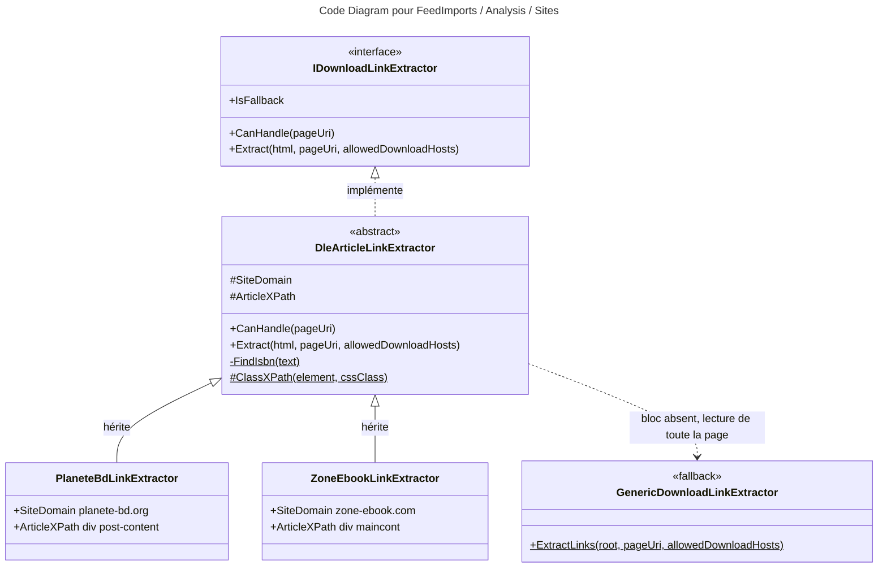

# C4 Code Level : FeedImports / Analysis / Sites

## Vue d'ensemble

- **Nom** : `Application.FeedImports.Analysis.Sites`
- **Description** : Extracteurs d'articles propres à deux sites de BD (planete-bd.org et zone-ebook.com), qui partagent la même mise en page DataLife Engine.
- **Emplacement relatif** : [Application/FeedImports/Analysis/Sites](../Application/FeedImports/Analysis/Sites)
- **Langage** : C# (.NET 10), `GeneratedRegex`, HtmlAgilityPack, `ILogger<T>`.
- **Objectif** : Ne lire que le bloc de l'article (métadonnées, liste des fichiers) pour ignorer la barre latérale, les boutons de partage et les publicités, et relever l'ISBN indiqué dans l'article. Si le bloc n'est pas trouvé (mise en page modifiée), l'extracteur journalise un avertissement et bascule sur la lecture de toute la page.

## Éléments de code

### Classes

#### DleArticleLinkExtractor

- Fichier : [DleArticleLinkExtractor.cs:13-73](../Application/FeedImports/Analysis/Sites/DleArticleLinkExtractor.cs#L13)
- Déclaration : `public abstract partial class DleArticleLinkExtractor(ILogger logger) : IDownloadLinkExtractor`
- Description : base commune des extracteurs DataLife Engine. Les classes dérivées ne fournissent que le domaine du site et le XPath du bloc d'article.
- Membres :
  - `protected abstract string SiteDomain { get; }` ([ligne 19](../Application/FeedImports/Analysis/Sites/DleArticleLinkExtractor.cs#L19)) : domaine du site, sous-domaines compris.
  - `protected abstract string ArticleXPath { get; }` ([ligne 22](../Application/FeedImports/Analysis/Sites/DleArticleLinkExtractor.cs#L22)) : XPath du bloc d'article.
  - `public bool IsFallback => false` ([ligne 24](../Application/FeedImports/Analysis/Sites/DleArticleLinkExtractor.cs#L24))
  - `public bool CanHandle(Uri pageUri)` ([lignes 26-30](../Application/FeedImports/Analysis/Sites/DleArticleLinkExtractor.cs#L26)) : `pageUri.Host` égal ou sous-domaine de `SiteDomain`.
  - `public ArticleExtraction Extract(string html, Uri pageUri, IReadOnlyList<string> allowedDownloadHosts)` ([lignes 32-57](../Application/FeedImports/Analysis/Sites/DleArticleLinkExtractor.cs#L32)) : renvoie `ArticleExtraction.Empty` si le HTML est vide ou si aucun hôte n'est autorisé ; cherche le bloc `ArticleXPath`, puis `//*[@id='post-img']` ; sans bloc, journalise un avertissement et appelle `GenericDownloadLinkExtractor.ExtractLinks` sur toute la page ; sinon extrait les liens du bloc et renseigne `Isbn`.
  - `private static string? FindIsbn(string text)` ([lignes 59-69](../Application/FeedImports/Analysis/Sites/DleArticleLinkExtractor.cs#L59)) : applique la regex ISBN, normalise avec `IsbnHelper.NormalizeIsbn` et ne garde que les ISBN valides (`IsbnHelper.IsValidISBN`).
  - `protected static string ClassXPath(string element, string cssClass)` ([lignes 71-72](../Application/FeedImports/Analysis/Sites/DleArticleLinkExtractor.cs#L71)) : construit un XPath `//element[contains(concat(' ', normalize-space(@class), ' '), ' cssClass ')]`.
  - `IsbnPattern()` ([lignes 16-17](../Application/FeedImports/Analysis/Sites/DleArticleLinkExtractor.cs#L16)) : regex `GeneratedRegex` pour « ISBN : ... » avec tirets et espaces.

#### PlaneteBdLinkExtractor

- Fichier : [PlaneteBdLinkExtractor.cs:5-10](../Application/FeedImports/Analysis/Sites/PlaneteBdLinkExtractor.cs#L5)
- Déclaration : `public sealed class PlaneteBdLinkExtractor(ILogger<PlaneteBdLinkExtractor> logger) : DleArticleLinkExtractor(logger)`
- Membres :
  - `protected override string SiteDomain => "planete-bd.org"` ([ligne 7](../Application/FeedImports/Analysis/Sites/PlaneteBdLinkExtractor.cs#L7))
  - `protected override string ArticleXPath { get; } = ClassXPath("div", "post-content");` ([ligne 9](../Application/FeedImports/Analysis/Sites/PlaneteBdLinkExtractor.cs#L9))
- Enregistrement DI : singleton `IDownloadLinkExtractor` dans [ApplicationDependencyInjection.cs:32](../Application/ApplicationDependencyInjection.cs#L32).

#### ZoneEbookLinkExtractor

- Fichier : [ZoneEbookLinkExtractor.cs:5-10](../Application/FeedImports/Analysis/Sites/ZoneEbookLinkExtractor.cs#L5)
- Déclaration : `public sealed class ZoneEbookLinkExtractor(ILogger<ZoneEbookLinkExtractor> logger) : DleArticleLinkExtractor(logger)`
- Membres :
  - `protected override string SiteDomain => "zone-ebook.com"` ([ligne 7](../Application/FeedImports/Analysis/Sites/ZoneEbookLinkExtractor.cs#L7))
  - `protected override string ArticleXPath { get; } = ClassXPath("div", "maincont");` ([ligne 9](../Application/FeedImports/Analysis/Sites/ZoneEbookLinkExtractor.cs#L9))
- Enregistrement DI : singleton `IDownloadLinkExtractor` dans [ApplicationDependencyInjection.cs:33](../Application/ApplicationDependencyInjection.cs#L33).

## Dépendances

### Dépendances internes

- `Application.FeedImports.Analysis` : interface `IDownloadLinkExtractor`, type `ArticleExtraction`, et la méthode `GenericDownloadLinkExtractor.ExtractLinks` (repli sur toute la page).
- `Application.Helpers.IsbnHelper` : `NormalizeIsbn` et `IsValidISBN`.
- `Domain.Extensions` : `IsSameOrSubdomainOf` pour le contrôle de domaine.
- Consommateur : `AnalyzeFeedImportDecisionCommandHandler`, qui choisit l'extracteur non générique dont `CanHandle` est vrai, sinon le générique.

### Dépendances externes

- `HtmlAgilityPack` : `HtmlDocument`, `HtmlNode`, `HtmlEntity`, `SelectSingleNode` avec XPath.
- `Microsoft.Extensions.Logging` : `ILogger` / `ILogger<T>` (avertissement de mise en page modifiée).
- `System.Text.RegularExpressions` : `[GeneratedRegex]`.

## Relations

## Notes

- La classe de base reçoit un `ILogger` non générique et les classes dérivées lui passent leur `ILogger<T>` : le `SourceContext` reste celui du site concerné.
- Le repli sur toute la page (bloc absent) ne renseigne pas l'ISBN : seul le bloc d'article est lu pour l'ISBN.
- `GroupKey` n'est pas renseigné par ces extracteurs : tous les liens du bloc sont regroupés par `DownloadLinkGrouper` selon les noms de fichiers.
- Le XPath est construit à partir de constantes internes : aucune donnée de la page n'est interpolée dans la requête.
