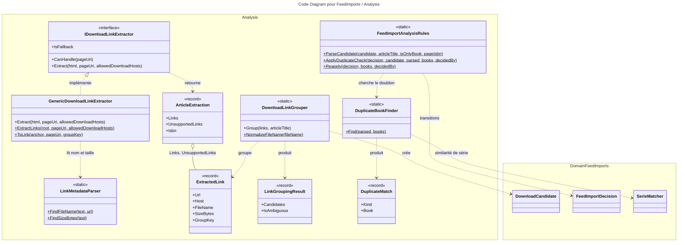

# C4 Code Level : FeedImports / Analysis

## Vue d'ensemble

- **Nom** : `Application.FeedImports.Analysis`
- **Description** : Logique pure d'analyse d'un article de BD : extraction des liens de téléchargement depuis le HTML, regroupement des liens en livres (miroirs), lecture des métadonnées dans les liens et détection des doublons dans les bibliothèques de l'utilisateur.
- **Emplacement relatif** : [Application/FeedImports/Analysis](../Application/FeedImports/Analysis)
- **Langage** : C# (.NET 10), `GeneratedRegex`, HtmlAgilityPack.
- **Objectif** : Transformer le HTML d'une page d'article en candidats de téléchargement (`DownloadCandidate` du domaine), décider si chaque livre est nouveau, doublon certain, doublon probable ou ambigu, et appliquer la transition correspondante sur `FeedImportDecision`. Aucun appel réseau ni écriture ici : les handlers des dossiers `Analyze` et `Arbitrate` orchestrent ces règles.

Les extracteurs spécifiques à un site sont dans le sous-dossier [Sites](../Application/FeedImports/Analysis/Sites).

## Éléments de code

### Types de transfert

#### ArticleExtraction

- Fichier : [ArticleExtraction.cs:6-9](../Application/FeedImports/Analysis/ArticleExtraction.cs#L6)
- Signature : `public sealed record ArticleExtraction(IReadOnlyList<ExtractedLink> Links, IReadOnlyList<ExtractedLink> UnsupportedLinks, string? Isbn = null)`
- Membre statique : `public static ArticleExtraction Empty { get; }` ([ligne 8](../Application/FeedImports/Analysis/ArticleExtraction.cs#L8))
- Description : résultat d'extraction d'une page. `Links` pointe vers `FeedImport:AllowedDownloadHosts` ; `UnsupportedLinks` regroupe les fichiers proposés sur d'autres hébergeurs, à télécharger à la main ; `Isbn` est l'ISBN affiché sur la page, s'il existe.

#### ExtractedLink

- Fichier : [ExtractedLink.cs:5](../Application/FeedImports/Analysis/ExtractedLink.cs#L5)
- Signature : `public sealed record ExtractedLink(string Url, string Host, string Text, string? FileName, long? SizeBytes, string? GroupKey = null)`
- Description : un lien `<a href>` retenu. `GroupKey` permet à un extracteur de site d'indiquer le bloc (ex. « Tome 3 ») auquel appartient le lien. Voir la remarque dans les notes : aucun extracteur actuel ne le renseigne.

#### LinkGroupingResult

- Fichier : [LinkGroupingResult.cs:5](../Application/FeedImports/Analysis/LinkGroupingResult.cs#L5)
- Signature : `public sealed record LinkGroupingResult(IReadOnlyList<DownloadCandidate> Candidates, bool IsAmbiguous, string? AmbiguityReason)`
- Description : candidats issus du regroupement et indicateur d'ambiguïté (regroupement impossible à trancher automatiquement).

#### DuplicateMatchKind (enum)

- Fichier : [DuplicateBookFinder.cs:6-11](../Application/FeedImports/Analysis/DuplicateBookFinder.cs#L6)
- Valeurs : `None`, `Probable`, `Certain`.

#### DuplicateMatch

- Fichier : [DuplicateBookFinder.cs:13-16](../Application/FeedImports/Analysis/DuplicateBookFinder.cs#L13)
- Signature : `public sealed record DuplicateMatch(DuplicateMatchKind Kind, BookIdentityDto? Book)`
- Membre statique : `public static DuplicateMatch None { get; }` ([ligne 15](../Application/FeedImports/Analysis/DuplicateBookFinder.cs#L15))

### Interfaces

#### IDownloadLinkExtractor

- Fichier : [IDownloadLinkExtractor.cs:3-12](../Application/FeedImports/Analysis/IDownloadLinkExtractor.cs#L3)
- Description : stratégie d'extraction. Un extracteur spécifique à un site est choisi quand `CanHandle` est vrai ; le générique (`IsFallback`) sert de repli.
- Membres :
  - `bool IsFallback { get; }` ([ligne 6](../Application/FeedImports/Analysis/IDownloadLinkExtractor.cs#L6))
  - `bool CanHandle(Uri pageUri)` ([ligne 8](../Application/FeedImports/Analysis/IDownloadLinkExtractor.cs#L8))
  - `ArticleExtraction Extract(string html, Uri pageUri, IReadOnlyList<string> allowedDownloadHosts)` ([ligne 11](../Application/FeedImports/Analysis/IDownloadLinkExtractor.cs#L11)) : ne retourne que les liens vers les hôtes autorisés (sous-domaines compris). Le parsing n'exécute jamais le contenu de la page.

### Classes

#### GenericDownloadLinkExtractor

- Fichier : [GenericDownloadLinkExtractor.cs:7-96](../Application/FeedImports/Analysis/GenericDownloadLinkExtractor.cs#L7)
- Déclaration : `public sealed class GenericDownloadLinkExtractor : IDownloadLinkExtractor`
- Description : extracteur de repli qui lit toutes les ancres de la page.
- Méthodes :
  - `public bool IsFallback => true` ([ligne 9](../Application/FeedImports/Analysis/GenericDownloadLinkExtractor.cs#L9))
  - `public bool CanHandle(Uri pageUri) => true` ([ligne 11](../Application/FeedImports/Analysis/GenericDownloadLinkExtractor.cs#L11))
  - `public ArticleExtraction Extract(string html, Uri pageUri, IReadOnlyList<string> allowedDownloadHosts)` ([ligne 13](../Application/FeedImports/Analysis/GenericDownloadLinkExtractor.cs#L13)) : charge le HTML avec HtmlAgilityPack et délègue à `ExtractLinks`.
  - `internal static ArticleExtraction ExtractLinks(HtmlNode root, Uri pageUri, IReadOnlyList<string> allowedDownloadHosts)` ([ligne 30](../Application/FeedImports/Analysis/GenericDownloadLinkExtractor.cs#L30)) : parcourt `.//a[@href]` dans l'ordre du document, sans doublon d'URL. Un lien vers un hôte autorisé va dans `Links` ; un lien nommé (fichier) vers un autre domaine que la page va dans `UnsupportedLinks`.
  - `internal static ExtractedLink? ToLink(HtmlNode anchor, Uri pageUri, string? groupKey = null)` ([ligne 62](../Application/FeedImports/Analysis/GenericDownloadLinkExtractor.cs#L62)) : ne retient que http/https ; ignore les pages de profil d'hébergeur ; renseigne `FileName` et `SizeBytes` à partir du texte de l'ancre puis du texte du parent.
  - `private static bool IsProfileLink(Uri url)` ([ligne 89](../Application/FeedImports/Analysis/GenericDownloadLinkExtractor.cs#L89)) : détecte les premiers segments `users`, `user`, `folder`, `folders`, `profile`.

#### LinkMetadataParser

- Fichier : [LinkMetadataParser.cs:6-72](../Application/FeedImports/Analysis/LinkMetadataParser.cs#L6)
- Déclaration : `public static partial class LinkMetadataParser`
- Description : lecture du nom de fichier et de la taille à partir du texte et de l'URL d'un lien.
- Membres :
  - `private static readonly string[] s_fileExtensions` ([ligne 8](../Application/FeedImports/Analysis/LinkMetadataParser.cs#L8)) : `.cbz`, `.cbr`, `.zip`, `.rar`, `.pdf`, `.epub`, `.cb7`, `.7z`.
  - `SizePattern()` ([lignes 10-12](../Application/FeedImports/Analysis/LinkMetadataParser.cs#L10)) : regex `GeneratedRegex` pour les tailles (« Mo », « Go », « MB », « GiB »…).
  - `FileNameInTextPattern()` ([lignes 14-16](../Application/FeedImports/Analysis/LinkMetadataParser.cs#L14)) : regex `GeneratedRegex` pour un nom de fichier dans un texte.
  - `public static string? FindFileName(string? text, Uri url)` ([ligne 19](../Application/FeedImports/Analysis/LinkMetadataParser.cs#L19)) : cherche d'abord dans le texte, puis dans les segments de l'URL (en retirant un éventuel suffixe `.html`). Retourne seulement le nom, jamais un chemin.
  - `public static long? FindSizeBytes(string? text)` ([ligne 50](../Application/FeedImports/Analysis/LinkMetadataParser.cs#L50)) : convertit « 125 Mo », « 1,2 Go », « 300MB » en octets (unités binaires, 1024).

#### DownloadLinkGrouper

- Fichier : [DownloadLinkGrouper.cs:8-76](../Application/FeedImports/Analysis/DownloadLinkGrouper.cs#L8)
- Déclaration : `public static class DownloadLinkGrouper`
- Description : transforme les liens d'un article en livres candidats, chacun avec ses miroirs. Des miroirs sont le même fichier sur plusieurs hôtes ; des noms de fichiers différents désignent des livres différents.
- Méthodes :
  - `public static LinkGroupingResult Group(IReadOnlyList<ExtractedLink> links, string articleTitle)` ([ligne 10](../Application/FeedImports/Analysis/DownloadLinkGrouper.cs#L10)) : règles, dans l'ordre : (1) si tous les liens ont un `GroupKey`, un groupe par clé ; (2) sinon regroupement par nom normalisé ; (3) un seul fichier nommé plus des liens sans nom sur d'autres hôtes forment un seul livre ; (4) des liens sans nom sur des hôtes distincts forment un seul livre ; (5) sinon, le résultat est marqué ambigu.
  - `private static LinkGroupingResult Ambiguous(IReadOnlyList<DownloadCandidate> candidates, string reason)` ([ligne 56](../Application/FeedImports/Analysis/DownloadLinkGrouper.cs#L56))
  - `private static bool HasDistinctHosts(List<ExtractedLink> links)` ([ligne 59](../Application/FeedImports/Analysis/DownloadLinkGrouper.cs#L59))
  - `private static DownloadCandidate ToCandidate(List<ExtractedLink> links, string articleTitle)` ([ligne 62](../Application/FeedImports/Analysis/DownloadLinkGrouper.cs#L62)) : le libellé est le nom de fichier sans extension, ou le titre de l'article ; les miroirs sont dédoublonnés par URL.
  - `internal static string NormalizeFileName(string fileName)` ([ligne 74](../Application/FeedImports/Analysis/DownloadLinkGrouper.cs#L74)) : nom sans extension, sans diacritiques, en majuscules, lettres et chiffres seulement.
- Dépendances : `Domain.Extensions` (`RemoveDiacritics`), `DownloadCandidate`, `DownloadMirror`.

#### DuplicateBookFinder

- Fichier : [DuplicateBookFinder.cs:20-78](../Application/FeedImports/Analysis/DuplicateBookFinder.cs#L20)
- Déclaration : `public static class DuplicateBookFinder`
- Description : recherche d'un livre déjà présent dans les bibliothèques de l'utilisateur.
- Méthodes :
  - `public static DuplicateMatch Find(ParsedComicTitle parsed, IReadOnlyList<BookIdentityDto> books)` ([ligne 22](../Application/FeedImports/Analysis/DuplicateBookFinder.cs#L22)) : (1) ISBN identique (normalisé, 10 ou 13 caractères) : `Certain` ; (2) sinon, si une série est connue, `FindBySerie`.
  - `private static BookIdentityDto? FindByIsbn(string? parsedIsbn, IReadOnlyList<BookIdentityDto> books)` ([ligne 36](../Application/FeedImports/Analysis/DuplicateBookFinder.cs#L36))
  - `private static DuplicateMatch FindBySerie(ParsedComicTitle parsed, IReadOnlyList<BookIdentityDto> books)` ([ligne 42](../Application/FeedImports/Analysis/DuplicateBookFinder.cs#L42)) : `Certain` si la similarité de série vaut 1 et le tome est identique ; sinon le meilleur `Probable`.
  - `private static bool IsProbable(double similarity, bool sameVolume, bool hasVolume)` ([ligne 65](../Application/FeedImports/Analysis/DuplicateBookFinder.cs#L65)) : (série identique et tome inconnu) ou (similarité ≥ `SerieMatcher.ProbableMatchThreshold` et même tome).
  - `private static string? NormalizeIsbn(string? isbn)` ([ligne 68](../Application/FeedImports/Analysis/DuplicateBookFinder.cs#L68)) : garde chiffres et `X`.
- Dépendances : `SerieMatcher` (domaine), `BookIdentityDto` (`Application.Books`), `ParsedComicTitle`.

#### FeedImportAnalysisRules

- Fichier : [FeedImportAnalysisRules.cs:10-91](../Application/FeedImports/Analysis/FeedImportAnalysisRules.cs#L10)
- Déclaration : `public static class FeedImportAnalysisRules`
- Description : règles partagées par l'analyse automatique (`Analyze`) et l'arbitrage manuel (`Arbitrate`, `Manage`) : parser un candidat, chercher un doublon, appliquer la transition.
- Méthodes :
  - `public static ParsedComicTitle ParseCandidate(DownloadCandidate candidate, string articleTitle, bool isOnlyBookOfArticle, string? pageIsbn = null)` ([ligne 12](../Application/FeedImports/Analysis/FeedImportAnalysisRules.cs#L12)) : si l'article ne contient qu'un livre, le titre de l'article prime ; sinon le nom de fichier décrit son propre livre. L'ISBN vient du nom de fichier, à défaut de la page.
  - `public static Result ApplyDuplicateCheck(FeedImportDecision decision, DownloadCandidate candidate, ParsedComicTitle parsed, IReadOnlyList<BookIdentityDto> books, FeedImportDecidedBy decidedBy)` ([ligne 26](../Application/FeedImports/Analysis/FeedImportAnalysisRules.cs#L26)) : `Certain` appelle `MarkDuplicate` (SkippedDuplicate) ; `Probable` appelle `RequestArbitration(ProbableDuplicate)` ; sinon `RecordLinks` (LinksExtracted).
  - `public static Result Reapply(FeedImportDecision decision, IReadOnlyList<BookIdentityDto> books, FeedImportDecidedBy decidedBy)` ([ligne 50](../Application/FeedImports/Analysis/FeedImportAnalysisRules.cs#L50)) : rejoue la règle sur les liens stockés. Sans lien, la décision reste `Pending`. Plusieurs candidats donnent `AmbiguousLinks`.
  - `private static ParsedComicTitle StoredParsed(FeedImportDecision decision, DownloadCandidate candidate)` ([ligne 71](../Application/FeedImports/Analysis/FeedImportAnalysisRules.cs#L71)) : conserve les corrections de l'utilisateur ; ne reparse le fichier que si rien n'est stocké.
  - `private static string Describe(BookIdentityDto book)` ([ligne 82](../Application/FeedImports/Analysis/FeedImportAnalysisRules.cs#L82))
  - `private static string DescribeLinks(DownloadCandidate candidate)` ([ligne 88](../Application/FeedImports/Analysis/FeedImportAnalysisRules.cs#L88))
- Dépendances : `FeedImportDecision`, `FeedImportArbitrationKind`, `FeedImportDecidedBy` (domaine `Domain.FeedImports`), `ComicTitleParser` (domaine `Domain.FeedImports`), `FileNameIsbnExtractor` (`Application.Helpers`), `BookIdentityDto` (`Application.Books`).

## Dépendances

### Dépendances internes

- `Application.FeedImports` : `DownloadCandidate` et `DownloadMirror` (domaine `Domain.FeedImports`), `FeedImportDecision`, `FeedImportArbitrationKind`, `FeedImportDecidedBy`, `ParsedComicTitle`, `ComicTitleParser`, `SerieMatcher` (domaine `Domain.FeedImports`).
- `Application.Books.BookIdentityDto` : identité minimale d'un livre d'une bibliothèque utilisateur.
- `Application.Helpers` : `FileNameIsbnExtractor` (ISBN dans un nom de fichier), `IsbnHelper` (utilisé par le sous-dossier `Sites`).
- `Domain.Extensions` : `RemoveDiacritics`, `IsSameOrSubdomainOf`.
- `Domain.Primitives.Result` : retours des règles.
- Consommateurs : `Analyze/AnalyzeFeedImportDecisionCommandHandler` (extracteurs, groupement, doublons), `Arbitrate/ResolveFeedImportArbitrationCommandHandler`, `Manage/CorrectFeedImportDecisionCommandHandler`, `Manage/ManageFeedImportDecisionCommandHandler`.

### Dépendances externes

- `HtmlAgilityPack` : parsing HTML (`HtmlDocument`, `HtmlNode`, `HtmlEntity`) dans `GenericDownloadLinkExtractor`.
- `System.Text.RegularExpressions` : `[GeneratedRegex]` dans `LinkMetadataParser`.
- `System.Globalization` : parsing des tailles et formats invariants.

## Relations

## Notes

- **Aucun extracteur ne renseigne `GroupKey`.** `GenericDownloadLinkExtractor.ExtractLinks` appelle `ToLink` sans clé, et les extracteurs de site passent par la même méthode. La première branche de `DownloadLinkGrouper.Group` (regroupement par clé) n'est donc pas atteinte aujourd'hui.
- Les messages d'analyse stockés dans la décision (`Reason`, `ErrorMessage`) sont en anglais dans le code (ex. « Duplicate: ... », « Ambiguous grouping ... »), alors que l'interface est en français.
- `DuplicateBookFinder` ne compare que les livres déjà présents dans les bibliothèques ; deux candidats d'un même article ne se détectent pas entre eux.
- `FindSizeBytes` applique des unités binaires (1024) pour « Mo » comme pour « MB ».
- `ExtractLinks` ignore silencieusement les ancres vers un hôte non autorisé qui n'ont pas de nom de fichier.
