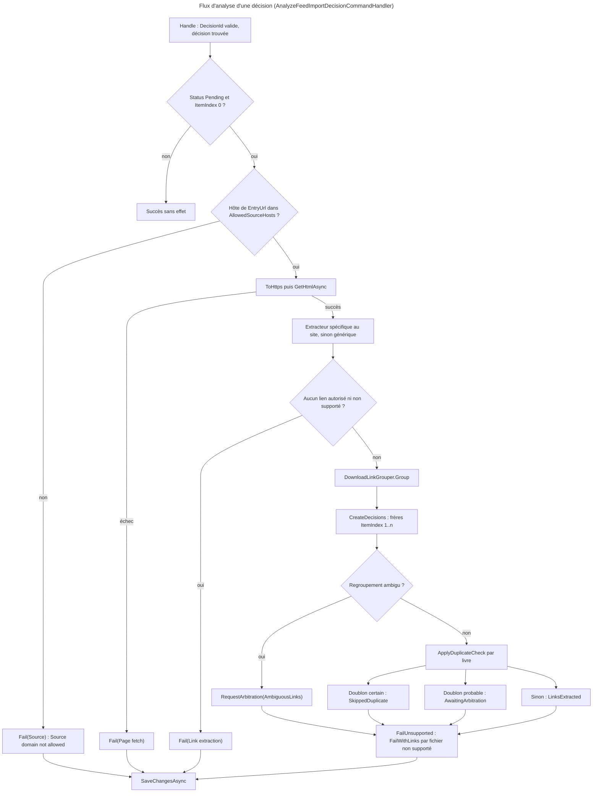
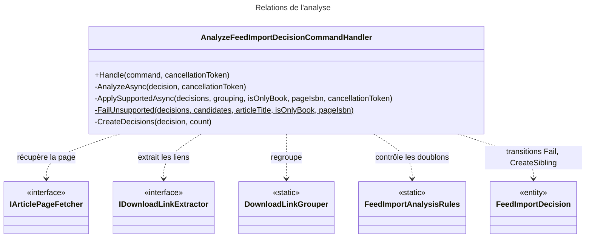

# C4 Code Level : FeedImports / Analyze

## Vue d'ensemble

- **Nom** : `Application.FeedImports.Analyze`
- **Description** : Cas d'usage qui analyse une décision `Pending` : vérification du domaine source, récupération de la page, extraction et regroupement des liens, contrôle des doublons, création des décisions « frères » pour les articles qui contiennent plusieurs livres.
- **Emplacement relatif** : [Application/FeedImports/Analyze](../Application/FeedImports/Analyze)
- **Langage** : C# (.NET 10), CQRS (`ICommand`, `ICommandHandler`), Ardalis.GuardClauses, `IOptions<T>`, `ILogger<T>`.
- **Objectif** : Faire passer une décision de `Pending` à `LinksExtracted`, `AwaitingArbitration`, `SkippedDuplicate` ou `Failed`. Ce cas d'usage ne télécharge rien. Il est appelé par le job `FeedImportSyncJob` (Web) juste après la synchronisation.

## Éléments de code

### Commandes

#### AnalyzeFeedImportDecisionCommand

- Fichier : [AnalyzeFeedImportDecisionCommand.cs:5](../Application/FeedImports/Analyze/AnalyzeFeedImportDecisionCommand.cs#L5)
- Signature : `public record AnalyzeFeedImportDecisionCommand(Guid DecisionId) : ICommand;`

### Handlers

#### AnalyzeFeedImportDecisionCommandHandler

- Fichier : [AnalyzeFeedImportDecisionCommandHandler.cs:16-210](../Application/FeedImports/Analyze/AnalyzeFeedImportDecisionCommandHandler.cs#L16)
- Déclaration : `public sealed class AnalyzeFeedImportDecisionCommandHandler(...) : ICommandHandler<AnalyzeFeedImportDecisionCommand>`
- Constructeur (dépendances primaires) :
  - `IFeedImportDecisionRepository decisionRepository`
  - `IArticlePageFetcher pageFetcher`
  - `IEnumerable<IDownloadLinkExtractor> extractors` (lignes 17-19)
  - `IBookReadService bookReadService`
  - `IUnitOfWork unitOfWork`
  - `IOptions<FeedImportSettings> feedImportSettings`
  - `ILogger<AnalyzeFeedImportDecisionCommandHandler> logger` (lignes 20-23)
- Constantes (noms des étapes d'échec, stockés dans `ErrorStep`) :
  - `public const string SourceStep = "Source";` ([ligne 25](../Application/FeedImports/Analyze/AnalyzeFeedImportDecisionCommandHandler.cs#L25))
  - `public const string FetchStep = "Page fetch";` ([ligne 26](../Application/FeedImports/Analyze/AnalyzeFeedImportDecisionCommandHandler.cs#L26))
  - `public const string ExtractionStep = "Link extraction";` ([ligne 27](../Application/FeedImports/Analyze/AnalyzeFeedImportDecisionCommandHandler.cs#L27))

Méthodes :

- `public async Task<Result> Handle(AnalyzeFeedImportDecisionCommand command, CancellationToken cancellationToken)` ([lignes 29-57](../Application/FeedImports/Analyze/AnalyzeFeedImportDecisionCommandHandler.cs#L29))
  - Description : valide `DecisionId` (`FeedImportError.BadRequest`), charge la décision (`NotFound`), ne fait rien si elle n'est pas `Pending` ou si ce n'est pas le livre d'index 0 (idempotence), appelle `AnalyzeAsync`, puis `SaveChangesAsync`.
- `private async Task<Result> AnalyzeAsync(FeedImportDecision decision, CancellationToken cancellationToken)` ([lignes 59-102](../Application/FeedImports/Analyze/AnalyzeFeedImportDecisionCommandHandler.cs#L59))
  - Description : enchaîne les étapes (détail dans le diagramme). Un échec de page ou d'extraction est enregistré via `decision.Fail` et journalisé en avertissement pour la page non récupérée.
- `private static int CountSupportedDecisions(LinkGroupingResult? grouping)` ([lignes 105-113](../Application/FeedImports/Analyze/AnalyzeFeedImportDecisionCommandHandler.cs#L105))
  - Description : nombre de décisions pour les liens autorisés ; un regroupement ambigu reste sur une seule décision.
- `private static IReadOnlyList<DownloadCandidate> GroupUnsupportedLinks(ArticleExtraction extraction, string articleTitle)` ([lignes 118-128](../Application/FeedImports/Analyze/AnalyzeFeedImportDecisionCommandHandler.cs#L118))
  - Description : regroupe les fichiers proposés uniquement sur des hébergeurs non autorisés. Un fichier aussi servi par un hébergeur autorisé est ignoré, et rien n'est signalé si un lien autorisé n'a pas de nom de fichier.
- `private Result<List<FeedImportDecision>> CreateDecisions(FeedImportDecision decision, int count)` ([lignes 131-146](../Application/FeedImports/Analyze/AnalyzeFeedImportDecisionCommandHandler.cs#L131))
  - Description : la décision d'origine garde le premier livre ; chaque autre livre crée un frère (`CreateSibling(i)`) ajouté au dépôt.
- `private async Task<Result> ApplySupportedAsync(List<FeedImportDecision> decisions, LinkGroupingResult? grouping, bool isOnlyBook, string? pageIsbn, CancellationToken cancellationToken)` ([lignes 148-181](../Application/FeedImports/Analyze/AnalyzeFeedImportDecisionCommandHandler.cs#L148))
  - Description : ambigu → `RequestArbitration(AmbiguousLinks)` sur la première décision ; sinon charge les identités des livres de l'utilisateur et applique `ApplyDuplicateCheck` à chaque candidat.
- `private static Result FailUnsupported(List<FeedImportDecision> decisions, IReadOnlyList<DownloadCandidate> candidates, string articleTitle, bool isOnlyBook, string? pageIsbn)` ([lignes 184-205](../Application/FeedImports/Analyze/AnalyzeFeedImportDecisionCommandHandler.cs#L184))
  - Description : `FailWithLinks` avec le message `DownloadHostNotSupported` et la liste des hôtes : les liens sont gardés pour un téléchargement manuel.
- `private static Uri ToHttps(Uri uri)` ([lignes 207-209](../Application/FeedImports/Analyze/AnalyzeFeedImportDecisionCommandHandler.cs#L207)) : force HTTPS (les liens du flux sont souvent en `http://`).

## Dépendances

### Dépendances internes

- `Application.Abstractions.Messaging` : `ICommand`, `ICommandHandler`.
- `Application.Interfaces` : `IFeedImportDecisionRepository`, `IBookReadService`, `IUnitOfWork`.
- `Application.FeedImports` : `IArticlePageFetcher`, `IDownloadLinkExtractor`, `FeedImportSettings`.
- `Application.FeedImports.Analysis` : `DownloadLinkGrouper`, `FeedImportAnalysisRules`, `LinkGroupingResult`, `ArticleExtraction`.
- `Domain.FeedImports` : `FeedImportDecision`, `FeedImportDecisionStatus`, `FeedImportError`, `DownloadCandidate`, `ComicTitleParser` / `ParsedComicTitle`.
- `Domain.Extensions` : `IsSameOrSubdomainOf`.
- `Domain.Primitives` : `Result`.

### Dépendances externes

- `Ardalis.GuardClauses` : `Guard.Against.Null`.
- `Microsoft.Extensions.Options` : `IOptions<FeedImportSettings>`.
- `Microsoft.Extensions.Logging` : `ILogger<T>`.

## Relations

## Notes

- **Ordre des effets de bord** : les frères sont ajoutés au dépôt (`decisionRepository.Add`) avant `ApplySupportedAsync`. Si une transition échoue, rien n'est enregistré (`SaveChanges` n'est pas appelé) ; la décision reste `Pending` et sera réanalysée à la synchronisation suivante.
- **Livres d'un même article** : la liste `books` est lue une seule fois avant la boucle. Deux livres d'un même article ne se comparent donc pas entre eux.
- **Messages en anglais** : les messages d'échec et de décision (`"No link to an allowed host (FeedImport:AllowedDownloadHosts)."`, `"Ambiguous grouping ..."`) sont en anglais, comme le reste des messages persistés.
- **Idempotence** : un appel sur une décision déjà analysée, ou sur un frère (`ItemIndex != 0`), renvoie un succès sans modification.
- **Garde de validation** : `DecisionId` vide est rejeté avant tout accès au dépôt, conformément à la règle CLAUDE.md.
- L'extracteur générique est obtenu par `extractors.First(e => e.IsFallback)` : il doit toujours être enregistré (c'est le cas dans `ApplicationDependencyInjection.cs`).
