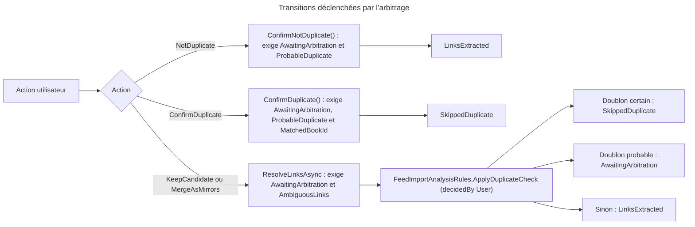
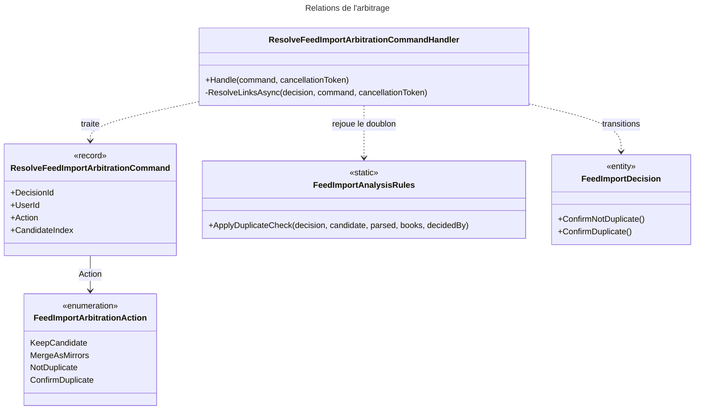

# C4 Code Level : FeedImports / Arbitrate

## Vue d'ensemble

- **Nom** : `Application.FeedImports.Arbitrate`
- **Description** : Cas d'usage de l'arbitrage manuel d'une décision en attente (`AwaitingArbitration`) : choix du bon lien parmi des candidats ambigus, fusion de liens en miroirs, confirmation ou infirmation d'un doublon probable.
- **Emplacement relatif** : [Application/FeedImports/Arbitrate](../Application/FeedImports/Arbitrate)
- **Langage** : C# (.NET 10), CQRS, Ardalis.GuardClauses.
- **Objectif** : Permettre à l'utilisateur de trancher les cas que l'analyse automatique ne sait pas résoudre, puis rejouer la vérification de doublon sur le lien choisi. L'action vient de la page Feeds (`FeedImportService`, Web).

## Éléments de code

### Énumérations

#### FeedImportArbitrationAction

- Fichier : [FeedImportArbitrationAction.cs:3-9](../Application/FeedImports/Arbitrate/FeedImportArbitrationAction.cs#L3)
- Valeurs :
  - `KeepCandidate` : liens ambigus, ne garder que le groupe choisi (index `CandidateIndex`).
  - `MergeAsMirrors` : liens ambigus, tous les liens sont des miroirs du même fichier.
  - `NotDuplicate` : doublon probable, c'est un autre livre ; le traitement continue.
  - `ConfirmDuplicate` : doublon probable, c'est le même livre ; le livre est ignoré.

### Commandes

#### ResolveFeedImportArbitrationCommand

- Fichier : [ResolveFeedImportArbitrationCommand.cs:5-9](../Application/FeedImports/Arbitrate/ResolveFeedImportArbitrationCommand.cs#L5)
- Signature : `public record ResolveFeedImportArbitrationCommand(Guid DecisionId, Guid UserId, FeedImportArbitrationAction Action, int? CandidateIndex = null) : ICommand;`

### Handlers

#### ResolveFeedImportArbitrationCommandHandler

- Fichier : [ResolveFeedImportArbitrationCommandHandler.cs:10-76](../Application/FeedImports/Arbitrate/ResolveFeedImportArbitrationCommandHandler.cs#L10)
- Déclaration : `public sealed class ResolveFeedImportArbitrationCommandHandler(...) : ICommandHandler<ResolveFeedImportArbitrationCommand>`
- Constructeur :
  - `IFeedImportDecisionRepository decisionRepository` (ligne 11)
  - `IBookReadService bookReadService` (ligne 12)
  - `IUnitOfWork unitOfWork` (ligne 13)

Méthodes :

- `public async Task<Result> Handle(ResolveFeedImportArbitrationCommand command, CancellationToken cancellationToken)` ([lignes 15-43](../Application/FeedImports/Arbitrate/ResolveFeedImportArbitrationCommandHandler.cs#L15))
  - Description : valide les identifiants, l'énumération et l'index (`KeepCandidate` exige un index non négatif) ; charge la décision et vérifie qu'elle appartient à l'utilisateur ; applique `NotDuplicate` / `ConfirmDuplicate` au domaine ou délègue à `ResolveLinksAsync` ; enregistre.
- `private async Task<Result> ResolveLinksAsync(FeedImportDecision decision, ResolveFeedImportArbitrationCommand command, CancellationToken cancellationToken)` ([lignes 45-75](../Application/FeedImports/Arbitrate/ResolveFeedImportArbitrationCommandHandler.cs#L45))
  - Description : exige le statut `AwaitingArbitration` et le type `AmbiguousLinks` (sinon `InvalidStatusTransition`). Pour `KeepCandidate`, prend le candidat à l'index (borné, sinon `BadRequest`). Pour `MergeAsMirrors`, fusionne les candidats : premier nom de fichier et première taille connus, miroirs dédoublonnés par URL. Puis charge les livres de l'utilisateur, parse le candidat (`isOnlyBookOfArticle: true`) et applique `ApplyDuplicateCheck` avec `FeedImportDecidedBy.User`.

## Dépendances

### Dépendances internes

- `Application.Abstractions.Messaging` : `ICommand`, `ICommandHandler`.
- `Application.Interfaces` : `IFeedImportDecisionRepository`, `IBookReadService`, `IUnitOfWork`.
- `Application.FeedImports.Analysis` : `FeedImportAnalysisRules` (parsing, contrôle de doublon).
- `Domain.FeedImports` : `FeedImportDecision`, `FeedImportDecisionStatus`, `FeedImportArbitrationKind`, `FeedImportDecidedBy`, `DownloadCandidate`, `FeedImportError`.
- `Domain.Primitives` : `Result`.
- Appelants : `FeedImportService` (couche Web, action « Arbitrer » de la page Feeds).

### Dépendances externes

- `Ardalis.GuardClauses` : `Guard.Against.Null`.

## Relations

## Notes

- **Contrôle de propriété** : la décision doit appartenir à `UserId`, sinon `NotFound` (même réponse qu'une décision inexistante, ce qui évite de révéler son existence).
- **Contrôle des transitions** : `NotDuplicate` et `ConfirmDuplicate` ne vérifient pas le type de l'arbitrage dans le handler ; c'est le domaine (`ArbitrationKind == ProbableDuplicate`) qui refuse une action incohérente.
- **Index de candidat** : la borne supérieure est vérifiée après l'état de la décision ; un index hors borne renvoie `BadRequest`.
- La fusion `MergeAsMirrors` ne compare pas les noms de fichiers des candidats : tous les liens sont supposés être le même fichier, ce que confirme l'utilisateur.
