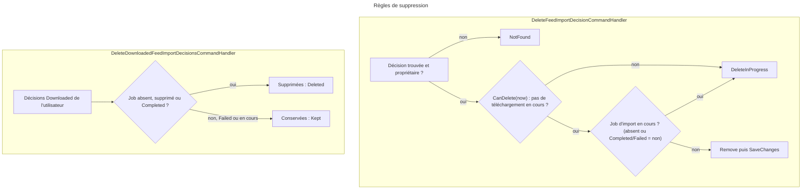
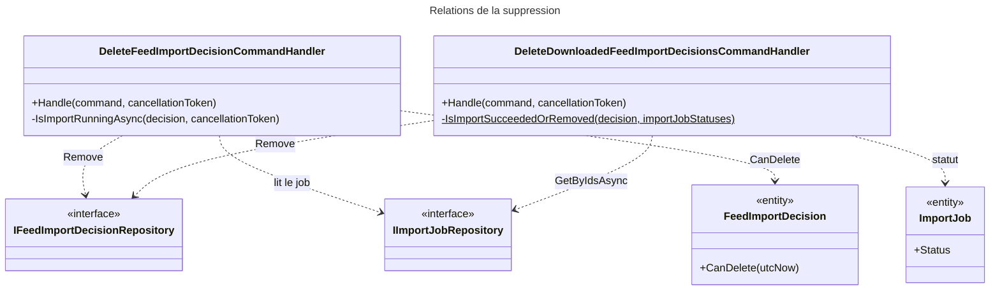

# C4 Code Level : FeedImports / Delete

## Vue d'ensemble

- **Nom** : `Application.FeedImports.Delete`
- **Description** : Cas d'usage de suppression des décisions d'import, unitaire ou en masse pour les décisions déjà téléchargées.
- **Emplacement relatif** : [Application/FeedImports/Delete](../Application/FeedImports/Delete)
- **Langage** : C# (.NET 10), CQRS, Ardalis.GuardClauses, `TimeProvider`.
- **Objectif** : Retirer les décisions de la liste Feeds sans toucher aux livres importés. Une suppression est refusée tant qu'un téléchargement ou un import est en cours, afin qu'un échec reste visible.

## Éléments de code

### Commandes et résultats

#### DeleteFeedImportDecisionCommand

- Fichier : [DeleteFeedImportDecisionCommand.cs:5](../Application/FeedImports/Delete/DeleteFeedImportDecisionCommand.cs#L5)
- Signature : `public record DeleteFeedImportDecisionCommand(Guid DecisionId, Guid UserId) : ICommand;`

#### DeleteDownloadedFeedImportDecisionsCommand

- Fichier : [DeleteDownloadedFeedImportDecisionsCommand.cs:5](../Application/FeedImports/Delete/DeleteDownloadedFeedImportDecisionsCommand.cs#L5)
- Signature : `public record DeleteDownloadedFeedImportDecisionsCommand(Guid UserId) : ICommand<DeleteDownloadedFeedImportDecisionsResult>;`

#### DeleteDownloadedFeedImportDecisionsResult

- Fichier : [DeleteDownloadedFeedImportDecisionsResult.cs:3](../Application/FeedImports/Delete/DeleteDownloadedFeedImportDecisionsResult.cs#L3)
- Signature : `public sealed record DeleteDownloadedFeedImportDecisionsResult(int Deleted, int Kept);`
- Description : nombre de décisions supprimées et nombre de décisions conservées (import en cours ou en échec).

### Handlers

#### DeleteFeedImportDecisionCommandHandler

- Fichier : [DeleteFeedImportDecisionCommandHandler.cs:13-54](../Application/FeedImports/Delete/DeleteFeedImportDecisionCommandHandler.cs#L13)
- Déclaration : `public sealed class DeleteFeedImportDecisionCommandHandler(...) : ICommandHandler<DeleteFeedImportDecisionCommand>`
- Constructeur :
  - `IFeedImportDecisionRepository decisionRepository` (ligne 14)
  - `IImportJobRepository importJobRepository` (ligne 15)
  - `IUnitOfWork unitOfWork` (ligne 16)
  - `TimeProvider timeProvider` (ligne 17)

Méthodes :

- `public async Task<Result> Handle(DeleteFeedImportDecisionCommand command, CancellationToken cancellationToken)` ([lignes 19-41](../Application/FeedImports/Delete/DeleteFeedImportDecisionCommandHandler.cs#L19))
  - Description : valide les identifiants (`BadRequest`), charge la décision et vérifie le propriétaire (`NotFound`), refuse si `CanDelete(now)` est faux ou si un import est en cours (`DeleteInProgress`), puis supprime et enregistre. Les événements sont supprimés en cascade.
- `private async Task<bool> IsImportRunningAsync(FeedImportDecision decision, CancellationToken cancellationToken)` ([lignes 44-53](../Application/FeedImports/Delete/DeleteFeedImportDecisionCommandHandler.cs#L44))
  - Description : `false` sans `ImportJobId` ou si le job a été supprimé de la page Import ; `true` si le job existe et n'est ni `Completed` ni `Failed`.

#### DeleteDownloadedFeedImportDecisionsCommandHandler

- Fichier : [DeleteDownloadedFeedImportDecisionsCommandHandler.cs:13-61](../Application/FeedImports/Delete/DeleteDownloadedFeedImportDecisionsCommandHandler.cs#L13)
- Déclaration : `public sealed class DeleteDownloadedFeedImportDecisionsCommandHandler(...) : ICommandHandler<DeleteDownloadedFeedImportDecisionsCommand, DeleteDownloadedFeedImportDecisionsResult>`
- Constructeur :
  - `IFeedImportDecisionRepository decisionRepository` (ligne 14)
  - `IImportJobRepository importJobRepository` (ligne 15)
  - `IUnitOfWork unitOfWork` (ligne 16)

Méthodes :

- `public async Task<Result<DeleteDownloadedFeedImportDecisionsResult>> Handle(DeleteDownloadedFeedImportDecisionsCommand command, CancellationToken cancellationToken)` ([lignes 18-55](../Application/FeedImports/Delete/DeleteDownloadedFeedImportDecisionsCommandHandler.cs#L18))
  - Description : charge les décisions `Downloaded` de l'utilisateur, récupère le statut de leurs jobs d'import en un seul appel, ne garde que celles à supprimer, supprime et enregistre. Renvoie `(Deleted, Kept)`.
- `private static bool IsImportSucceededOrRemoved(FeedImportDecision decision, Dictionary<Guid, ImportJobStatus> importJobStatuses)` ([lignes 57-60](../Application/FeedImports/Delete/DeleteDownloadedFeedImportDecisionsCommandHandler.cs#L57))
  - Description : supprimable si la décision n'a pas de job, si le job n'existe plus, ou si son statut est `Completed`.

## Dépendances

### Dépendances internes

- `Application.Abstractions.Messaging` : `ICommand`, `ICommandHandler`.
- `Application.Interfaces` : `IFeedImportDecisionRepository`, `IImportJobRepository`, `IUnitOfWork`.
- `Domain.FeedImports` : `FeedImportDecision`, `FeedImportDecisionStatus`, `FeedImportError`.
- `Domain.ImportJobs` : `ImportJobStatus`.
- `Domain.Primitives` : `Result`.

### Dépendances externes

- `Ardalis.GuardClauses` : `Guard.Against.Null`.
- `System.TimeProvider` : horloge injectée (`GetUtcNow()`), utilisée pour l'échéance de téléchargement bloqué.

## Relations

## Notes

- **Livres intacts** : aucun handler ne touche à la bibliothèque. Les livres importés restent.
- **Échecs visibles** : un job en `Failed` ne bloque pas la suppression unitaire, mais la suppression en masse conserve la décision pour que l'échec reste affiché.
- **Multi-livres** : chaque livre d'un article est une décision séparée ; supprimer l'un ne supprime pas les autres.
- **Miniflux** : l'article a déjà été désétoilé lors de la synchronisation. Il ne sera réimporté que s'il est de nouveau étoilé.
- **Requête groupée** : la suppression en masse appelle `GetByIdsAsync` une seule fois (pas de requête par décision).
- **Ordre des vérifications** : `CanDelete` est testé avant `IsImportRunningAsync`, donc aucune requête sur le job n'est faite pour un téléchargement encore en cours.
