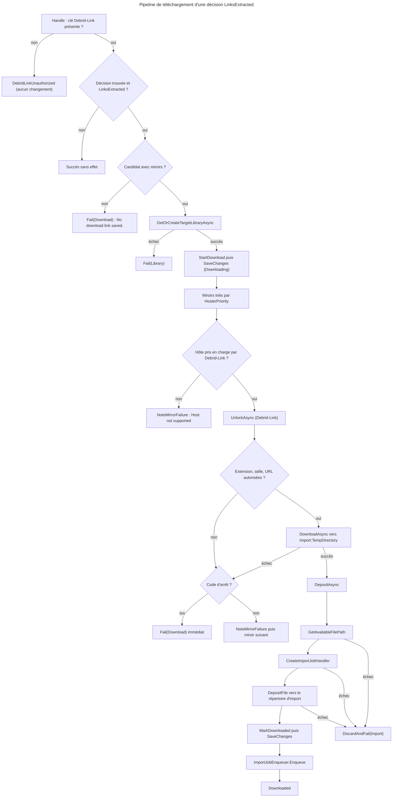
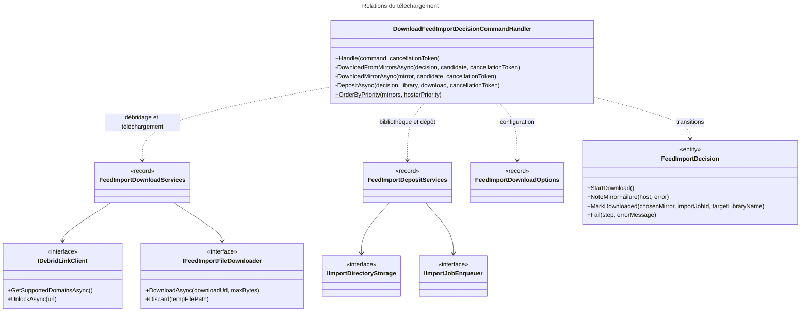

# C4 Code Level : FeedImports / Download

## Vue d'ensemble

- **Nom** : `Application.FeedImports.Download`
- **Description** : Cas d'usage qui télécharge un livre extrait d'un article : débridage d'un miroir avec Debrid-Link, téléchargement en flux dans le répertoire temporaire, création de l'`ImportJob` et dépôt du fichier dans le dossier d'import de la bibliothèque « À trier ».
- **Emplacement relatif** : [Application/FeedImports/Download](../Application/FeedImports/Download)
- **Langage** : C# (.NET 10), CQRS, Ardalis.GuardClauses, `ILogger<T>`, `IOptions<T>`.
- **Objectif** : Faire passer une décision de `LinksExtracted` à `Downloaded` (ou `Failed`). Le handler est appelé par `FeedImportDownloadJob` (Web), un job Hangfire lancé à la fin d'une synchronisation ou après une action manuelle.

## Éléments de code

### Commandes

#### DownloadFeedImportDecisionCommand

- Fichier : [DownloadFeedImportDecisionCommand.cs:5](../Application/FeedImports/Download/DownloadFeedImportDecisionCommand.cs#L5)
- Signature : `public record DownloadFeedImportDecisionCommand(Guid DecisionId) : ICommand;`

### Handlers

#### DownloadFeedImportDecisionCommandHandler

- Fichier : [DownloadFeedImportDecisionCommandHandler.cs:18-311](../Application/FeedImports/Download/DownloadFeedImportDecisionCommandHandler.cs#L18)
- Déclaration : `public sealed class DownloadFeedImportDecisionCommandHandler(...) : ICommandHandler<DownloadFeedImportDecisionCommand>`
- Constructeur :
  - `IFeedImportDecisionRepository decisionRepository` (ligne 19)
  - `IUnitOfWork unitOfWork` (ligne 20)
  - `FeedImportDownloadServices downloadServices` (ligne 21)
  - `FeedImportDepositServices depositServices` (ligne 22)
  - `FeedImportDownloadOptions options` (ligne 23)
  - `ILogger<DownloadFeedImportDecisionCommandHandler> logger` (ligne 24)
- Constantes :
  - `LibraryStep = "Library"`, `DownloadStep = "Download"`, `ImportStep = "Import"` ([lignes 26-28](../Application/FeedImports/Download/DownloadFeedImportDecisionCommandHandler.cs#L26))
  - `TargetLibraryColor = "#5C6BC0"`, `TargetLibraryIcon = "CollectionsBookmark"` ([lignes 30-31](../Application/FeedImports/Download/DownloadFeedImportDecisionCommandHandler.cs#L30))
  - `private static readonly HashSet<string> s_stopCodes` ([lignes 34-40](../Application/FeedImports/Download/DownloadFeedImportDecisionCommandHandler.cs#L34)) : codes d'erreur qui se reproduiraient sur chaque miroir (`DebridLinkUnauthorized`, `DebridLinkQuotaReached`, `FileTooLarge`, `UnsupportedFileType`). Ils arrêtent la boucle sur les miroirs.
- Record privé : `private sealed record MirrorDownload(DownloadMirror Mirror, string FileName, DownloadedFile File)` ([ligne 310](../Application/FeedImports/Download/DownloadFeedImportDecisionCommandHandler.cs#L310))

Méthodes :

- `public async Task<Result> Handle(DownloadFeedImportDecisionCommand command, CancellationToken cancellationToken)` ([lignes 42-99](../Application/FeedImports/Download/DownloadFeedImportDecisionCommandHandler.cs#L42))
  - Description : valide l'identifiant ; refuse sans clé Debrid-Link (`DebridLinkUnauthorized`, aucun changement d'état) ; charge la décision ; ne fait rien si elle n'est pas `LinksExtracted` ; échoue à l'étape *Download* sans miroir ; obtient ou crée la bibliothèque ; appelle `StartDownload` puis enregistre ; télécharge ; dépose le fichier.
- `private async Task<Result<Library>> GetOrCreateTargetLibraryAsync(Guid userId, CancellationToken cancellationToken)` ([lignes 101-126](../Application/FeedImports/Download/DownloadFeedImportDecisionCommandHandler.cs#L101))
  - Description : cherche la bibliothèque `FeedImport:TargetLibraryName` ; si absente, la crée (type numérique, couleur et icône constantes) ; si elle existe mais n'est pas numérique, renvoie `TargetLibraryInvalid` ; s'assure que son répertoire d'import existe.
- `private async Task<Result<MirrorDownload>> DownloadFromMirrorsAsync(FeedImportDecision decision, DownloadCandidate candidate, CancellationToken cancellationToken)` ([lignes 128-158](../Application/FeedImports/Download/DownloadFeedImportDecisionCommandHandler.cs#L128))
  - Description : essaie les miroirs utilisables dans l'ordre. Un échec non fatal est tracé par `NoteMirrorFailure` puis le miroir suivant est tenté. Un code de `s_stopCodes` arrête immédiatement la boucle.
- `private async Task<IReadOnlyList<DownloadMirror>> GetUsableMirrorsAsync(FeedImportDecision decision, IReadOnlyList<DownloadMirror> mirrors, CancellationToken cancellationToken)` ([lignes 161-178](../Application/FeedImports/Download/DownloadFeedImportDecisionCommandHandler.cs#L161))
  - Description : trie par priorité, puis garde les hôtes listés par `GetSupportedDomainsAsync`. Les autres sont tracés comme « Host not supported ». Si la liste de domaines est indisponible, tous les miroirs sont tentés.
- `public static IReadOnlyList<DownloadMirror> OrderByPriority(IReadOnlyList<DownloadMirror> mirrors, IReadOnlyList<string> hosterPriority)` ([lignes 180-200](../Application/FeedImports/Download/DownloadFeedImportDecisionCommandHandler.cs#L180))
  - Description : rang = index du premier domaine de priorité correspondant (sous-domaines compris), sinon nombre de domaines de priorité. `OrderBy` est stable : à rang égal, l'ordre de la page est conservé.
- `private async Task<Result<MirrorDownload>> DownloadMirrorAsync(DownloadMirror mirror, DownloadCandidate candidate, CancellationToken cancellationToken)` ([lignes 202-237](../Application/FeedImports/Download/DownloadFeedImportDecisionCommandHandler.cs#L202))
  - Description : débride le lien (`UnlockAsync`), vérifie l'extension (`Import:SupportedExtensions`), la taille annoncée (`Import:MaxFileSizeMb`, ignorée si la taille est inconnue), puis l'URL de téléchargement (HTTPS et domaine autorisé), et télécharge le fichier avec la limite de taille.
- `private bool IsAllowedDownloadUrl(Uri downloadUrl)` ([lignes 239-245](../Application/FeedImports/Download/DownloadFeedImportDecisionCommandHandler.cs#L239)) : HTTPS et hôte égal ou sous-domaine de `FeedImport:AllowedDownloadHosts` ou `DebridLink:DownloadHosts`.
- `private async Task<Result> DepositAsync(FeedImportDecision decision, Library library, MirrorDownload download, CancellationToken cancellationToken)` ([lignes 247-288](../Application/FeedImports/Download/DownloadFeedImportDecisionCommandHandler.cs#L247))
  - Description : choisit un chemin libre dans le répertoire d'import, crée l'`ImportJob`, dépose le fichier (`DepositFile`), marque la décision `Downloaded`, enregistre, puis met le job en file (`ImportJobEnqueuer.Enqueue`). Voir la note sur l'ordre des opérations.
- `private async Task<Result> DiscardAndFailAsync(FeedImportDecision decision, MirrorDownload download, TError error, CancellationToken cancellationToken)` ([lignes 290-295](../Application/FeedImports/Download/DownloadFeedImportDecisionCommandHandler.cs#L290)) : supprime le fichier temporaire puis passe à l'échec à l'étape *Import*.
- `private async Task<Result> FailAsync(FeedImportDecision decision, string step, string message, CancellationToken cancellationToken)` ([lignes 298-308](../Application/FeedImports/Download/DownloadFeedImportDecisionCommandHandler.cs#L298)) : `decision.Fail` puis enregistrement. L'échec est une donnée de la décision, la commande renvoie donc un succès.

#### FeedImportDepositServices

- Fichier : [FeedImportDepositServices.cs:13-18](../Application/FeedImports/Download/FeedImportDepositServices.cs#L13)
- Signature : `public sealed record FeedImportDepositServices(ILibraryReadService LibraryReadService, ICommandHandler<CreateLibraryCommand, Library> CreateLibraryHandler, IImportDirectoryStorage ImportDirectoryStorage, ICommandHandler<CreateImportJobCommand, ImportJob> CreateImportJobHandler, IImportJobEnqueuer ImportJobEnqueuer);`
- Description : regroupe les services de remise du fichier au pipeline d'import.

#### FeedImportDownloadOptions

- Fichier : [FeedImportDownloadOptions.cs:6-9](../Application/FeedImports/Download/FeedImportDownloadOptions.cs#L6)
- Signature : `public sealed record FeedImportDownloadOptions(IOptions<FeedImportSettings> FeedImport, IOptions<DebridLinkSettings> DebridLink, IOptions<ImportSettings> Import);`

#### FeedImportDownloadServices

- Fichier : [FeedImportDownloadServices.cs:4](../Application/FeedImports/Download/FeedImportDownloadServices.cs#L4)
- Signature : `public sealed record FeedImportDownloadServices(IDebridLinkClient DebridLinkClient, IFeedImportFileDownloader FileDownloader);`
- Description : services de récupération du fichier (débridage et téléchargement).

## Dépendances

### Dépendances internes

- `Application.Abstractions.Messaging` : `ICommand`, `ICommandHandler`.
- `Application.Interfaces` : `IFeedImportDecisionRepository`, `IUnitOfWork`, `IImportJobEnqueuer`.
- `Application.ImportJobs` : `IImportDirectoryStorage`, `ImportSettings`.
- `Application.Libraries` : `ILibraryReadService`.
- `Application.FeedImports` : `IDebridLinkClient`, `IFeedImportFileDownloader`, `DownloadedFile`, `DebridLinkFile`, `FeedImportSettings`, `DebridLinkSettings`.
- `Application.ImportJobs` / `Application.ImportJobs.Create` : `ImportSettings`, `CreateImportJobCommand`.
- `Application.Libraries` / `Application.Libraries.Create` : `CreateLibraryCommand`, `ILibraryReadService`.
- `Application.FeedImports.Analysis` : aucune dépendance directe ; les candidats viennent du domaine.
- `Domain.FeedImports` : `FeedImportDecision`, `FeedImportDecisionStatus`, `FeedImportError`, `DownloadCandidate`, `DownloadMirror`.
- `Domain.Libraries` : `Library`, `LibraryBookType`.
- `Domain.ImportJobs` : `ImportJob`.
- `Domain.Extensions` : `IsSameOrSubdomainOf`.
- `Domain.Primitives` : `Result`, `TError`.

### Dépendances externes

- `Ardalis.GuardClauses` : `Guard.Against.Null`.
- `Microsoft.Extensions.Logging` : `ILogger<T>`.
- `Microsoft.Extensions.Options` : `IOptions<T>`, via les records d'options.

## Relations

## Notes

- **Ordre des effets de bord (à corriger)** : dans `DepositAsync`, `decision.MarkDownloaded(...)` (validation domaine, lignes 272-276) est appelé **après** `storage.DepositFile(...)` (effet sur le système de fichiers, ligne 265). La règle CLAUDE.md impose que toutes les validations précèdent tout effet sur le système de fichiers. En cas d'échec de `MarkDownloaded`, le handler renvoie l'erreur sans passer par `FailAsync` : le fichier est déjà dans le répertoire d'import, le job est créé, et la décision reste `Downloading` en base. Un `Retry` ultérieur téléchargerait alors le fichier une seconde fois. Ce cas est peu probable car les préconditions sont garanties par le flux, mais l'ordre doit être corrigé (valider d'abord, déposer ensuite).
- **Création de bibliothèque avant `StartDownload`** : la bibliothèque et son répertoire sont créés avant le passage en `Downloading`. Ces effets sont idempotents et ne touchent pas à un fichier de l'utilisateur.
- **Taille inconnue** : si Debrid-Link ne renvoie pas la taille (`SizeBytes` null), le contrôle `FileTooLarge` est sauté ; la limite est alors appliquée pendant le flux par `DownloadAsync(maxBytes)`.
- **Quota par hôte** : `DebridLinkHostQuotaReached` n'est pas dans `s_stopCodes` : seul ce miroir est abandonné et le suivant est tenté. Le quota global (`DebridLinkQuotaReached`) arrête la boucle.
- **Miroirs non retenus** : un miroir non pris en charge par Debrid-Link est tracé mais ne consomme aucun quota.
- **Messages persistés en anglais** : `"No download link saved."`, `"Downloading through Debrid-Link."` et les codes d'erreur sont stockés tels quels.
- **Filet de sécurité** : `ImportJobEnqueuer.Enqueue` n'est appelé qu'après `SaveChanges`. Le job est créé avant le dépôt pour que le `FileWatcher` retrouve un job actif et n'en crée pas un second.
