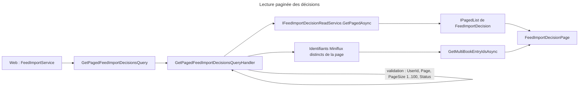
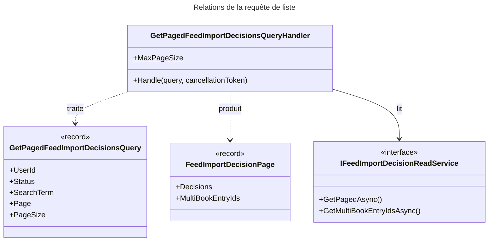

# C4 Code Level : FeedImports / List

## Vue d'ensemble

- **Nom** : `Application.FeedImports.List`
- **Description** : Requête de lecture paginée des décisions d'import de l'utilisateur, filtrables par statut et par texte.
- **Emplacement relatif** : [Application/FeedImports/List](../Application/FeedImports/List)
- **Langage** : C# (.NET 10), CQRS (`IQuery`, `IQueryHandler`), Ardalis.GuardClauses.
- **Objectif** : Alimenter la page Feeds (`/feed-imports`) avec une page de décisions et l'ensemble des entrées Miniflux qui ont été découpées en plusieurs livres, pour les regrouper visuellement.

## Éléments de code

### Requêtes et résultats

#### GetPagedFeedImportDecisionsQuery

- Fichier : [GetPagedFeedImportDecisionsQuery.cs:6-11](../Application/FeedImports/List/GetPagedFeedImportDecisionsQuery.cs#L6)
- Signature : `public record GetPagedFeedImportDecisionsQuery(Guid UserId, FeedImportDecisionStatus? Status, string? SearchTerm, int Page, int PageSize) : IQuery<FeedImportDecisionPage>;`

#### FeedImportDecisionPage

- Fichier : [FeedImportDecisionPage.cs:7](../Application/FeedImports/List/FeedImportDecisionPage.cs#L7)
- Signature : `public sealed record FeedImportDecisionPage(IPagedList<FeedImportDecision> Decisions, IReadOnlySet<long> MultiBookEntryIds);`
- Description : une page de décisions. `MultiBookEntryIds` contient les identifiants d'entrées Miniflux présentes sur la page qui ont été découpées en plusieurs livres.

### Handlers

#### GetPagedFeedImportDecisionsQueryHandler

- Fichier : [GetPagedFeedImportDecisionsQueryHandler.cs:9-35](../Application/FeedImports/List/GetPagedFeedImportDecisionsQueryHandler.cs#L9)
- Déclaration : `public sealed class GetPagedFeedImportDecisionsQueryHandler(IFeedImportDecisionReadService readService) : IQueryHandler<GetPagedFeedImportDecisionsQuery, FeedImportDecisionPage>`
- Constante : `public const int MaxPageSize = 100;` ([ligne 12](../Application/FeedImports/List/GetPagedFeedImportDecisionsQueryHandler.cs#L12))

Méthodes :

- `public async Task<Result<FeedImportDecisionPage>> Handle(GetPagedFeedImportDecisionsQuery query, CancellationToken cancellationToken)` ([lignes 14-34](../Application/FeedImports/List/GetPagedFeedImportDecisionsQueryHandler.cs#L14))
  - Description : rejette (`BadRequest`) un `UserId` vide, une page < 1, une taille hors de 1..100 ou un statut hors énumération. Appelle `GetPagedAsync` avec le terme de recherche rogné, puis `GetMultiBookEntryIdsAsync` pour les identifiants d'entrées Miniflux distincts de la page.

## Dépendances

### Dépendances internes

- `Application.Abstractions.Messaging` : `IQuery`, `IQueryHandler`.
- `Application.Interfaces` : `IFeedImportDecisionReadService` (méthodes `GetPagedAsync` et `GetMultiBookEntryIdsAsync`), `IPagedList<T>`.
- `Domain.FeedImports` : `FeedImportDecision`, `FeedImportDecisionStatus`, `FeedImportError`.
- `Domain.Primitives` : `Result`.
- Implémentation : `FeedImportDecisionReadService` (couche Persistence, `Persistence/Queries/FeedImportDecisionReadService.cs`).

### Dépendances externes

- `Ardalis.GuardClauses` : `Guard.Against.Null`.

## Relations

## Notes

- **Tri déterministe** : la lecture (`Persistence/Queries/FeedImportDecisionReadService.cs`, lignes 40-43) trie par `CreatedAt` décroissant, puis `MinifluxEntryId` décroissant, `ItemIndex` et `Id`. Le dernier critère est une clé unique, ce qui respecte la règle de pagination de CLAUDE.md. Les événements sont triés de la même façon (ligne 20).
- **Pas de lecture de l'état métier** : le handler ne modifie rien et ne passe pas par le domaine, sauf pour lire les statuts.
- **Recherche** : le terme est rogné avant d'être transmis ; il n'y a pas de limite de longueur côté handler.
- Les entrées Miniflux multi-livres sont identifiées par une seconde requête, séparée de la page, pour ne pas alourdir la lecture paginée.
