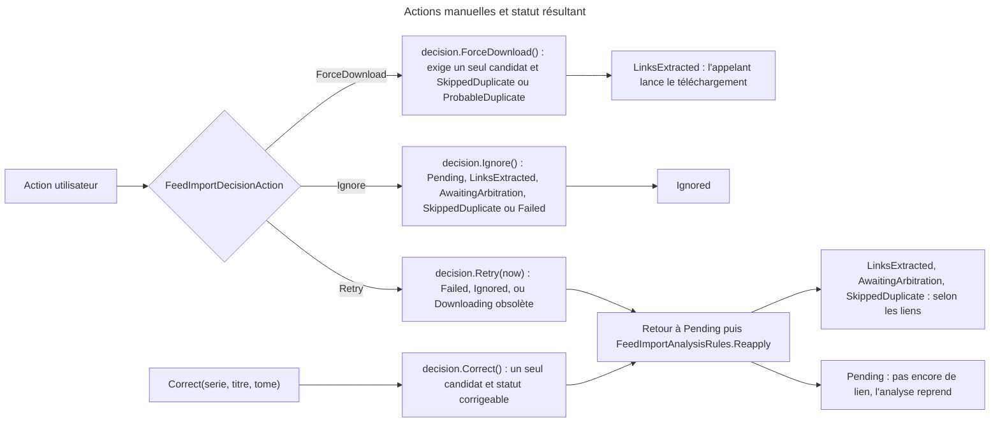
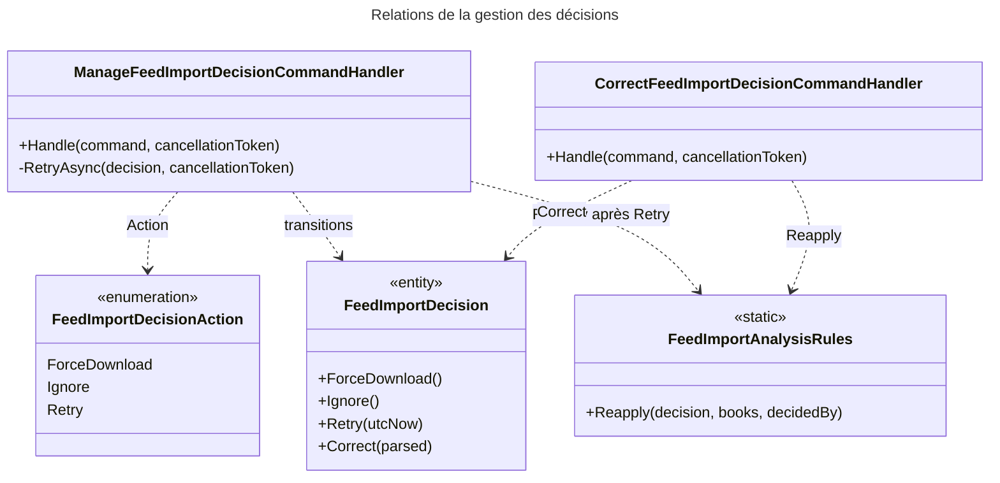

# C4 Code Level : FeedImports / Manage

## Vue d'ensemble

- **Nom** : `Application.FeedImports.Manage`
- **Description** : Cas d'usage des actions manuelles sur une décision d'import (forcer le téléchargement, ignorer, relancer, corriger série, titre et tome).
- **Emplacement relatif** : [Application/FeedImports/Manage](../Application/FeedImports/Manage)
- **Langage** : C# (.NET 10), CQRS, Ardalis.GuardClauses, `TimeProvider`.
- **Objectif** : Permettre à l'utilisateur de reprendre la main sur une décision depuis la page Feeds. Chaque action est vérifiée par le domaine (`FeedImportDecision`), puis rejouée sur les liens déjà stockés quand c'est pertinent (doublon, analyse). Le statut retourné indique à l'appelant s'il doit lancer un téléchargement (`LinksExtracted`) ou une analyse (`Pending`).

## Éléments de code

### Énumérations

#### FeedImportDecisionAction

- Fichier : [FeedImportDecisionAction.cs:3-8](../Application/FeedImports/Manage/FeedImportDecisionAction.cs#L3)
- Valeurs :
  - `ForceDownload` : télécharger malgré un doublon (certain ou probable).
  - `Ignore` : plus aucun traitement pour cette décision.
  - `Retry` : échec, décision ignorée ou téléchargement interrompu ; relancer l'analyse ou le téléchargement.

### Commandes

#### ManageFeedImportDecisionCommand

- Fichier : [ManageFeedImportDecisionCommand.cs:7-8](../Application/FeedImports/Manage/ManageFeedImportDecisionCommand.cs#L7)
- Signature : `public record ManageFeedImportDecisionCommand(Guid DecisionId, Guid UserId, FeedImportDecisionAction Action) : ICommand<FeedImportDecisionStatus>;`

#### CorrectFeedImportDecisionCommand

- Fichier : [CorrectFeedImportDecisionCommand.cs:7-8](../Application/FeedImports/Manage/CorrectFeedImportDecisionCommand.cs#L7)
- Signature : `public record CorrectFeedImportDecisionCommand(Guid DecisionId, Guid UserId, string Serie, string? Title, int? Volume) : ICommand<FeedImportDecisionStatus>;`

### Handlers

#### ManageFeedImportDecisionCommandHandler

- Fichier : [ManageFeedImportDecisionCommandHandler.cs:10-56](../Application/FeedImports/Manage/ManageFeedImportDecisionCommandHandler.cs#L10)
- Déclaration : `public sealed class ManageFeedImportDecisionCommandHandler(...) : ICommandHandler<ManageFeedImportDecisionCommand, FeedImportDecisionStatus>`
- Constructeur :
  - `IFeedImportDecisionRepository decisionRepository` (ligne 11)
  - `IBookReadService bookReadService` (ligne 12)
  - `IUnitOfWork unitOfWork` (ligne 13)
  - `TimeProvider timeProvider` (ligne 14)

Méthodes :

- `public async Task<Result<FeedImportDecisionStatus>> Handle(ManageFeedImportDecisionCommand command, CancellationToken cancellationToken)` ([lignes 16-43](../Application/FeedImports/Manage/ManageFeedImportDecisionCommandHandler.cs#L16))
  - Description : valide les identifiants et l'énumération (`BadRequest`), charge la décision et vérifie le propriétaire (`NotFound`). `ForceDownload` appelle `decision.ForceDownload()`, `Ignore` appelle `decision.Ignore()`, tout autre cas appelle `RetryAsync`. Enregistre et renvoie le statut.
- `private async Task<Result> RetryAsync(FeedImportDecision decision, CancellationToken cancellationToken)` ([lignes 45-55](../Application/FeedImports/Manage/ManageFeedImportDecisionCommandHandler.cs#L45))
  - Description : `decision.Retry(now)` (retour à `Pending`), puis `FeedImportAnalysisRules.Reapply` avec les livres de l'utilisateur. Sans lien stocké, la décision reste `Pending` et sera réanalysée.

#### CorrectFeedImportDecisionCommandHandler

- Fichier : [CorrectFeedImportDecisionCommandHandler.cs:10-50](../Application/FeedImports/Manage/CorrectFeedImportDecisionCommandHandler.cs#L10)
- Déclaration : `public sealed class CorrectFeedImportDecisionCommandHandler(...) : ICommandHandler<CorrectFeedImportDecisionCommand, FeedImportDecisionStatus>`
- Constructeur :
  - `IFeedImportDecisionRepository decisionRepository` (ligne 11)
  - `IBookReadService bookReadService` (ligne 12)
  - `IUnitOfWork unitOfWork` (ligne 13)

Méthodes :

- `public async Task<Result<FeedImportDecisionStatus>> Handle(CorrectFeedImportDecisionCommand command, CancellationToken cancellationToken)` ([lignes 15-49](../Application/FeedImports/Manage/CorrectFeedImportDecisionCommandHandler.cs#L15))
  - Description : valide l'identifiant, la série (non vide, longueur max `FeedImportConstants.MaxParsedSerieLength`), le titre (longueur max `MaxParsedTitleLength`) et le tome (≥ 0), sinon `BadRequest`. Charge la décision et vérifie le propriétaire. Construit un `ParsedComicTitle` avec les valeurs rognées, appelle `decision.Correct(parsed)` (qui repasse en `Pending`), recharge les livres et appelle `FeedImportAnalysisRules.Reapply`. Enregistre et renvoie le nouveau statut.

## Dépendances

### Dépendances internes

- `Application.Abstractions.Messaging` : `ICommand`, `ICommandHandler`.
- `Application.Interfaces` : `IFeedImportDecisionRepository`, `IBookReadService`, `IUnitOfWork`.
- `Application.FeedImports.Analysis` : `FeedImportAnalysisRules.Reapply`.
- `Domain.FeedImports` : `FeedImportDecision`, `FeedImportDecisionStatus`, `FeedImportDecidedBy`, `FeedImportConstants` (longueurs max), `ParsedComicTitle`, `FeedImportError`.
- `Domain.Primitives` : `Result`.
- Appelant : `FeedImportService` (couche Web), qui transmet les actions de la page Feeds.

### Dépendances externes

- `Ardalis.GuardClauses` : `Guard.Against.Null`.
- `System.TimeProvider` : horloge injectée pour `Retry`.

## Relations

## Notes

- **Statut retourné** : les deux handlers renvoient le statut final. L'appelant ne doit lancer le téléchargement que pour `LinksExtracted` et l'analyse que pour `Pending`.
- **Action sur une décision incohérente** : `ForceDownload`, `Ignore`, `Retry` et `Correct` passent tous par les gardes du domaine (`CanForceDownload`, `CanIgnore`, `CanRetry`, `CanCorrect`) ; une action non permise renvoie `InvalidStatusTransition`.
- **Corrections** : `Correct` réinitialise l'arbitrage et l'erreur, puis le contrôle de doublon est rejoué sur les liens conservés. Les corrections sont conservées tant qu'aucun nouveau fichier ne les remplace (`StoredParsed`).
- **Horloge injectée** : `Retry` utilise `TimeProvider`, ce qui permet de tester le délai du téléchargement bloqué.
- **Garde de validation** : `Enum.IsDefined` protège l'action avant tout accès au dépôt.
