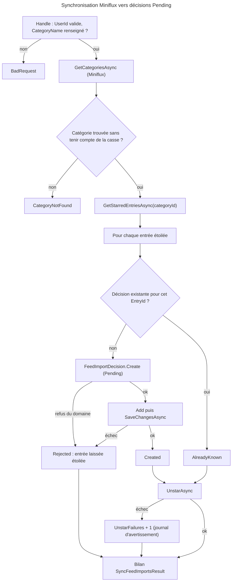
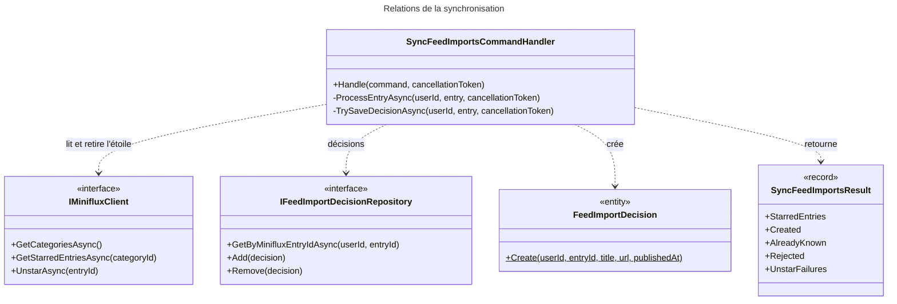

# C4 Code Level : FeedImports / Sync

## Vue d'ensemble

- **Nom** : `Application.FeedImports.Sync`
- **Description** : Cas d'usage de synchronisation avec Miniflux : lecture des articles étoilés de la catégorie surveillée, création d'une décision `Pending` par nouvel article, puis retrait de l'étoile.
- **Emplacement relatif** : [Application/FeedImports/Sync](../Application/FeedImports/Sync)
- **Langage** : C# (.NET 10), CQRS, Ardalis.GuardClauses, `IOptions<T>`, `ILogger<T>`.
- **Objectif** : Être le point d'entrée de la chaîne d'import. Il ne télécharge rien et n'analyse rien : il enregistre les articles et laisse l'analyse (`Analyze`) s'exécuter ensuite. Il est appelé par `FeedImportSyncJob` (Web), toutes les `FeedImport:SyncIntervalMinutes` minutes ou via le bouton « Sync now ».

## Éléments de code

### Commandes et résultats

#### SyncFeedImportsCommand

- Fichier : [SyncFeedImportsCommand.cs:5](../Application/FeedImports/Sync/SyncFeedImportsCommand.cs#L5)
- Signature : `public record SyncFeedImportsCommand(Guid UserId) : ICommand<SyncFeedImportsResult>;`

#### SyncFeedImportsResult

- Fichier : [SyncFeedImportsResult.cs:3](../Application/FeedImports/Sync/SyncFeedImportsResult.cs#L3)
- Signature : `public sealed record SyncFeedImportsResult(int StarredEntries, int Created, int AlreadyKnown, int Rejected, int UnstarFailures);`
- Description : bilan de la synchronisation : entrées lues, décisions créées, entrées déjà connues, entrées rejetées, échecs de retrait d'étoile.

### Handlers

#### SyncFeedImportsCommandHandler

- Fichier : [SyncFeedImportsCommandHandler.cs:11-131](../Application/FeedImports/Sync/SyncFeedImportsCommandHandler.cs#L11)
- Déclaration : `public sealed class SyncFeedImportsCommandHandler(...) : ICommandHandler<SyncFeedImportsCommand, SyncFeedImportsResult>`
- Constructeur :
  - `IMinifluxClient minifluxClient` (ligne 12)
  - `IFeedImportDecisionRepository decisionRepository` (ligne 13)
  - `IUnitOfWork unitOfWork` (ligne 14)
  - `IOptions<MinifluxSettings> minifluxSettings` (ligne 15)
  - `ILogger<SyncFeedImportsCommandHandler> logger` (ligne 16)
- Type privé : `private enum EntryOutcome { Created, AlreadyKnown, Rejected }` ([lignes 18-23](../Application/FeedImports/Sync/SyncFeedImportsCommandHandler.cs#L18))

Méthodes :

- `public async Task<Result<SyncFeedImportsResult>> Handle(SyncFeedImportsCommand command, CancellationToken cancellationToken)` ([lignes 25-79](../Application/FeedImports/Sync/SyncFeedImportsCommandHandler.cs#L25))
  - Description : valide `UserId` et le nom de catégorie (`BadRequest`) ; récupère les catégories et sélectionne celle dont le titre correspond sans tenir compte de la casse (`CategoryNotFound` sinon) ; récupère les entrées étoilées ; traite chaque entrée et compte les résultats.
- `private async Task<(EntryOutcome Outcome, bool Unstarred)> ProcessEntryAsync(Guid userId, MinifluxEntry entry, CancellationToken cancellationToken)` ([lignes 83-105](../Application/FeedImports/Sync/SyncFeedImportsCommandHandler.cs#L83))
  - Description : si aucune décision n'existe pour cette entrée (`GetByMinifluxEntryIdAsync`), la crée et l'enregistre avant de retirer l'étoile. Si l'enregistrement échoue, l'entrée est `Rejected` et reste étoilée. Le retrait est tenté dans tous les cas ; un échec est journalisé en avertissement.
- `private async Task<bool> TrySaveDecisionAsync(Guid userId, MinifluxEntry entry, CancellationToken cancellationToken)` ([lignes 107-130](../Application/FeedImports/Sync/SyncFeedImportsCommandHandler.cs#L107))
  - Description : `FeedImportDecision.Create(userId, entry.Id, entry.Title, entry.Url, entry.PublishedAt?.UtcDateTime)` ; un refus du domaine (URL invalide, par exemple) journalise un avertissement et renvoie `false`. Une erreur d'enregistrement détache la décision (`Remove`) pour qu'elle ne soit pas renvoyée avec l'entrée suivante.

## Dépendances

### Dépendances internes

- `Application.Abstractions.Messaging` : `ICommand`, `ICommandHandler`.
- `Application.Interfaces` : `IFeedImportDecisionRepository`, `IUnitOfWork`.
- `Application.FeedImports` : `IMinifluxClient`, `MinifluxEntry`, `MinifluxCategory` (implicite via `GetCategoriesAsync`), `MinifluxSettings`.
- `Domain.FeedImports` : `FeedImportDecision` (factory `Create`), `FeedImportError` (`BadRequest`, `CategoryNotFound`).
- `Domain.Primitives` : `Result`.
- Appelant : `FeedImportSyncJob` (couche Web), qui résout le handler dans un scope de service et le lance avec un `UserId`.
- Implémentations : `MinifluxClient` (Web/Infrastructure) ; `MinifluxHealthCheck` applique le même critère de correspondance de catégorie (commentaire dans le code).

### Dépendances externes

- `Ardalis.GuardClauses` : `Guard.Against.Null`.
- `Microsoft.Extensions.Options` : `IOptions<MinifluxSettings>`.
- `Microsoft.Extensions.Logging` : `ILogger<T>`.

## Relations

## Notes

- **Persistance avant retrait d'étoile** : la décision est enregistrée avant `UnstarAsync`. Si le retrait échoue, l'entrée est déjà connue (`MinifluxEntryId` unique) et la synchronisation suivante retente seulement le retrait, sans créer de doublon (commentaire de la ligne 81-82).
- **Entrées rejetées** : une entrée que le domaine refuse (par exemple une URL invalide, ligne 109) reste étoilée dans Miniflux. Elle est relue et rejetée à chaque synchronisation, avec un avertissement journalisé à chaque fois. Elle n'est pas comptée dans `UnstarFailures`. C'est un point d'attention : une entrée durablement invalide génère du bruit dans les journaux.
- **Un enregistrement par entrée** : chaque entrée fait son propre `SaveChangesAsync`. C'est ce qui permet de garder une entrée valide même si une autre échoue, au prix de plusieurs transactions.
- **Contenu de l'article** : la synchronisation ne lit que les métadonnées Miniflux (titre, URL, date). Le contenu de la page est lu plus tard par `Analyze`.
- **Déploiement** : la synchronisation ne doit être active que sur un seul environnement, car Miniflux est partagé (voir `docs/FEED-IMPORT.md`).
