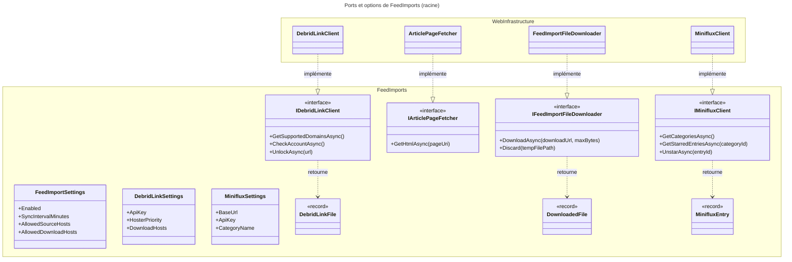

# C4 Code Level : FeedImports (racine)

## Vue d'ensemble

- **Nom** : `Application.FeedImports` (racine du module)
- **Description** : Contrats (interfaces, ports), types de transfert et options de configuration partagés par tous les sous-dossiers de la fonctionnalité d'import automatique de bandes dessinées depuis Miniflux, avec téléchargement via Debrid-Link.
- **Emplacement relatif** : [Application/FeedImports](../Application/FeedImports)
- **Langage** : C# (.NET 10), nullable activé, records et classes scellées.
- **Objectif** : Définir les ports que la couche Web implémente (clients HTTP Miniflux et Debrid-Link, récupération de page d'article, téléchargement de fichier) ainsi que les options liées aux sections `FeedImport:*`, `Miniflux:*` et `DebridLink:*` de la configuration. Ce dossier ne contient aucun handler : les cas d'usage se trouvent dans les sous-dossiers (`Analysis`, `Analyze`, `Arbitrate`, `Delete`, `Download`, `List`, `Manage`, `Sync`).

## Éléments de code

### Interfaces (ports)

#### IMinifluxClient

- Fichier : [IMinifluxClient.cs](../Application/FeedImports/IMinifluxClient.cs) (lignes 5-13)
- Description : port d'accès à l'API Miniflux (catégories, entrées étoilées, retrait d'étoile).
- Méthodes :
  - `Task<Result<IReadOnlyList<MinifluxCategory>>> GetCategoriesAsync(CancellationToken cancellationToken = default)`
    - Description : liste les catégories Miniflux.
    - Emplacement : [IMinifluxClient.cs:7](../Application/FeedImports/IMinifluxClient.cs#L7)
    - Dépendances : `MinifluxCategory`, `Domain.Primitives.Result`.
  - `Task<Result<IReadOnlyList<MinifluxEntry>>> GetStarredEntriesAsync(long categoryId, CancellationToken cancellationToken = default)`
    - Description : liste les articles étoilés d'une catégorie.
    - Emplacement : [IMinifluxClient.cs:9](../Application/FeedImports/IMinifluxClient.cs#L9)
    - Dépendances : `MinifluxEntry`.
  - `Task<Result> UnstarAsync(long entryId, CancellationToken cancellationToken = default)`
    - Description : retire l'étoile d'un article. Miniflux n'expose qu'un basculement : l'implémentation doit vérifier que l'article est toujours étoilé avant de basculer (commentaire de l'interface).
    - Emplacement : [IMinifluxClient.cs:12](../Application/FeedImports/IMinifluxClient.cs#L12)

#### IArticlePageFetcher

- Fichier : [IArticlePageFetcher.cs](../Application/FeedImports/IArticlePageFetcher.cs) (lignes 5-9)
- Description : port de récupération HTML d'une page d'article.
- Méthodes :
  - `Task<Result<string>> GetHtmlAsync(Uri pageUri, CancellationToken cancellationToken = default)`
    - Description : renvoie le HTML de la page. Les implémentations ne joignent que les domaines de `FeedImport:AllowedSourceHosts`.
    - Emplacement : [IArticlePageFetcher.cs:8](../Application/FeedImports/IArticlePageFetcher.cs#L8)

#### IDebridLinkClient

- Fichier : [IDebridLinkClient.cs](../Application/FeedImports/IDebridLinkClient.cs) (lignes 6-16)
- Description : port d'accès à l'API Debrid-Link (débridage des liens d'hébergeurs). Le pragma `CA1054` est désactivé car les URL viennent du JSON des décisions.
- Méthodes :
  - `Task<Result<IReadOnlyList<string>>> GetSupportedDomainsAsync(CancellationToken cancellationToken = default)`
    - Description : domaines que Debrid-Link sait débrider (`GET /downloader/domains`).
    - Emplacement : [IDebridLinkClient.cs:9](../Application/FeedImports/IDebridLinkClient.cs#L9)
  - `Task<Result> CheckAccountAsync(CancellationToken cancellationToken = default)`
    - Description : valide la clé d'API et la disponibilité de l'API (`GET /account/infos`). Utilisé par le health check.
    - Emplacement : [IDebridLinkClient.cs:12](../Application/FeedImports/IDebridLinkClient.cs#L12)
  - `Task<Result<DebridLinkFile>> UnlockAsync(string url, CancellationToken cancellationToken = default)`
    - Description : débride un lien d'hébergeur et renvoie le lien direct (`POST /downloader/add`).
    - Emplacement : [IDebridLinkClient.cs:15](../Application/FeedImports/IDebridLinkClient.cs#L15)
    - Dépendances : `DebridLinkFile`.

#### IFeedImportFileDownloader

- Fichier : [IFeedImportFileDownloader.cs](../Application/FeedImports/IFeedImportFileDownloader.cs) (lignes 5-11)
- Description : port de téléchargement en flux vers le répertoire temporaire.
- Méthodes :
  - `Task<Result<DownloadedFile>> DownloadAsync(Uri downloadUrl, long maxBytes, CancellationToken cancellationToken = default)`
    - Description : écrit le fichier dans `Import:TempDirectory`. Échoue et supprime le fichier partiel au-delà de `maxBytes`.
    - Emplacement : [IFeedImportFileDownloader.cs:8](../Application/FeedImports/IFeedImportFileDownloader.cs#L8)
    - Dépendances : `DownloadedFile`.
  - `void Discard(string tempFilePath)`
    - Description : supprime un fichier temporaire qui ne sera pas déposé.
    - Emplacement : [IFeedImportFileDownloader.cs:10](../Application/FeedImports/IFeedImportFileDownloader.cs#L10)

### Types de transfert (records)

#### DebridLinkFile

- Fichier : [DebridLinkFile.cs:3](../Application/FeedImports/DebridLinkFile.cs#L3)
- Signature : `public sealed record DebridLinkFile(string Name, long? SizeBytes, Uri DownloadUrl);`
- Description : fichier débridé renvoyé par Debrid-Link (nom, taille éventuellement inconnue, lien direct).

#### DownloadedFile

- Fichier : [DownloadedFile.cs:3](../Application/FeedImports/DownloadedFile.cs#L3)
- Signature : `public sealed record DownloadedFile(string TempFilePath, long SizeBytes);`
- Description : fichier téléchargé dans le répertoire temporaire, prêt à être déposé.

#### MinifluxCategory

- Fichier : [MinifluxCategory.cs:3](../Application/FeedImports/MinifluxCategory.cs#L3)
- Signature : `public sealed record MinifluxCategory(long Id, string Title);`

#### MinifluxEntry

- Fichier : [MinifluxEntry.cs:4](../Application/FeedImports/MinifluxEntry.cs#L4)
- Signature : `public sealed record MinifluxEntry(long Id, string Title, string Url, DateTimeOffset? PublishedAt);`
- Description : article Miniflux. L'URL brute est validée à la création de la décision (les pragmas `CA1054`/`CA1056` sont désactivés pour cette raison).

### Options de configuration (classes)

#### FeedImportSettings

- Fichier : [FeedImportSettings.cs](../Application/FeedImports/FeedImportSettings.cs) (lignes 3-17)
- Section : `FeedImport`
- Propriétés :
  - `bool Enabled` (ligne 5) : active la synchronisation (défaut `false`).
  - `int SyncIntervalMinutes` (ligne 7) : intervalle du job récurrent (défaut `30`).
  - `string UserEmail` (ligne 10) : utilisateur MCM propriétaire des décisions.
  - `string TargetLibraryName` (ligne 12) : bibliothèque de dépôt (défaut `À trier`).
  - `IReadOnlyList<string> AllowedSourceHosts` (ligne 14) : domaines des pages d'articles.
  - `IReadOnlyList<string> AllowedDownloadHosts` (ligne 16) : domaines des hébergeurs retenus.

#### DebridLinkSettings

- Fichier : [DebridLinkSettings.cs](../Application/FeedImports/DebridLinkSettings.cs) (lignes 3-15)
- Section : `DebridLink`
- Propriétés :
  - `Uri BaseUrl` (ligne 5) : défaut `https://debrid-link.com/api/v2/`.
  - `string ApiKey` (ligne 8) : clé privée ; vide signifie qu'aucun téléchargement n'est lancé.
  - `IReadOnlyList<string> HosterPriority` (ligne 11) : ordre d'essai des miroirs.
  - `IReadOnlyList<string> DownloadHosts` (ligne 14) : domaines des serveurs de fichiers Debrid-Link.

#### MinifluxSettings

- Fichier : [MinifluxSettings.cs](../Application/FeedImports/MinifluxSettings.cs) (lignes 3-10)
- Section : `Miniflux`
- Propriétés :
  - `Uri? BaseUrl` (ligne 5) : URL de Miniflux (seul hôte autorisé par le garde-fou SSRF côté Web).
  - `string ApiKey` (ligne 7) : clé d'API (secret, uniquement en variable d'environnement).
  - `string CategoryName` (ligne 9) : catégorie surveillée (défaut `BD`).

## Dépendances

### Dépendances internes

- `Domain.Primitives` : type `Result` et `Result<T>`, retournés par toutes les interfaces.
- Sous-dossiers `Analysis` et `Analysis/Sites` : `DownloadCandidate` (domaine) et les types d'analyse.
- Consommateurs : `Analyze` (`IArticlePageFetcher`, `IDownloadLinkExtractor`, `FeedImportSettings`), `Sync` (`IMinifluxClient`, `MinifluxEntry`, `MinifluxSettings`), `Download` (`IDebridLinkClient`, `IFeedImportFileDownloader`, `DebridLinkSettings`, `DownloadedFile`, `DebridLinkFile`).
- Implémentations dans la couche Web (hors de ce dossier) : `MinifluxClient`, `ArticlePageFetcher`, `DebridLinkClient`, `FeedImportFileDownloader` ([Web/Infrastructure](../Web/Infrastructure)), enregistrées dans [FeedImportConfiguration.cs](../Web/Configuration/FeedImportConfiguration.cs). Les health checks [MinifluxHealthCheck.cs](../Web/Infrastructure/MinifluxHealthCheck.cs) et [DebridLinkHealthCheck.cs](../Web/Infrastructure/DebridLinkHealthCheck.cs) consomment aussi les ports.

### Dépendances externes

- Aucune bibliothèque tierce dans les fichiers de ce dossier (uniquement `System` : `Uri`, `CancellationToken`, `DateTimeOffset`).

## Relations

## Notes

- Ce dossier ne contient aucune logique métier : les contrats sont des ports au sens de l'architecture hexagonale utilisée par le module.
- Le contrat de `IMinifluxClient.UnstarAsync` (vérifier que l'article est encore étoilé avant de basculer) n'est pas imposé par le type : il repose sur l'implémentation Web.
- `FeedImportSettings.Enabled` et les clés obligatoires sont validés au démarrage par la couche Web ; ce dossier ne fait que porter les valeurs.
- Documentation fonctionnelle associée : [docs/FEED-IMPORT.md](../docs/FEED-IMPORT.md), [ADR-0019](../docs/adr/0019-integration-miniflux-debrid-link.md).
