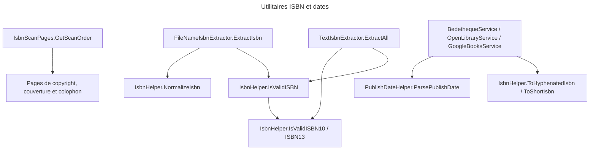

# C4 Code Level : Application.Helpers

## Vue d'ensemble

- **Nom** : Application.Helpers : utilitaires ISBN et dates
- **Description** : Fonctions statiques pures qui extraient, valident, normalisent et formatent les ISBN, qui choisissent les pages à lire pour trouver un ISBN, et qui analysent les dates de publication retournées par les sources externes.
- **Emplacement** : [Application/Helpers/](../Application/Helpers/)
- **Langage** : C# (.NET 10), expressions régulières générées (`[GeneratedRegex]`)
- **Objectif** : Fournir les règles ISBN (checksum ISBN-10 et ISBN-13, préfixes français) et les heuristiques de lecture (nom de fichier, texte OCR, pages de la couverture) sans état ni dépendance d'infrastructure.

## Éléments de code

### Classes

#### FileNameIsbnExtractor

- **Type** : classe statique partielle publique
- **Signature** :

```csharp
public static partial class FileNameIsbnExtractor
{
    public static string? ExtractIsbn(string fileName);
}
```

- **Description** : Extrait un ISBN valide du nom d'un fichier (sans son extension). Cinq motifs sont essayés dans l'ordre : préfixe `ISBN-`/`ISBN_`/`ISBN ` ; entre parenthèses ; entre crochets ; séquence brute de 13 chiffres commençant par 978 ou 979 ; séquence brute de 10 caractères. Le premier candidat dont la somme de contrôle est valide est retourné, normalisé (sans tirets ni espaces).
- **Emplacement** : [FileNameIsbnExtractor.cs](../Application/Helpers/FileNameIsbnExtractor.cs) lignes 5-76 (méthode publique lignes 27-62)
- **Dépendances** : `IsbnHelper.NormalizeIsbn`, `IsbnHelper.IsValidISBN`, `System.Text.RegularExpressions`, `System.IO.Path`
- **Membres privés** : motifs `IsbnPrefixPattern`, `IsbnInParenthesesPattern`, `IsbnInBracketsPattern`, `Isbn13SequencePattern`, `Isbn10SequencePattern` (lignes 8-25) ; `TryMatch` (lignes 64-75).

#### IsbnScanPages

- **Type** : classe statique publique
- **Signature** :

```csharp
public static class IsbnScanPages
{
    public const int DefaultPagesFromEachEnd = 5;

    public static IReadOnlyList<int> GetScanOrder(int pageCount, int pagesFromEachEnd = DefaultPagesFromEachEnd);

    public static IReadOnlyList<int> GetPagesInReadingOrder(int pageCount, int pagesFromEachEnd = DefaultPagesFromEachEnd);
}
```

- **Description** : Détermine les pages (indexes base 0) où un ISBN est le plus souvent imprimé : page de copyright (index 1 et 2), dernières pages (couverture arrière, colophon) et `pagesFromEachEnd` pages de chaque extrémité. `GetScanOrder` renvoie les pages les plus probables en premier, pour arrêter le scan dès qu'un ISBN est trouvé. `GetPagesInReadingOrder` renvoie les mêmes pages triées.
- **Emplacement** : [IsbnScanPages.cs](../Application/Helpers/IsbnScanPages.cs) lignes 7-39 (`DefaultPagesFromEachEnd` ligne 9 ; `GetScanOrder` lignes 15-34 ; `GetPagesInReadingOrder` lignes 37-38)
- **Dépendances** : LINQ uniquement.

#### IsbnHelper

- **Type** : classe statique publique
- **Signature** :

```csharp
public static class IsbnHelper
{
    public static bool IsValidISBN(string isbn);
    public static bool IsValidISBN10(string? isbn);
    public static bool IsValidISBN13(string? isbn);
    public static string NormalizeIsbn(string isbn);
    public static string? ToHyphenatedIsbn(string isbn);
    public static string? ToShortIsbn(string isbn);
}
```

- **Description** :
  - `IsValidISBN` : normalise puis valide un ISBN de 10 ou 13 caractères (les autres longueurs sont refusées).
  - `IsValidISBN10` : neuf chiffres puis un chiffre ou `X`, somme pondérée multiple de 11.
  - `IsValidISBN13` : treize chiffres, somme pondérée (1 et 3 alternés) et chiffre de contrôle.
  - `NormalizeIsbn` : supprime tirets, espaces et sauts de ligne, met en majuscules ; chaîne vide si l'entrée est vide.
  - `ToHyphenatedIsbn` : formate un ISBN-13 français (préfixes 978-2 et 979-10) avec tirets selon les plages de la publication (éditeur) ; `null` si le préfixe ou la plage ne sont pas gérés.
  - `ToShortIsbn` : forme courte `X-XXX-XXXXX` (préfixe EAN et contrôle retirés) pour les ISBN 978 et 979 ; `null` sinon.
- **Emplacement** : [IsbnHelper.cs](../Application/Helpers/IsbnHelper.cs) lignes 3-185 (`IsValidISBN` lignes 5-28 ; `IsValidISBN10` lignes 30-70 ; `IsValidISBN13` lignes 72-100 ; `NormalizeIsbn` lignes 102-113 ; `ToHyphenatedIsbn` lignes 117-146 ; `ToShortIsbn` lignes 150-163)
- **Membres privés** : `PublisherLength978Group2`, `PublisherLength979Group10`, `PublisherLength`, `TryParseSlice` (lignes 165-184), qui lisent la longueur de l'éditeur dans les tables de plages ISBN.
- **Dépendances** : `System.Globalization.CultureInfo`, `System.StringComparison`.

#### TextIsbnExtractor

- **Type** : classe statique partielle publique
- **Signature** :

```csharp
public static partial class TextIsbnExtractor
{
    public static IReadOnlyList<string> ExtractAll(string? text);
}
```

- **Description** : Trouve les ISBN valides dans un texte lu par OCR sur une page de livre (en général la page de copyright). Trois passes : ISBN introduit par le libellé « ISBN » (les confusions OCR courantes, comme `O` pour `0`, ne sont corrigées qu'après ce libellé) ; ISBN-13 nu, avec au plus un séparateur entre chiffres ; ISBN-10 nu, uniquement s'il est écrit avec tirets. Seuls les nombres dont la somme de contrôle est valide sont retournés, dédoublonnés, les numéros introduits par le libellé en premier.
- **Emplacement** : [TextIsbnExtractor.cs](../Application/Helpers/TextIsbnExtractor.cs) lignes 10-144 (`ExtractAll` lignes 43-68)
- **Membres privés** : table `s_digitLookalikes` (lignes 13-24) ; expressions `LabelledIsbnPattern` (ligne 28), `BareIsbn13Pattern` (ligne 32), `BareHyphenatedIsbn10Pattern` (ligne 36) ; `ReadLabelledIsbn`, `ToDigits`, `ValidOrNull`, `NormalizeSeparators`, `AddIfNew`.
- **Dépendances** : `IsbnHelper.IsValidISBN13`, `IsbnHelper.IsValidISBN10`, `IsbnHelper.IsValidISBN`, `System.Text.StringBuilder`.

#### PublishDateHelper

- **Type** : classe statique publique
- **Signature** :

```csharp
public static class PublishDateHelper
{
    public const string DisplayFormat = "dd/MM/yyyy";

    public static DateOnly? ParsePublishDate(string? dateString, ILogger logger);
}
```

- **Description** : Convertit une date de publication en `DateOnly`. Essaie onze formats explicites (« September 16, 1987 », « 1987-09-16 », « 16/09/1987 », « September 1987 », « 1987 », etc.) en culture invariante, puis `DateTime.TryParse` en repli. Une chaîne non reconnue est journalisée en avertissement et donne `null`. Une date seule (année ou mois) est convertie au premier jour de la période.
- **Emplacement** : [PublishDateHelper.cs](../Application/Helpers/PublishDateHelper.cs) lignes 6-53 (`DisplayFormat` ligne 8 ; `ParsePublishDate` lignes 10-52)
- **Dépendances** : `Microsoft.Extensions.Logging.ILogger` (paramètre, `ArgumentNullException.ThrowIfNull`), `System.Globalization.CultureInfo`, `System.Globalization.DateTimeStyles`.
- **Utilisée par** : [BedethequeService.cs](../Application/ComicInfoSearch/BedethequeService.cs), [OpenLibraryService.cs](../Application/ComicInfoSearch/OpenLibraryService.cs), [GoogleBooksService.cs](../Application/ComicInfoSearch/GoogleBooksService.cs).

## Dépendances

### Internes

- Aucune dépendance vers d'autres répertoires de `Application` : ce sont des utilitaires purs.
- Usages constatés :
  - `Application/ComicInfoSearch` : `IsbnHelper` (normalisation, formats) et `PublishDateHelper` (dates de publication).
  - `Application/Books/IsbnScan/IsbnOcrSettings.cs` (ligne 15) : valeur par défaut `IsbnScanPages.DefaultPagesFromEachEnd`.
  - `Application/ImportJobs/Process/ProcessImportJobCommandHandler.cs` (ligne 306) : `FileNameIsbnExtractor.ExtractIsbn` sur le nom du fichier importé.
  - Couche Persistence (service de scan OCR) : `IsbnScanPages.GetScanOrder` et `TextIsbnExtractor.ExtractAll`, hors de ce répertoire.

### Externes

- `System.Text.RegularExpressions` : `[GeneratedRegex]` (source generators).
- `Microsoft.Extensions.Logging` : `ILogger` dans `PublishDateHelper`.
- `System.IO.Path`, `System.Globalization` : BCL.

## Relations



## Notes

- `IsbnHelper.IsValidISBN10` accepte `X` seulement en dernière position : c'est la valeur de contrôle ISBN-10 standard.
- `TextIsbnExtractor` ne retient jamais un ISBN-10 nu sans tirets, car n'importe quel nombre de 10 chiffres serait accepté.
- `IsbnHelper.NormalizeIsbn` supprime aussi `Environment.NewLine`, un détail sans effet sur les entrées sans saut de ligne.
