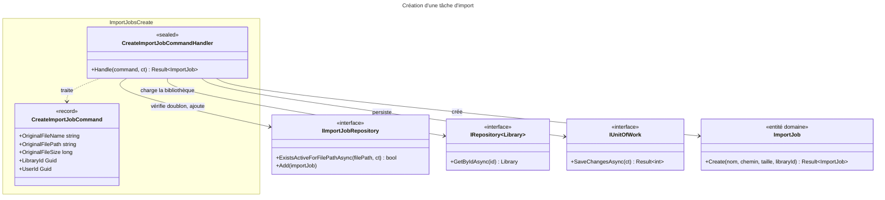

# C4 Code Level : ImportJobs/Create

## Vue d'ensemble

- **Nom** : Application.ImportJobs.Create
- **Description** : Commande et handler de création d'une tâche d'import (`ImportJob`) pour un fichier déposé dans une bibliothèque numérique. Valide le fichier, vérifie la propriété de la bibliothèque, dédoublonne les imports actifs, puis persiste la tâche en statut `Pending`.
- **Emplacement relatif** : [Application/ImportJobs/Create](../Application/ImportJobs/Create)
- **Langage** : C# (.NET 10), espace de noms `Application.ImportJobs.Create`
- **Objectif** : Enregistrer une demande d'import qui sera ensuite traitée de façon asynchrone par le pipeline `Process`.

## Éléments de code

### Commandes

#### `CreateImportJobCommand`

```csharp
public record CreateImportJobCommand(
    string OriginalFileName,
    string OriginalFilePath,
    long OriginalFileSize,
    Guid LibraryId,
    Guid UserId
) : ICommand<ImportJob>;
```

- **Description** : Commande (record immuable) qui porte les métadonnées du fichier source, la bibliothèque cible et l'utilisateur demandeur. Retourne l'entité `ImportJob` créée.
- **Emplacement** : `Application/ImportJobs/Create/CreateImportJobCommand.cs:6-12`
- **Dépendances** : `Application.Abstractions.Messaging.ICommand<TResponse>`, `Domain.ImportJobs.ImportJob`

### Handlers

#### `CreateImportJobCommandHandler`

```csharp
public sealed class CreateImportJobCommandHandler(
    IImportJobRepository importJobRepository,
    IRepository<Library, Guid> libraryRepository,
    IUnitOfWork unitOfWork)
    : ICommandHandler<CreateImportJobCommand, ImportJob>
{
    private static readonly HashSet<string> s_allowedExtensions =
        new(StringComparer.OrdinalIgnoreCase) { ".cbz", ".cbr", ".zip", ".rar", ".pdf" };

    public async Task<Result<ImportJob>> Handle(CreateImportJobCommand request, CancellationToken cancellationToken);
}
```

- **Description** : Orchestre la création de la tâche d'import selon les étapes suivantes :
  1. Validation des paramètres (nom, chemin non vides, taille > 0, `LibraryId` non vide) ; retourne `ImportJobError.BadRequest` (`Application/ImportJobs/Create/CreateImportJobCommandHandler.cs:21-27`).
  2. Validation de l'extension via `s_allowedExtensions` (`.cbz`, `.cbr`, `.zip`, `.rar`, `.pdf`, insensible à la casse) ; retourne `ImportJobError.BadRequest` (lignes 30-34).
  3. Chargement de la bibliothèque ; retourne `LibrariesError.NotFound` si elle est absente ou n'appartient pas à `UserId` (lignes 37-46).
  4. Vérification du type `LibraryBookType.Digital` ; retourne `LibrariesError.BookTypeMismatch` sinon (lignes 49-52).
  5. Dédoublonnage : retourne `ImportJobError.AlreadyQueued` si une tâche active existe déjà pour ce `OriginalFilePath` (lignes 55-58).
  6. Création de l'entité via `ImportJob.Create` (lignes 61-70), ajout au dépôt, sauvegarde via `IUnitOfWork` (lignes 73-78).
- **Emplacement** : `Application/ImportJobs/Create/CreateImportJobCommandHandler.cs:9-82` (classe lignes 9-13, champ statique lignes 15-16, méthode `Handle` lignes 18-81)
- **Dépendances** :
  - `IImportJobRepository` : `ExistsActiveForFilePathAsync`, `Add`
  - `IRepository<Library, Guid>` : `GetByIdAsync`
  - `IUnitOfWork` : `SaveChangesAsync`
  - `ImportJob.Create(...)` (domaine)
  - `ImportJobError`, `LibrariesError` (domaine)

## Dépendances

### Dépendances internes

- `Application/Interfaces` : `IImportJobRepository`, `IRepository<TEntity, TEntityId>`, `IUnitOfWork`
- `Application/Abstractions/Messaging` : `ICommand<TResponse>`, `ICommandHandler<TCommand, TResponse>`
- `Domain/ImportJobs` : `ImportJob`, `ImportJobError`
- `Domain/Libraries` : `Library`, `LibraryBookType`, `LibrariesError`
- `Domain/Primitives` : `Result<T>`

### Dépendances externes

- BCL : `System.IO.Path` (extraction de l'extension), `System.StringComparer`, `System.Collections.Generic.HashSet<T>`

## Relations



## Notes

- Toutes les validations métier précèdent la sauvegarde ; aucun effet de bord sur le système de fichiers n'est réalisé dans ce handler (conforme à la règle de CLAUDE.md sur l'ordre des effets de bord).
- `ImportJob.Create` (lignes 61-70) revalide les mêmes paramètres que les lignes 21-27 : une redondance défensive, l'entité restant ainsi valide quel que soit l'appelant.
- `IRepository.GetByIdAsync` est appelé ici sans `CancellationToken` (ligne 37), contrairement à `ExistsActiveForFilePathAsync` (ligne 55).
- Une bibliothèque appartenant à un autre utilisateur renvoie `LibrariesError.NotFound` (lignes 43-46), comme une bibliothèque absente, ce qui évite de confirmer son existence.
