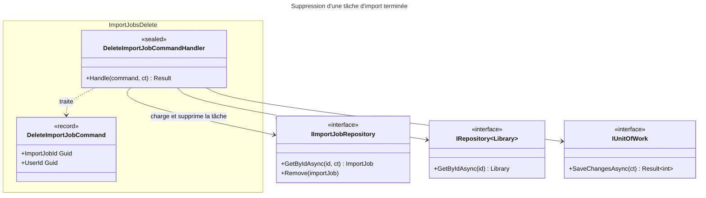

# C4 Code Level : ImportJobs/Delete

## Vue d'ensemble

- **Nom** : Application.ImportJobs.Delete
- **Description** : Commande et handler de suppression d'une tâche d'import terminée (`Completed`) ou en échec (`Failed`). Seule la ligne de la tâche est supprimée ; le fichier source et les livrables ne sont pas touchés par ce handler.
- **Emplacement relatif** : [Application/ImportJobs/Delete](../Application/ImportJobs/Delete)
- **Langage** : C# (.NET 10), espace de noms `Application.ImportJobs.Delete`
- **Objectif** : Permettre à l'utilisateur propriétaire de retirer de son historique une tâche d'import qui n'est plus active.

## Éléments de code

### Commandes

#### `DeleteImportJobCommand`

```csharp
public record DeleteImportJobCommand(Guid ImportJobId, Guid UserId) : ICommand;
```

- **Description** : Commande sans valeur de retour (`ICommand`) identifiant la tâche et l'utilisateur demandeur.
- **Emplacement** : `Application/ImportJobs/Delete/DeleteImportJobCommand.cs:5`
- **Dépendances** : `Application.Abstractions.Messaging.ICommand`

### Handlers

#### `DeleteImportJobCommandHandler`

```csharp
public sealed class DeleteImportJobCommandHandler(
    IImportJobRepository importJobRepository,
    IRepository<Library, Guid> libraryRepository,
    IUnitOfWork unitOfWork) : ICommandHandler<DeleteImportJobCommand>
{
    public async Task<Result> Handle(DeleteImportJobCommand request, CancellationToken cancellationToken);
}
```

- **Description** : Supprime la tâche après contrôle d'appartenance et de statut :
  1. `Guard.Against.Null(request)` (ligne 17) : lève une exception si la requête est nulle.
  2. Chargement de la tâche ; `ImportJobError.NotFound` si absente (lignes 19-23).
  3. Chargement de la bibliothèque de la tâche ; `ImportJobError.NotFound` si absente ou non possédée par `UserId` (lignes 25-29). L'erreur est volontairement identique au cas « tâche absente ».
  4. Statut doit être `Completed` ou `Failed` ; sinon `ImportJobError.NotTerminal` (lignes 31-34).
  5. `Remove` puis `SaveChangesAsync` (lignes 36-43) ; retourne `Result.Success()`.
- **Emplacement** : `Application/ImportJobs/Delete/DeleteImportJobCommandHandler.cs:10-45` (méthode `Handle` lignes 15-44)
- **Dépendances** :
  - `IImportJobRepository` : `GetByIdAsync`, `Remove`
  - `IRepository<Library, Guid>` : `GetByIdAsync`
  - `IUnitOfWork` : `SaveChangesAsync`
  - `ImportJobError.NotFound`, `ImportJobError.NotTerminal`
  - `Ardalis.GuardClauses` (`Guard.Against.Null`)

## Dépendances

### Dépendances internes

- `Application/Interfaces` : `IImportJobRepository`, `IRepository<TEntity, TEntityId>`, `IUnitOfWork`
- `Application/Abstractions/Messaging` : `ICommand`, `ICommandHandler<TCommand>`
- `Domain/ImportJobs` : `ImportJob`, `ImportJobStatus`, `ImportJobError`
- `Domain/Libraries` : `Library`
- `Domain/Primitives` : `Result`

### Dépendances externes

- `Ardalis.GuardClauses` : garde `Guard.Against.Null`

## Relations



## Notes

- Le handler ne touche pas au système de fichiers : le fichier source a déjà été supprimé ou déplacé vers le répertoire d'erreur par `Process`.
- Une tâche en cours de traitement (statut intermédiaire) est refusée avec `NotTerminal` ; la suppression n'est possible que pour un état terminal. Pour une tâche bloquée, voir `ForceFail`.
- `Guard.Against.Null` lève une exception (`ArgumentNullException`) pour une requête nulle, alors que les handlers de `Libraries` retournent `LibrariesError.ValidationError` dans ce cas.
- `IRepository.GetByIdAsync` pour la bibliothèque est appelé sans `CancellationToken` (ligne 25).
