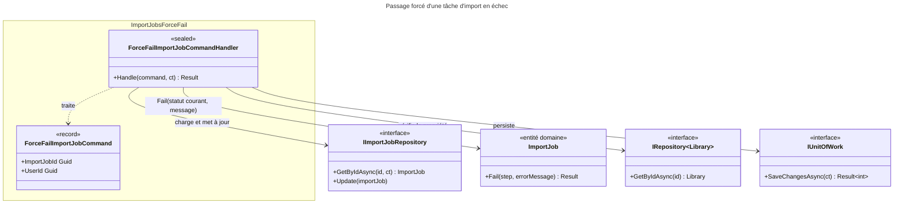

# C4 Code Level : ImportJobs/ForceFail

## Vue d'ensemble

- **Nom** : Application.ImportJobs.ForceFail
- **Description** : Commande et handler qui force le passage d'une tâche d'import à l'état `Failed` avec le message « Manually marked as failed. ». Sert à débloquer une tâche restée bloquée dans un statut intermédiaire.
- **Emplacement relatif** : [Application/ImportJobs/ForceFail](../Application/ImportJobs/ForceFail)
- **Langage** : C# (.NET 10), espace de noms `Application.ImportJobs.ForceFail`
- **Objectif** : Offrir à l'utilisateur propriétaire une action de rattrapage manuel sur une tâche d'import qui n'avance plus.

## Éléments de code

### Commandes

#### `ForceFailImportJobCommand`

```csharp
public record ForceFailImportJobCommand(Guid ImportJobId, Guid UserId) : ICommand;
```

- **Description** : Commande sans valeur de retour identifiant la tâche et l'utilisateur demandeur.
- **Emplacement** : `Application/ImportJobs/ForceFail/ForceFailImportJobCommand.cs:5`
- **Dépendances** : `Application.Abstractions.Messaging.ICommand`

### Handlers

#### `ForceFailImportJobCommandHandler`

```csharp
public sealed class ForceFailImportJobCommandHandler(
    IImportJobRepository importJobRepository,
    IRepository<Library, Guid> libraryRepository,
    IUnitOfWork unitOfWork) : ICommandHandler<ForceFailImportJobCommand>
{
    public async Task<Result> Handle(ForceFailImportJobCommand request, CancellationToken cancellationToken);
}
```

- **Description** : Marque la tâche en échec après contrôle d'appartenance :
  1. `Guard.Against.Null(request)` (ligne 17).
  2. Chargement de la tâche ; `ImportJobError.NotFound` si absente (lignes 19-23).
  3. Chargement de la bibliothèque ; `ImportJobError.NotFound` si absente ou non possédée par `UserId` (lignes 25-29).
  4. `job.Fail(job.Status.ToString(), "Manually marked as failed.")` (ligne 31) : l'étape en erreur est le statut courant de la tâche. Si la tâche est déjà `Completed` ou `Failed`, l'entité renvoie `ImportJobError.AlreadyCompleted` ou `AlreadyFailed` (lignes 32-35).
  5. `Update` puis `SaveChangesAsync` (lignes 37-43) ; retourne `Result.Success()`.
- **Emplacement** : `Application/ImportJobs/ForceFail/ForceFailImportJobCommandHandler.cs:10-46` (méthode `Handle` lignes 15-45)
- **Dépendances** :
  - `IImportJobRepository` : `GetByIdAsync`, `Update`
  - `IRepository<Library, Guid>` : `GetByIdAsync`
  - `IUnitOfWork` : `SaveChangesAsync`
  - `ImportJob.Fail(string step, string errorMessage)` (domaine)
  - `Ardalis.GuardClauses`

## Dépendances

### Dépendances internes

- `Application/Interfaces` : `IImportJobRepository`, `IRepository<TEntity, TEntityId>`, `IUnitOfWork`
- `Application/Abstractions/Messaging` : `ICommand`, `ICommandHandler<TCommand>`
- `Domain/ImportJobs` : `ImportJob` (méthode `Fail`), `ImportJobError`
- `Domain/Libraries` : `Library`
- `Domain/Primitives` : `Result`

### Dépendances externes

- `Ardalis.GuardClauses` : `Guard.Against.Null`

## Relations



## Notes

- Le handler ne vérifie pas que la tâche est dans un statut intermédiaire : c'est l'entité `ImportJob.Fail` qui refuse une tâche déjà terminée (`AlreadyCompleted`, `AlreadyFailed`).
- Le handler ne touche pas au système de fichiers : ni le fichier source ni le répertoire temporaire ne sont déplacés ou supprimés par cette action.
- Une course est possible avec un traitement `Process` encore en cours : si ce dernier appelle ensuite `Advance`, il recevra `AlreadyFailed` (domaine `ImportJob.Advance`).
- `Guard.Against.Null` lève une exception, comme dans `DeleteImportJobCommandHandler`.
- `IRepository.GetByIdAsync` pour la bibliothèque est appelé sans `CancellationToken` (ligne 25).
