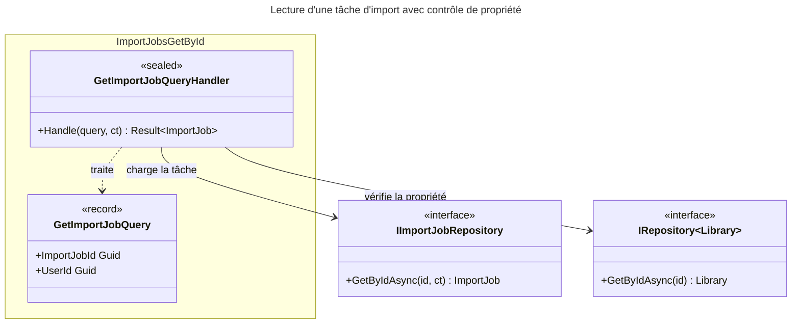

# C4 Code Level : ImportJobs/GetById

## Vue d'ensemble

- **Nom** : Application.ImportJobs.GetById
- **Description** : Requête et handler de lecture d'une tâche d'import par son identifiant, avec contrôle de propriété via la bibliothèque de la tâche.
- **Emplacement relatif** : [Application/ImportJobs/GetById](../Application/ImportJobs/GetById)
- **Langage** : C# (.NET 10), espace de noms `Application.ImportJobs.GetById`
- **Objectif** : Fournir à l'interface utilisateur une tâche d'import accessible à son propriétaire, sans jamais exposer une tâche appartenant à un autre utilisateur.

## Éléments de code

### Requêtes

#### `GetImportJobQuery`

```csharp
public record GetImportJobQuery(Guid ImportJobId, Guid UserId) : IQuery<ImportJob>;
```

- **Description** : Requête (record) identifiant la tâche et l'utilisateur demandeur ; retourne l'entité `ImportJob`.
- **Emplacement** : `Application/ImportJobs/GetById/GetImportJobQuery.cs:6`
- **Dépendances** : `Application.Abstractions.Messaging.IQuery<TResponse>`, `Domain.ImportJobs.ImportJob`

### Handlers

#### `GetImportJobQueryHandler`

```csharp
public sealed class GetImportJobQueryHandler(
    IImportJobRepository importJobRepository,
    IRepository<Library, Guid> libraryRepository)
    : IQueryHandler<GetImportJobQuery, ImportJob>
{
    public async Task<Result<ImportJob>> Handle(GetImportJobQuery query, CancellationToken cancellationToken);
}
```

- **Description** : Lit la tâche après validation :
  1. Si `ImportJobId` ou `UserId` vaut `Guid.Empty`, retourne `ImportJobError.BadRequest` (lignes 16-19).
  2. Chargement de la tâche ; `ImportJobError.NotFound` si absente (lignes 21-25).
  3. Chargement de la bibliothèque de la tâche ; `ImportJobError.NotFound` si elle est absente ou non possédée par `UserId` (lignes 27-31).
  4. Retourne la tâche (ligne 33).
- **Emplacement** : `Application/ImportJobs/GetById/GetImportJobQueryHandler.cs:9-35` (méthode `Handle` lignes 14-34)
- **Dépendances** :
  - `IImportJobRepository` : `GetByIdAsync(id, ct)`
  - `IRepository<Library, Guid>` : `GetByIdAsync(id)`
  - `ImportJobError.BadRequest`, `ImportJobError.NotFound`

## Dépendances

### Dépendances internes

- `Application/Interfaces` : `IImportJobRepository`, `IRepository<TEntity, TEntityId>`
- `Application/Abstractions/Messaging` : `IQuery<TResponse>`, `IQueryHandler<TQuery, TResponse>`
- `Domain/ImportJobs` : `ImportJob`, `ImportJobError`
- `Domain/Libraries` : `Library`
- `Domain/Primitives` : `Result<T>`

### Dépendances externes

- Aucune.

## Relations



## Notes

- Le contrôle de propriété passe par la bibliothèque de la tâche (`importJob.LibraryId`), et non par un champ `UserId` de la tâche elle-même : `ImportJob` ne porte pas d'identifiant utilisateur.
- Les tâches absentes et les tâches d'autres utilisateurs renvoient le même `ImportJobError.NotFound`, ce qui n'expose pas l'existence d'une tâche.
- Le `CancellationToken` est transmis au dépôt de tâches (ligne 21) mais pas à `GetByIdAsync` de la bibliothèque (ligne 27).
- Le handler renvoie l'entité `ImportJob` complète, y compris `OriginalFilePath`, sans projection vers un DTO.
