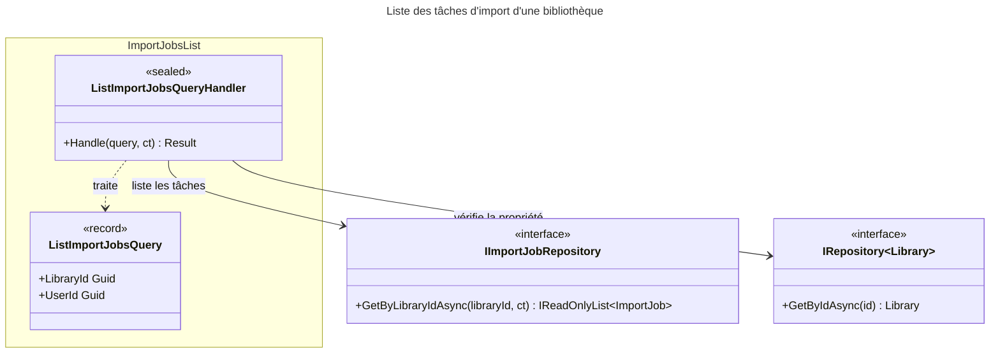

# C4 Code Level : ImportJobs/List

## Vue d'ensemble

- **Nom** : Application.ImportJobs.List
- **Description** : Requête et handler de liste des tâches d'import d'une bibliothèque, après contrôle que la bibliothèque appartient à l'utilisateur.
- **Emplacement relatif** : [Application/ImportJobs/List](../Application/ImportJobs/List)
- **Langage** : C# (.NET 10), espace de noms `Application.ImportJobs.List`
- **Objectif** : Alimenter la vue de suivi des imports d'une bibliothèque numérique.

## Éléments de code

### Requêtes

#### `ListImportJobsQuery`

```csharp
public record ListImportJobsQuery(Guid LibraryId, Guid UserId) : IQuery<IReadOnlyList<ImportJob>>;
```

- **Description** : Requête (record) identifiant la bibliothèque et l'utilisateur demandeur ; retourne la liste des tâches de la bibliothèque.
- **Emplacement** : `Application/ImportJobs/List/ListImportJobsQuery.cs:6`
- **Dépendances** : `Application.Abstractions.Messaging.IQuery<TResponse>`, `Domain.ImportJobs.ImportJob`

### Handlers

#### `ListImportJobsQueryHandler`

```csharp
public sealed class ListImportJobsQueryHandler(
    IImportJobRepository importJobRepository,
    IRepository<Library, Guid> libraryRepository)
    : IQueryHandler<ListImportJobsQuery, IReadOnlyList<ImportJob>>
{
    public async Task<Result<IReadOnlyList<ImportJob>>> Handle(ListImportJobsQuery query, CancellationToken cancellationToken);
}
```

- **Description** : Liste les tâches après validation :
  1. Si `LibraryId` ou `UserId` vaut `Guid.Empty`, retourne `ImportJobError.BadRequest` (lignes 16-19).
  2. Chargement de la bibliothèque ; `LibrariesError.NotFound` si absente ou non possédée par `UserId` (lignes 21-25).
  3. Récupération des tâches de la bibliothèque via `GetByLibraryIdAsync` (ligne 27) et retour en `Result.Success` (ligne 28).
- **Emplacement** : `Application/ImportJobs/List/ListImportJobsQueryHandler.cs:9-30` (méthode `Handle` lignes 14-29)
- **Dépendances** :
  - `IImportJobRepository` : `GetByLibraryIdAsync(libraryId, ct)`
  - `IRepository<Library, Guid>` : `GetByIdAsync(id)`
  - `ImportJobError.BadRequest`, `LibrariesError.NotFound`

## Dépendances

### Dépendances internes

- `Application/Interfaces` : `IImportJobRepository`, `IRepository<TEntity, TEntityId>`
- `Application/Abstractions/Messaging` : `IQuery<TResponse>`, `IQueryHandler<TQuery, TResponse>`
- `Domain/ImportJobs` : `ImportJob`, `ImportJobError`
- `Domain/Libraries` : `Library`, `LibrariesError`
- `Domain/Primitives` : `Result<T>`

### Dépendances externes

- BCL : `IReadOnlyList<T>`

## Relations



## Notes

- Le handler ne pagine pas et ne trie pas : toutes les tâches de la bibliothèque sont retournées. L'ordre dépend du dépôt (`GetByLibraryIdAsync`).
- Une bibliothèque inexistante ou appartenant à un autre utilisateur renvoie `LibrariesError.NotFound` (ligne 24), alors que les autres handlers de ce module renvoient `ImportJobError.NotFound`. Cette incohérence de type d'erreur est à relever.
- `ImportJobError.BadRequest` est retourné pour un identifiant vide, sans appel au dépôt.
- Le `CancellationToken` est transmis au dépôt de tâches (ligne 27) mais pas à `GetByIdAsync` de la bibliothèque (ligne 21).
