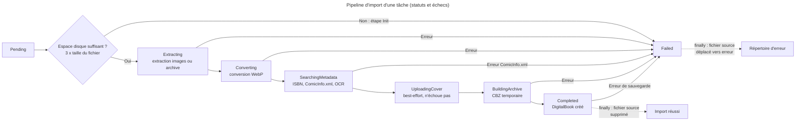
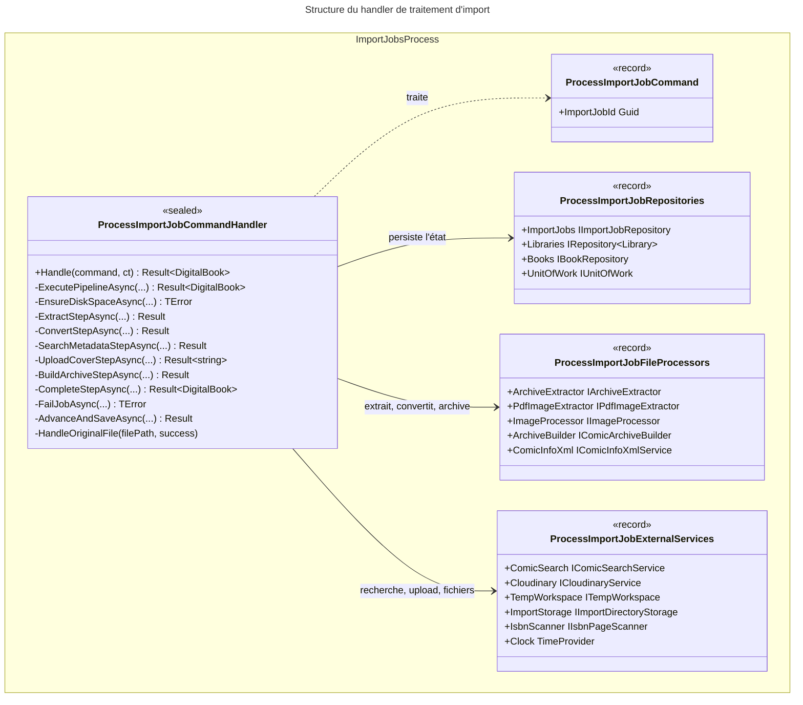

# C4 Code Level : ImportJobs/Process

## Vue d'ensemble

- **Nom** : Application.ImportJobs.Process
- **Description** : Pipeline asynchrone qui transforme un fichier source (CBZ, CBR, ZIP, RAR ou PDF) en livre numérique (`DigitalBook`) rangé dans la bibliothèque. Le pipeline enchaîne sept étapes avec persistance de l'état de la tâche à chaque transition : vérification d'espace disque, extraction, conversion WebP, recherche de métadonnées (ISBN, ComicInfo.xml, OCR), envoi de la couverture, construction de l'archive CBZ et finalisation.
- **Emplacement relatif** : [Application/ImportJobs/Process](../Application/ImportJobs/Process)
- **Langage** : C# (.NET 10), espace de noms `Application.ImportJobs.Process`
- **Objectif** : Exécuter de bout en bout l'import d'une tâche `Pending`, avec compensation des effets de bord fichiers et reprise des tâches bloquées.

## Éléments de code

### Commande

#### `ProcessImportJobCommand`

```csharp
public record ProcessImportJobCommand(Guid ImportJobId) : ICommand<DigitalBook>;
```

- **Description** : Commande de traitement d'une tâche. Retourne le `DigitalBook` créé.
- **Emplacement** : `Application/ImportJobs/Process/ProcessImportJobCommand.cs:6`
- **Dépendances** : `Application.Abstractions.Messaging.ICommand<TResponse>`, `Domain.Books.DigitalBook`

### Regroupements de dépendances (records)

#### `ProcessImportJobRepositories`

```csharp
public record ProcessImportJobRepositories(
    IImportJobRepository ImportJobs,
    IRepository<Library, Guid> Libraries,
    IBookRepository Books,
    IUnitOfWork UnitOfWork);
```

- **Description** : Regroupe les dépôts et l'unité de travail utilisés par le pipeline.
- **Emplacement** : `Application/ImportJobs/Process/ProcessImportJobRepositories.cs:6-10`

#### `ProcessImportJobExternalServices`

```csharp
public record ProcessImportJobExternalServices(
    IComicSearchService ComicSearch,
    ICloudinaryService Cloudinary,
    ITempWorkspace TempWorkspace,
    IImportDirectoryStorage ImportStorage,
    IIsbnPageScanner IsbnScanner,
    TimeProvider Clock);
```

- **Description** : Services externes et d'infrastructure : recherche de métadonnées par ISBN, upload Cloudinary, espace de travail temporaire, stockage du répertoire d'import, scanner OCR d'ISBN et horloge.
- **Emplacement** : `Application/ImportJobs/Process/ProcessImportJobExternalServices.cs:5-11`

#### `ProcessImportJobFileProcessors`

```csharp
public record ProcessImportJobFileProcessors(
    IArchiveExtractor ArchiveExtractor,
    IPdfImageExtractor PdfImageExtractor,
    IImageProcessor ImageProcessor,
    IComicArchiveBuilder ArchiveBuilder,
    IComicInfoXmlService ComicInfoXml);
```

- **Description** : Processeurs de fichiers : extraction d'archive, extraction d'images PDF, conversion WebP, construction du CBZ et lecture/écriture de `ComicInfo.xml`.
- **Emplacement** : `Application/ImportJobs/Process/ProcessImportJobFileProcessors.cs:5-10`

### Handler

#### `ProcessImportJobCommandHandler`

```csharp
public sealed class ProcessImportJobCommandHandler(
    ProcessImportJobRepositories repositories,
    ProcessImportJobFileProcessors fileProcessors,
    ProcessImportJobExternalServices externalServices,
    ILogger<ProcessImportJobCommandHandler> logger)
    : ICommandHandler<ProcessImportJobCommand, DigitalBook>
{
    private const string CompletedStatus = "Completed";

    public async Task<Result<DigitalBook>> Handle(ProcessImportJobCommand request, CancellationToken cancellationToken);
}
```

- **Description** : Point d'entrée du pipeline. Il garde la tâche, crée l'espace de travail, exécute le pipeline et nettoie dans tous les cas (bloc `finally`).

#### Méthodes privées (par ordre d'apparition)

| Méthode | Lignes | Rôle |
|---|---|---|
| `Handle(request, ct) : Task<Result<DigitalBook>>` | 21-69 | Garde ID vide, chargement de la tâche, reprise des tâches bloquées (lignes 34-48), chargement de la bibliothèque, création du répertoire de travail, `finally` : nettoyage et gestion du fichier source |
| `ExecutePipelineAsync(importJob, library, tempDir, rawDir, convertedDir, ct) : Task<Result<DigitalBook>>` | 73-117 | Enchaîne les 7 étapes, capture certaines exceptions (lignes 115-116) |
| `EnsureDiskSpaceAsync(importJob, ct) : Task<TError?>` | 121-129 | Étape « Init » : exige 3 × la taille du fichier d'espace libre |
| `HandleOriginalFile(filePath, success) : void` | 133-153 | Supprime le fichier source en cas de succès, sinon le déplace vers le répertoire d'erreur ; échecs journalisés en avertissement |
| `ExtractStepAsync(importJob, rawDir, ct) : Task<Result<ComicInfoData?>>` | 157-199 | Extraction des images (PDF) ou de l'archive (CBZ/CBR/ZIP/RAR) ; lecture optionnelle de `ComicInfo.xml` |
| `ConvertStepAsync(importJob, rawDir, convertedDir, ct) : Task<Result<ImageProcessingResult>>` | 203-240 | Conversion WebP avec progression persistée (tous les 10 % et à la fin, lignes 216-217) |
| `SearchMetadataStepAsync(importJob, comicInfo, conversion, pages, convertedDir, ct) : Task<Result<(BookMetadata Metadata, IsbnScanResult? IsbnScan)>>` | 244-300 | Métadonnées de base (ComicInfo ou nom de fichier), enrichissement par ISBN, écriture de `ComicInfo.xml` |
| `ResolveIsbnAsync(importJob, comicInfo, pages, ct) : Task<(string? Isbn, IsbnScanResult? Scan)>` | 303-322 | ISBN issu du nom de fichier ou de ComicInfo, sinon OCR des pages ; plusieurs ISBN : aucun retenu |
| `UploadCoverStepAsync(importJob, isbn, coverFiles, ct) : Task<Result<string>>` | 326-352 | Upload Cloudinary de la première image, en best-effort (ne fait jamais échouer le pipeline) |
| `BuildArchiveStepAsync(importJob, isbn, webpFiles, convertedDir, tempDir, ct) : Task<Result<(string OutputPath, string OutputFileName, long FileSize)>>` | 356-384 | Construction du CBZ dans le répertoire temporaire, nommé `{ISBN}.cbz` ou `{Id}.cbz` |
| `CompleteStepAsync(importJob, library, meta, isbnScan, archive, imageLink, ct) : Task<Result<DigitalBook>>` | 388-451 | Validation, déplacement vers la bibliothèque, création du `DigitalBook`, persistance et compensation |
| `HandleUnexpectedExceptionAsync(importJob, ex, ct) : Task<Result<DigitalBook>>` | 455-463 | Journalise l'exception, échoue la tâche avec le code `IMP500` (message tronqué à 500 caractères) |
| `AdvanceAndSaveAsync(importJob, status, ct) : Task<Result>` | 465-477 | Avance le statut de la tâche puis persiste |
| `FailJobAsync(importJob, step, error, ct) : Task<TError>` | 479-490 | Passe la tâche en `Failed` avec l'étape et le message, persiste, et retourne l'erreur |

- **Emplacement** : `Application/ImportJobs/Process/ProcessImportJobCommandHandler.cs:12-491`
- **Dépendances** :
  - `ProcessImportJobRepositories`, `ProcessImportJobFileProcessors`, `ProcessImportJobExternalServices`
  - `ILogger<ProcessImportJobCommandHandler>` (Microsoft.Extensions.Logging)
  - `ImportJob` (`Advance`, `Fail`, `Complete`, `UpdateConversionProgress`), `DigitalBook.Create`, `DigitalBook.RecordIsbnScan`
  - `FileNameIsbnExtractor`, `IsbnHelper` (`Application.Helpers`)
  - `ImportJobError`, `LibrariesError`, `BooksError`, `TError`

## Dépendances

### Dépendances internes

- `Application/Interfaces` : `IImportJobRepository`, `IRepository<TEntity, TEntityId>`, `IBookRepository`, `IUnitOfWork`, `IComicSearchService`, `ICloudinaryService`, `ITempWorkspace`, `IIsbnPageScanner`, `IArchiveExtractor`, `IPdfImageExtractor`, `IImageProcessor`, `IComicArchiveBuilder`, `IComicInfoXmlService`
- `Application/ImportJobs` : `IImportDirectoryStorage`
- `Application/Helpers` : `FileNameIsbnExtractor`, `IsbnHelper`
- `Application/Abstractions/Messaging` : `ICommand<TResponse>`, `ICommandHandler<TCommand, TResponse>`
- `Domain/ImportJobs` : `ImportJob`, `ImportJobStatus`, `ImportJobError`
- `Domain/Books` : `DigitalBook`, `BookMetadata`, `BooksError`
- `Domain/Libraries` : `Library`, `LibrariesError`
- `Domain/Primitives` : `Result`, `Result<T>`, `TError`

### Dépendances externes

- `Microsoft.Extensions.Logging` : `ILogger<T>` (journalisation par `SourceContext`, conforme à CLAUDE.md)
- BCL : `TimeProvider` (horloge), `IOException`, `InvalidOperationException`, `UnauthorizedAccessException`, `HttpRequestException`, `InvalidDataException`

## Relations

### Séquence des statuts



### Classes et dépendances



## Notes

- **Ordre des effets de bord (CLAUDE.md)** : dans `CompleteStepAsync`, la validation (`Serie`, `Title`, `FileSize`, lignes 404-407) précède le déplacement vers la bibliothèque (ligne 409). `DigitalBook.Create` peut échouer après le déplacement ; le fichier est alors supprimé (ligne 420), ce qui est une compensation défensive.
- **Compensation après échec de sauvegarde** : si `SaveChangesAsync` échoue à la ligne 435, le fichier déplacé est supprimé (ligne 439). La tâche n'est volontairement pas réessayée (commentaires lignes 441-444) ; elle reste dans un statut intermédiaire et sera passée en `Failed` lors d'une reprise.
- **Reprise des tâches bloquées** (lignes 34-48) : une tâche qui n'est ni `Pending` ni terminale est passée en `Failed` avec `ImportJobError.InvalidStatusTransition` lors d'un nouvel essai (par exemple une reprise Hangfire après exception non gérée).
- **Exceptions non capturées** : seules les exceptions listées à la ligne 115 sont converties en `IMP500`. Une autre exception se propage ; le `finally` de `Handle` déplace alors le fichier source vers le répertoire d'erreur, mais la tâche reste dans son statut intermédiaire jusqu'à la reprise.
- **Création du répertoire de travail** (ligne 56) hors du `try` : une exception à cet endroit n'entraîne pas de nettoyage du répertoire temporaire.
- **Cover best-effort** (lignes 340-351) : un échec d'upload ou un fichier illisible renvoie une chaîne vide et ne fait pas échouer l'import. La couverture est la première image WebP retournée par `GetWebpFiles` (ligne 342).
- **Métadonnées** : un ISBN unique est retenu ; s'il y en a plusieurs sur les pages, aucun n'est retenu et l'utilisateur doit choisir (lignes 313-319). La recherche par ISBN remplace serie, titre, auteurs, éditeurs, date et numéro de tome lorsque `Found` est vrai (lignes 271-280).
- **Date** : une année seule (mois et jour absents de ComicInfo.xml) est stockée au 1er janvier (lignes 264-267).
- **Étape d'échec de la finalisation** : une validation échouée dans `CompleteStepAsync` (ligne 406) enregistre l'étape `Completed` alors que la tâche est encore en `BuildingArchive`. Le champ `ErrorStep` ne reflète donc pas l'étape réellement en cours.
- **Résultat ignoré** : `importJob.Complete(digitalBook.Id)` (ligne 432) retourne un `Result` qui n'est pas consulté. Il n'échoue que si le statut n'est pas `BuildingArchive`, or l'étape 6 (ligne 364) vient de le positionner à cette valeur.
- **Erreur ComicInfo.xml à la lecture** : une lecture échouée est ignorée silencieusement (lignes 191-196) ; seule l'écriture (ligne 290) fait échouer l'étape.
- **Mise à jour de progression** : un échec de sauvegarde de progression est journalisé en avertissement et n'arrête pas la conversion (lignes 222-227).
