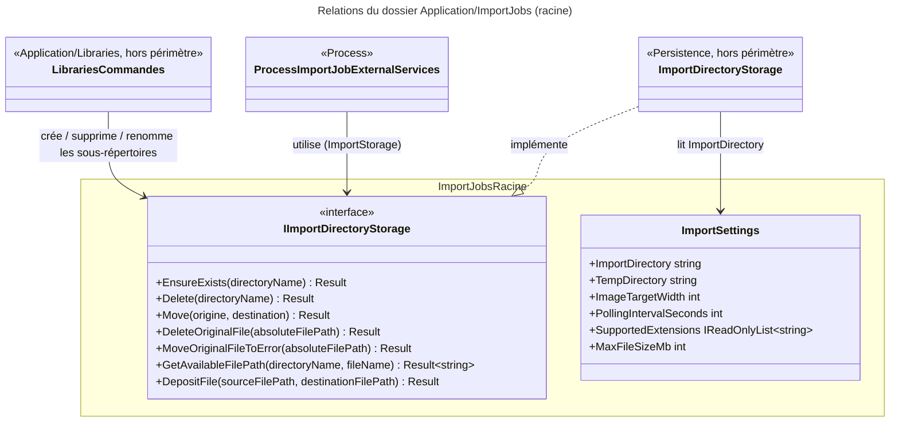

# C4 Code Level : ImportJobs (racine)

## Vue d'ensemble

- **Nom** : Application.ImportJobs (racine)
- **Description** : Contrats et paramètres partagés par toute la fonctionnalité d'import de fichiers numériques (CBZ, CBR, ZIP, RAR, PDF) : abstraction du stockage du répertoire d'import et options de configuration de l'import. Ce dossier ne contient aucun handler ; ceux-ci vivent dans les sous-dossiers `Create`, `Delete`, `ForceFail`, `GetById`, `List` et `Process`.
- **Emplacement relatif** : [Application/ImportJobs](../Application/ImportJobs)
- **Langage** : C# (.NET 10), espace de noms `Application.ImportJobs`
- **Objectif** : Définir le port de stockage du répertoire d'import (surveillé par le watcher) et les paramètres de l'import, sans dépendance vers l'infrastructure (implémentations dans `Persistence` et `Web`).

## Éléments de code

### Interfaces

#### `IImportDirectoryStorage`

```csharp
public interface IImportDirectoryStorage
{
    Result EnsureExists(string directoryName);
    Result Delete(string directoryName);
    Result Move(string originDirectoryName, string destinationDirectoryName);
    Result DeleteOriginalFile(string absoluteFilePath);
    Result MoveOriginalFileToError(string absoluteFilePath);
    Result<string> GetAvailableFilePath(string directoryName, string fileName);
    Result DepositFile(string sourceFilePath, string destinationFilePath);
}
```

- **Description** : Port d'accès au système de fichiers du répertoire d'import. Chaque opération retourne un `Result` (pas d'exception pour les cas métier connus).
  - `EnsureExists` : crée le sous-répertoire d'import d'une bibliothèque s'il n'existe pas.
  - `Delete` : supprime le sous-répertoire d'import d'une bibliothèque.
  - `Move` : renomme un sous-répertoire d'import (changement de nom de bibliothèque).
  - `DeleteOriginalFile` : supprime le fichier source après un import réussi.
  - `MoveOriginalFileToError` : déplace le fichier source vers le répertoire d'erreur après un échec.
  - `GetAvailableFilePath` : retourne un chemin absolu libre dans le répertoire d'import ; un suffixe est ajouté si le nom est déjà pris.
  - `DepositFile` : copie le fichier source en `{destination}.part` (ignoré par le watcher), puis le renomme sur place, pour que le watcher ne voie jamais un fichier partiel.
- **Emplacement** : `Application/ImportJobs/IImportDirectoryStorage.cs:5-19` (lignes 13-18 pour les commentaires de `GetAvailableFilePath` et `DepositFile`)
- **Implémentation connue** : `Persistence/LocalStorage/ImportDirectoryStorage.cs` (`ImportDirectoryStorage`, hors périmètre)
- **Dépendances** : `Domain.Primitives` (`Result`, `Result<T>`)

### Classes de configuration

#### `ImportSettings`

```csharp
public class ImportSettings
{
    public string ImportDirectory { get; set; } = "/data/import";
    public string TempDirectory { get; set; } = "/data/temp";
    public int ImageTargetWidth { get; set; } = 1400;
    public int PollingIntervalSeconds { get; set; } = 30;
    public IReadOnlyList<string> SupportedExtensions { get; set; } = [".cbz", ".cbr", ".zip", ".rar", ".pdf"];
    public int MaxFileSizeMb { get; set; } = 500;
}
```

- **Description** : Options de l'import, liées par `IOptions<ImportSettings>` (enregistrement dans `Web/Program.cs:46`).
  - `ImportDirectory` : racine du répertoire d'import surveillé.
  - `TempDirectory` : répertoire de travail temporaire (extraction, conversion, archive).
  - `ImageTargetWidth` : largeur cible (px) de la conversion des images.
  - `PollingIntervalSeconds` : intervalle d'interrogation du répertoire d'import.
  - `SupportedExtensions` : extensions acceptées par l'import.
  - `MaxFileSizeMb` : taille maximale d'un fichier importé.
- **Emplacement** : `Application/ImportJobs/ImportSettings.cs:3-11`
- **Consommateurs connus** (hors périmètre) : `Persistence/LocalStorage/TempWorkspace.cs`, `Persistence/LocalStorage/ImportDirectoryStorage.cs`, `Web/Services/FileWatcherService.cs`, `Web/Services/ImportService.cs`, `Web/Infrastructure/ImportDirectoryHealthCheck.cs`
- **Dépendances** : aucune (type POCO)

## Dépendances

### Dépendances internes

- `Domain.Primitives` : `Result` et `Result<T>` (retours de `IImportDirectoryStorage`)
- `Process` consomme `IImportDirectoryStorage` via `ProcessImportJobExternalServices.ImportStorage` (`DeleteOriginalFile`, `MoveOriginalFileToError`). `Application/Libraries/Create`, `Delete` et `Update` consomment `IImportDirectoryStorage` pour créer, supprimer et renommer les sous-répertoires d'import. Les sous-dossiers `Create`, `Delete`, `ForceFail`, `GetById` et `List` (ImportJobs) n'y font pas appel directement.

### Dépendances externes

- Aucune bibliothèque externe directe dans ce dossier (BCL uniquement : `IReadOnlyList<T>`).

## Relations



## Notes

- Le dossier ne contient pas de logique métier : c'est un port (`IImportDirectoryStorage`) et un objet de configuration (`ImportSettings`). Les valeurs par défaut de `ImportSettings` sont des chemins Linux (`/data/...`) ; elles sont surchargées par la configuration.
- `ImportSettings.ImageTargetWidth` n'est pas utilisé dans les sous-dossiers analysés ici ; sa consommation se situe dans le pipeline de conversion (hors périmètre).
- Les messages d'erreur de `FeedImports` mentionnent la clé `Import:MaxFileSizeMb`, ce qui suggère une liaison de `ImportSettings` à la section `Import` de la configuration.
