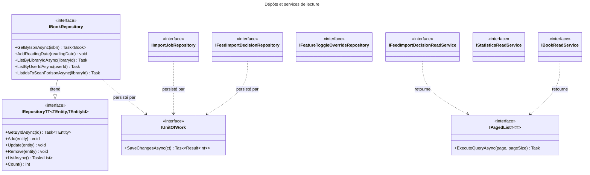
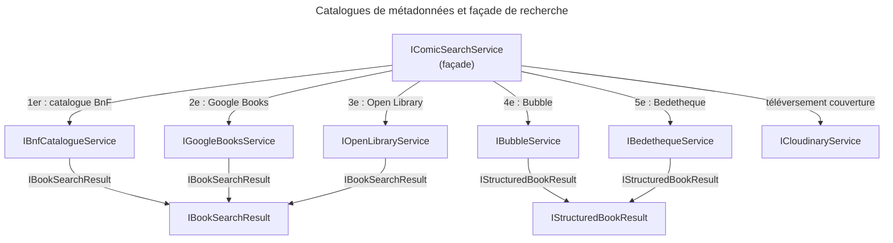
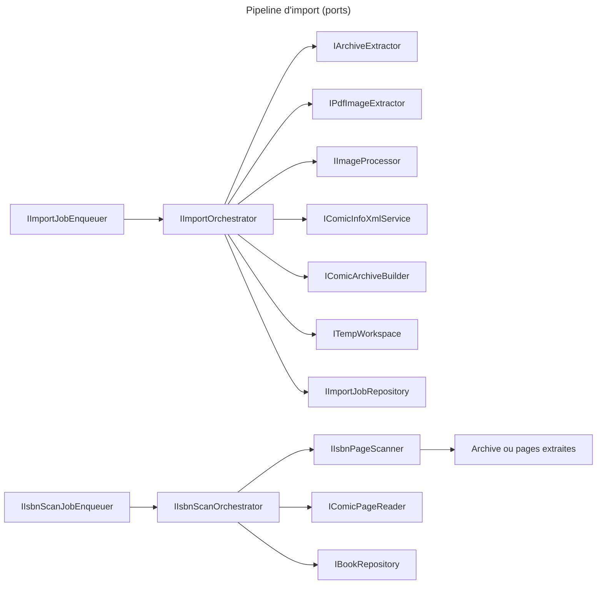

# C4 Code Level : Application.Interfaces

## Vue d'ensemble

- **Nom** : Application.Interfaces : ports de la couche Application
- **Description** : Ensemble des contrats (interfaces et records de transfert) que la couche Application exige de l'infrastructure : dépôts, services de lecture, catalogues de métadonnées, stockage temporaire, traitement d'images et d'archives, file de travaux, stockage Cloudinary, bascules de fonctionnalités.
- **Emplacement** : [Application/Interfaces/](../Application/Interfaces/) (36 fichiers)
- **Langage** : C# (.NET 10)
- **Objectif** : Inverser les dépendances : `Application` ne connaît que ces contrats, `Persistence` et `Web` les implémentent. Les implémentations des catalogues de métadonnées se trouvent dans `Application/ComicInfoSearch`, les autres dans `Persistence` ou `Web`.

## Éléments de code

Les types sont regroupés par thème. Chaque interface est listée avec ses membres publics. Les records de résultat déclarés dans le même fichier sont décrits avec leur interface.

### Dépôts et accès aux données

#### IRepository&lt;TEntity, TEntityId&gt;

- **Type** : interface générique publique
- **Signature** :

```csharp
public interface IRepository<TEntity, TEntityId>
{
    Task<TEntity?> GetByIdAsync(TEntityId id);
    void Add(TEntity entity);
    void Update(TEntity entity);
    void Remove(TEntity entity);
    Task<List<TEntity>> ListAsync();
    int Count();
}
```

- **Description** : Dépôt générique de base. Les modifications sont effectives après `IUnitOfWork.SaveChangesAsync`. `GetByIdAsync` et `ListAsync` n'ont pas de `CancellationToken`.
- **Emplacement** : [IRepository.cs](../Application/Interfaces/IRepository.cs) lignes 3-17
- **Dépendances** : aucune.
- **Étendue par** : `IBookRepository` (`IRepository<Book, Guid>`). Les dépôts de `Persistence` l'implémentent pour `Library` (`IRepository<Library, Guid>`), `User` (`IRepository<User, Guid>`) et les autres entités.

#### IBookRepository

- **Type** : interface publique, hérite de `IRepository<Book, Guid>`
- **Signature** :

```csharp
public interface IBookRepository : IRepository<Book, Guid>
{
    Task<Book?> GetByIsbnAsync(string isbn, CancellationToken cancellationToken = default);
    void AddReadingDate(ReadingDate readingDate);
    Task<List<Book>> ListByLibraryIdAsync(Guid libraryId, CancellationToken cancellationToken = default);
    Task<List<Book>> ListByUserIdAsync(Guid userId, CancellationToken cancellationToken = default);
    Task<List<Guid>> ListIdsToScanForIsbnAsync(Guid libraryId, CancellationToken cancellationToken = default);
}
```

- **Description** : Accès aux livres. `ListIdsToScanForIsbnAsync` renvoie les livres numériques de la bibliothèque sans ISBN et jamais analysés pour en trouver un.
- **Emplacement** : [IBookRepository.cs](../Application/Interfaces/IBookRepository.cs) lignes 5-14
- **Dépendances** : `Domain.Books.Book`, `Domain.Books.ReadingDate`.

#### IFeedImportDecisionRepository

- **Type** : interface publique
- **Signature** :

```csharp
public interface IFeedImportDecisionRepository
{
    void Add(FeedImportDecision decision);
    void Remove(FeedImportDecision decision);
    Task<FeedImportDecision?> GetByIdAsync(Guid id, CancellationToken ct = default);
    Task<FeedImportDecision?> GetByMinifluxEntryIdAsync(Guid userId, long minifluxEntryId, CancellationToken ct = default);
    Task<IReadOnlyList<Guid>> GetPendingIdsAsync(Guid userId, CancellationToken ct = default);
    Task<IReadOnlyList<Guid>> GetIdsByStatusAsync(Guid userId, FeedImportDecisionStatus status, CancellationToken ct = default);
    Task<IReadOnlyList<FeedImportDecision>> GetByStatusAsync(Guid userId, FeedImportDecisionStatus status, CancellationToken ct = default);
}
```

- **Description** : Décisions d'import issues des flux (un article de flux peut donner une décision par livre).
- **Emplacement** : [IFeedImportDecisionRepository.cs](../Application/Interfaces/IFeedImportDecisionRepository.cs) lignes 5-14
- **Dépendances** : `Domain.FeedImports.FeedImportDecision`, `Domain.FeedImports.FeedImportDecisionStatus`.

#### IImportJobRepository

- **Type** : interface publique
- **Signature** :

```csharp
public interface IImportJobRepository
{
    void Add(ImportJob importJob);
    void Remove(ImportJob importJob);
    Task<ImportJob?> GetByIdAsync(Guid id, CancellationToken ct = default);
    Task<IReadOnlyList<ImportJob>> GetByIdsAsync(IReadOnlyCollection<Guid> ids, CancellationToken ct = default);
    Task<IReadOnlyList<ImportJob>> GetByLibraryIdAsync(Guid libraryId, CancellationToken ct = default);
    Task<IReadOnlyList<ImportJob>> GetPendingAsync(CancellationToken ct = default);
    Task<bool> ExistsActiveForFilePathAsync(string filePath, CancellationToken ct = default);
    void Update(ImportJob importJob);
}
```

- **Description** : Travaux d'import de fichiers. `ExistsActiveForFilePathAsync` évite de lancer deux fois le même fichier.
- **Emplacement** : [IImportJobRepository.cs](../Application/Interfaces/IImportJobRepository.cs) lignes 5-15
- **Dépendances** : `Domain.ImportJobs.ImportJob`.

#### IFeatureToggleOverrideRepository

- **Type** : interface publique
- **Signature** :

```csharp
public interface IFeatureToggleOverrideRepository
{
    void Add(FeatureToggleOverride toggleOverride);
    void Remove(FeatureToggleOverride toggleOverride);
    Task<FeatureToggleOverride?> GetAsync(FeatureToggle toggle, CancellationToken ct = default);
    Task<IReadOnlyList<FeatureToggleOverride>> GetAllAsync(CancellationToken ct = default);
}
```

- **Description** : Persistance des valeurs choisies dans la page Réglages, qui priment sur la configuration.
- **Emplacement** : [IFeatureToggleOverrideRepository.cs](../Application/Interfaces/IFeatureToggleOverrideRepository.cs) lignes 5-11
- **Dépendances** : `Domain.Settings.FeatureToggle`, `Domain.Settings.FeatureToggleOverride`.

#### IIsbnBedethequeCacheRepository

- **Type** : interface publique
- **Signature** :

```csharp
public interface IIsbnBedethequeCacheRepository
{
    Task<string?> GetUrlByIsbnAsync(string isbn, CancellationToken ct = default);
    Task SaveAsync(string isbn, string url, CancellationToken ct = default);
}
```

- **Description** : Cache ISBN vers URL de l'album Bedetheque, pour ne pas payer une seconde recherche SerpApi.
- **Emplacement** : [IIsbnBedethequeCacheRepository.cs](../Application/Interfaces/IIsbnBedethequeCacheRepository.cs) lignes 4-8 (pragma `CA1054` aux lignes 3 et 9)
- **Dépendances** : aucune.

#### IUnitOfWork

- **Type** : interface publique
- **Signature** :

```csharp
public interface IUnitOfWork
{
    Task<Result<int>> SaveChangesAsync(CancellationToken cancellationToken);
}
```

- **Description** : Valide les modifications en attente. Renvoie le nombre d'entités écrites, ou une erreur.
- **Emplacement** : [IUnitOfWork.cs](../Application/Interfaces/IUnitOfWork.cs) lignes 5-8
- **Dépendances** : `Domain.Primitives.Result<TValue>`.

### Services de lecture (requêtes)

#### IBookReadService

- **Type** : interface publique
- **Signature** :

```csharp
public interface IBookReadService
{
    Task<IPagedList<BookSummaryDto>> GetPagedByLibraryAsync(
        Guid libraryId, Guid userId, int page, int pageSize,
        BookSortOrder sortOrder, string? searchTerm, CancellationToken cancellationToken = default);
    Task<IReadOnlyList<BookIdentityDto>> ListIdentitiesByUserAsync(Guid userId, CancellationToken cancellationToken = default);
    Task<IReadOnlyList<BookSerieLocationDto>> ListSerieLocationsAsync(Guid userId, CancellationToken cancellationToken = default);
}
```

- **Description** : Lectures optimisées pour les vues livres : pages de livres d'une bibliothèque, identités légères pour la détection de doublons, emplacements des séries pour suggérer où ranger un livre.
- **Emplacement** : [IBookReadService.cs](../Application/Interfaces/IBookReadService.cs) lignes 7-22
- **Dépendances** : `Domain.Libraries.BookSortOrder`, `Application.Books.List.BookSummaryDto`, `Application.Books.BookIdentityDto`, `Application.Books.BookSerieLocationDto`, `IPagedList<T>`.

#### IStatisticsReadService

- **Type** : interface publique
- **Signature** :

```csharp
public interface IStatisticsReadService
{
    Task<StatisticsDto> GetStatisticsAsync(
        Guid userId, Guid? libraryId, DateTime readingsFromUtc, CancellationToken cancellationToken = default);
}
```

- **Description** : Calcule les statistiques de l'utilisateur, éventuellement limitées à une bibliothèque. `ReadingsPerMonth` ne contient que les mois ayant au moins une lecture depuis `readingsFromUtc` (le complément des mois vides est fait par le handler).
- **Emplacement** : [IStatisticsReadService.cs](../Application/Interfaces/IStatisticsReadService.cs) lignes 5-17
- **Dépendances** : `Application.Statistics.Get.StatisticsDto`.

#### IFeedImportDecisionReadService

- **Type** : interface publique
- **Signature** :

```csharp
public interface IFeedImportDecisionReadService
{
    Task<IPagedList<FeedImportDecision>> GetPagedAsync(
        Guid userId, FeedImportDecisionStatus? status, string? searchTerm,
        int page, int pageSize, CancellationToken cancellationToken = default);
    Task<IReadOnlySet<long>> GetMultiBookEntryIdsAsync(
        Guid userId, IReadOnlyCollection<long> minifluxEntryIds, CancellationToken cancellationToken = default);
    Task<int> CountByStatusAsync(Guid userId, FeedImportDecisionStatus status, CancellationToken cancellationToken = default);
    Task<IReadOnlyDictionary<FeedImportDecisionStatus, int>> CountPerStatusAsync(Guid userId, CancellationToken cancellationToken = default);
}
```

- **Description** : Lectures paginées et compteurs des décisions d'import. `GetMultiBookEntryIdsAsync` renvoie les identifiants d'entrées Miniflux qui ont plusieurs décisions (article découpé en plusieurs livres). `CountPerStatusAsync` omet les statuts sans décision.
- **Emplacement** : [IFeedImportDecisionReadService.cs](../Application/Interfaces/IFeedImportDecisionReadService.cs) lignes 5-25
- **Dépendances** : `Domain.FeedImports.FeedImportDecision`, `Domain.FeedImports.FeedImportDecisionStatus`, `IPagedList<T>`.

#### IPagedList&lt;T&gt;

- **Type** : interface générique publique
- **Signature** :

```csharp
public interface IPagedList<T>
{
    bool HasNextPage { get; }
    bool HasPreviousPage { get; }
    IReadOnlyCollection<T>? Items { get; }
    int Page { get; }
    int PageSize { get; }
    int TotalCount { get; }
    Task<IPagedList<T>> ExecuteQueryAsync(int page, int pageSize, CancellationToken cancellationToken = default);
}
```

- **Description** : Page de résultats avec ses métadonnées. `ExecuteQueryAsync` permet de charger une autre page de la même requête (chargement différé).
- **Emplacement** : [IPagedList.cs](../Application/Interfaces/IPagedList.cs) lignes 3-13
- **Dépendances** : aucune.

#### IUserReadService

Ce service est déclaré dans `Application/Users` et non dans `Application/Interfaces` : voir [c4-code-Application-Users.md](c4-code-Application-Users.md).

### Catalogues de métadonnées (recherche par ISBN)

#### IBookSearchResult

- **Type** : interface publique, contrat commun des résultats de catalogues « plats » (titre unique)
- **Signature** :

```csharp
public interface IBookSearchResult
{
    string Title { get; }
    string? Subtitle { get; }
    IReadOnlyList<string> Authors { get; }
    IReadOnlyList<string> Publishers { get; }
    DateOnly? PublishDate { get; }
    int? NumberOfPages { get; }
    Uri? CoverUrl { get; }
    bool Found { get; }
    bool Failed { get; }
}
```

- **Description** : `Failed` distingue une source en erreur (délai, blocage) d'un livre absent (`Found` à `false`).
- **Emplacement** : [IBookSearchResult.cs](../Application/Interfaces/IBookSearchResult.cs) lignes 3-16
- **Implémentée par** : records `OpenLibraryBookResult` ([IOpenLibraryService.cs](../Application/Interfaces/IOpenLibraryService.cs)), `GoogleBooksBookResult` ([IGoogleBooksService.cs](../Application/Interfaces/IGoogleBooksService.cs)) et `BnfBookResult` ([IBnfCatalogueService.cs](../Application/Interfaces/IBnfCatalogueService.cs)). `BubbleBookResult` et `BedethequeBookResult` implémentent `IStructuredBookResult` à la place.

#### IStructuredBookResult

- **Type** : interface publique, contrat des résultats qui séparent la série et le numéro de tome
- **Signature** :

```csharp
public interface IStructuredBookResult
{
    string Title { get; }
    string Serie { get; }
    int VolumeNumber { get; }
    IReadOnlyList<string> Authors { get; }
    IReadOnlyList<string> Publishers { get; }
    DateOnly? PublishDate { get; }
    int? NumberOfPages { get; }
    Uri? CoverUrl { get; }
    bool Found { get; }
    bool Failed { get; }
}
```

- **Description** : Équivalent de `IBookSearchResult` pour les sources BD (Bedetheque, Bubble) qui fournissent la série et le tome séparément.
- **Emplacement** : [IStructuredBookResult.cs](../Application/Interfaces/IStructuredBookResult.cs) lignes 3-19
- **Implémentée par** : `BedethequeBookResult` (lignes 3-15 de [IBedethequeService.cs](../Application/Interfaces/IBedethequeService.cs)), `BubbleBookResult` (lignes 3-14 de [IBubbleService.cs](../Application/Interfaces/IBubbleService.cs)).

#### IBnfCatalogueService

- **Type** : interface publique
- **Signature** :

```csharp
public interface IBnfCatalogueService
{
    bool IsEnabled { get; }
    Task<BnfBookResult> SearchByIsbnAsync(string isbn, CancellationToken cancellationToken = default);
}
```

- **Record associé** : `BnfBookResult(string Title, string? Subtitle, IReadOnlyList<string> Authors, IReadOnlyList<string> Publishers, DateOnly? PublishDate, int? NumberOfPages, Uri? CoverUrl, bool Found, bool Failed = false) : IBookSearchResult` (lignes 4-14). `CoverUrl` est toujours `null`.
- **Description** : Catalogue de la BnF, qui connaît presque toutes les BD françaises (dépôt légal). `IsEnabled` est faux si la source est désactivée.
- **Emplacement** : [IBnfCatalogueService.cs](../Application/Interfaces/IBnfCatalogueService.cs) lignes 3-26
- **Implémentée par** : `BnfCatalogueService` ([BnfCatalogueService.cs](../Application/ComicInfoSearch/BnfCatalogueService.cs)).

#### IGoogleBooksService

- **Type** : interface publique
- **Signature** :

```csharp
public interface IGoogleBooksService
{
    bool IsEnabled { get; }
    Task<GoogleBooksBookResult> SearchByIsbnAsync(string isbn, CancellationToken cancellationToken = default);
}
```

- **Record associé** : `GoogleBooksBookResult(string Title, string? Subtitle, IReadOnlyList<string> Authors, IReadOnlyList<string> Publishers, DateOnly? PublishDate, int? NumberOfPages, Uri? CoverUrl, string? Description, IReadOnlyList<string> Categories, string? Language, bool Found, bool Failed = false) : IBookSearchResult` (lignes 3-16).
- **Description** : Google Books, interrogé par ISBN. `IsEnabled` reflète la configuration et les réglages.
- **Emplacement** : [IGoogleBooksService.cs](../Application/Interfaces/IGoogleBooksService.cs) lignes 3-25
- **Implémentée par** : `GoogleBooksService` ([GoogleBooksService.cs](../Application/ComicInfoSearch/GoogleBooksService.cs)).

#### IOpenLibraryService

- **Type** : interface publique
- **Signature** :

```csharp
public interface IOpenLibraryService
{
    bool IsEnabled { get; }
    Task<OpenLibraryBookResult> SearchByIsbnAsync(string isbn, CancellationToken cancellationToken = default);
}
```

- **Record associé** : `OpenLibraryBookResult(string Title, string? Subtitle, IReadOnlyList<string> Authors, IReadOnlyList<string> Publishers, DateOnly? PublishDate, int? NumberOfPages, Uri? CoverUrl, bool Found, bool Failed = false) : IBookSearchResult` (lignes 3-13).
- **Description** : Open Library, interrogée par ISBN.
- **Emplacement** : [IOpenLibraryService.cs](../Application/Interfaces/IOpenLibraryService.cs) lignes 3-21
- **Implémentée par** : `OpenLibraryService` ([OpenLibraryService.cs](../Application/ComicInfoSearch/OpenLibraryService.cs)).

#### IBubbleService

- **Type** : interface publique
- **Signature** :

```csharp
public interface IBubbleService
{
    bool IsEnabled { get; }
    Task<BubbleBookResult> SearchByIsbnAsync(string isbn, CancellationToken ct = default);
}
```

- **Record associé** : `BubbleBookResult(string Title, string Serie, int VolumeNumber, IReadOnlyList<string> Authors, IReadOnlyList<string> Publishers, DateOnly? PublishDate, int? NumberOfPages, Uri? CoverUrl, bool Found, bool Failed = false) : IStructuredBookResult` (lignes 3-14).
- **Description** : Bubble (bubblebd.com), interrogée par ISBN. `IsEnabled` est faux sans clé API.
- **Emplacement** : [IBubbleService.cs](../Application/Interfaces/IBubbleService.cs) lignes 3-22
- **Implémentée par** : `BubbleService` ([BubbleService.cs](../Application/ComicInfoSearch/BubbleService.cs)).

#### IBedethequeService

- **Type** : interface publique
- **Signature** :

```csharp
public interface IBedethequeService
{
    bool IsEnabled { get; }
    Task<BedethequeBookResult> SearchByIsbnAsync(string isbn, CancellationToken ct = default);
}
```

- **Record associé** : `BedethequeBookResult(string Title, string Serie, int VolumeNumber, IReadOnlyList<string> Authors, IReadOnlyList<string> Publishers, DateOnly? PublishDate, int? NumberOfPages, Uri? CoverUrl, bool Found, bool Failed = false) : IStructuredBookResult` (lignes 3-15).
- **Description** : Bedetheque, interrogée par ISBN. `IsEnabled` est faux si la source est désactivée dans la configuration.
- **Emplacement** : [IBedethequeService.cs](../Application/Interfaces/IBedethequeService.cs) lignes 3-23
- **Implémentée par** : `BedethequeService` ([BedethequeService.cs](../Application/ComicInfoSearch/BedethequeService.cs)).

#### IComicSearchService

- **Type** : interface publique, façade de recherche qui agrège les catalogues et envoie la couverture à Cloudinary
- **Signature** :

```csharp
public interface IComicSearchService
{
    Task<ComicSearchResult> SearchByIsbnAsync(string isbn, CancellationToken cancellationToken = default);
    Task<ComicSearchResult> SearchByIsbnWithLocalCoverAsync(
        string isbn, Stream? coverStream, string? coverFileName, CancellationToken cancellationToken = default);
    (string Title, string Serie, int VolumeNumber) ParseTitleInfo(string rawTitle, string? subtitle);
    Task<string> UploadCoverAsync(Uri coverUrl, string isbn, CancellationToken cancellationToken = default);
}
```

- **Record associé** : `ComicSearchResult(string Title, string Serie, string Isbn, int VolumeNumber, string ImageUrl, string Authors, string Publishers, DateOnly? PublishDate, int? NumberOfPages, bool Found)` avec la propriété `string? Source { get; init; }` (lignes 4-19). Les auteurs et éditeurs sont joints par des virgules. `Source` nomme le catalogue qui a trouvé le livre (« BnF », « Google Books »...).
- **Description** : Recherche le livre dans les catalogues, dans l'ordre de priorité, puis téléverse la couverture. `SearchByIsbnWithLocalCoverAsync` préfère une couverture locale fournie par l'utilisateur.
- **Emplacement** : [IComicSearchService.cs](../Application/Interfaces/IComicSearchService.cs) lignes 3-32 (pragma `CA1054, CA1056` lignes 3 et 20)
- **Implémentée par** : `ComicSearchService` ([ComicSearchService.cs](../Application/ComicInfoSearch/ComicSearchService.cs)).

#### IFeatureToggles

- **Type** : interface publique
- **Signature** :

```csharp
public interface IFeatureToggles
{
    bool IsEnabled(FeatureToggle toggle);
}
```

- **Description** : Indique si une fonctionnalité est active : la valeur choisie dans la page Réglages, à défaut la configuration.
- **Emplacement** : [IFeatureToggles.cs](../Application/Interfaces/IFeatureToggles.cs) lignes 5-9
- **Dépendances** : `Domain.Settings.FeatureToggle`.
- **Implémentée par** : `FeatureToggles` ([FeatureToggles.cs](../Application/Settings/FeatureToggles.cs)).

#### ICloudinaryService

- **Type** : interface publique
- **Signature** :

```csharp
public interface ICloudinaryService
{
    Task<CloudinaryUploadResult> UploadImageFromUrlAsync(Uri sourceUrl, string folder, string publicId, CancellationToken cancellationToken = default);
    Task<CloudinaryUploadResult> UploadImageFromFileAsync(string filePath, string folder, string publicId, CancellationToken cancellationToken = default);
    Task<CloudinaryUploadResult> UploadImageFromStreamAsync(Stream imageStream, string fileName, string folder, string publicId, CancellationToken cancellationToken = default);
    Task<bool> PingAsync(CancellationToken cancellationToken = default);
}
```

- **Record associé** : `CloudinaryUploadResult(Uri? Url, string? PublicId, bool Success, string? Error)` (lignes 3-8).
- **Description** : Téléversement d'images vers Cloudinary et test de disponibilité du service.
- **Emplacement** : [ICloudinaryService.cs](../Application/Interfaces/ICloudinaryService.cs) lignes 3-32
- **Implémentée par** : l'infrastructure (hors Application). Consommée par `ComicSearchService`.

#### ICurrentUserService

- **Type** : interface publique
- **Signature** :

```csharp
public interface ICurrentUserService
{
    Task<Result<Guid>> GetCurrentUserIdAsync(CancellationToken cancellationToken = default);
}
```

- **Description** : Identifiant de l'utilisateur courant, obtenu depuis le contexte d'authentification (implémentation côté Web).
- **Emplacement** : [ICurrentUserService.cs](../Application/Interfaces/ICurrentUserService.cs) lignes 5-8
- **Dépendances** : `Domain.Primitives.Result<TValue>`.

### Import de fichiers et traitement

#### IImportJobEnqueuer

- **Type** : interface publique
- **Signature** : `string Enqueue(Guid importJobId);`
- **Description** : Met un travail d'import en file d'attente et renvoie l'identifiant de la tâche en file.
- **Emplacement** : [IImportJobEnqueuer.cs](../Application/Interfaces/IImportJobEnqueuer.cs) lignes 3-6

#### IImportOrchestrator

- **Type** : interface publique
- **Signature** : `Task ProcessAsync(Guid importJobId, CancellationToken ct = default);`
- **Description** : Exécute un travail d'import de bout en bout (extraction, conversion, archivage, dépôt).
- **Emplacement** : [IImportOrchestrator.cs](../Application/Interfaces/IImportOrchestrator.cs) lignes 3-6

#### IIsbnScanJobEnqueuer

- **Type** : interface publique
- **Signature** : `string Enqueue(Guid libraryId);`
- **Description** : Met en file le scan ISBN d'une bibliothèque.
- **Emplacement** : [IIsbnScanJobEnqueuer.cs](../Application/Interfaces/IIsbnScanJobEnqueuer.cs) lignes 3-6

#### IIsbnScanOrchestrator

- **Type** : interface publique
- **Signature** : `Task ScanLibraryAsync(Guid libraryId, CancellationToken ct = default);`
- **Description** : Parcourt les livres numériques d'une bibliothèque sans ISBN et tente d'en lire un sur leurs pages.
- **Emplacement** : [IIsbnScanOrchestrator.cs](../Application/Interfaces/IIsbnScanOrchestrator.cs) lignes 3-6

#### IIsbnPageScanner

- **Type** : interface publique
- **Signature** :

```csharp
public interface IIsbnPageScanner
{
    Task<IsbnScanResult> ScanPagesAsync(IReadOnlyList<string> pageFiles, CancellationToken ct = default);
    Task<IsbnScanResult> ScanArchiveAsync(string archivePath, CancellationToken ct = default);
}
```

- **Record associé** : `IsbnScanResult(bool Completed, IReadOnlyList<string> Isbns)` avec `static IsbnScanResult NotScanned` (lignes 7-10). `Completed` à `false` signifie que les pages n'ont pas pu être lues (OCR désactivé, archive illisible) : le livre peut être rescanné plus tard.
- **Description** : Lit les premières et dernières pages d'un livre, les plus probables d'abord, jusqu'à trouver un ISBN.
- **Emplacement** : [IIsbnPageScanner.cs](../Application/Interfaces/IIsbnPageScanner.cs) lignes 4-22
- **Dépendances** : aucune.

#### IArchiveExtractor

- **Type** : interface publique
- **Signature** :

```csharp
public interface IArchiveExtractor
{
    Task<Result<ArchiveExtractionResult>> ExtractAsync(string archivePath, string destinationPath, CancellationToken ct = default);
    bool CanHandle(string filePath);
}
```

- **Record associé** : `ArchiveExtractionResult(IReadOnlyList<string> ExtractedFiles, string? ComicInfoXmlPath)` (lignes 5-7).
- **Description** : Extrait les images et les XML d'une archive zip, cbz, rar ou cbr. `CanHandle` indique si le format est pris en charge.
- **Emplacement** : [IArchiveExtractor.cs](../Application/Interfaces/IArchiveExtractor.cs) lignes 5-20

#### IPdfImageExtractor

- **Type** : interface publique
- **Signature** :

```csharp
public interface IPdfImageExtractor
{
    Task<Result<PdfExtractionResult>> ExtractImagesAsync(string pdfPath, string destinationPath, CancellationToken ct = default);
    bool CanHandle(string filePath);
}
```

- **Record associé** : `PdfExtractionResult(IReadOnlyList<string> ExtractedImagePaths, int PageCount)` (lignes 5-7).
- **Description** : Extrait les images intégrées de chaque page d'un PDF.
- **Emplacement** : [IPdfImageExtractor.cs](../Application/Interfaces/IPdfImageExtractor.cs) lignes 5-20
- **Dépendances** : `Domain.Primitives.Result<TValue>`.

#### IImageProcessor

- **Type** : interface publique
- **Signature** :

```csharp
public interface IImageProcessor
{
    Task<Result<ImageProcessingResult>> ProcessImagesAsync(
        string sourceDirectory, string destinationDirectory, int targetWidth = 1400,
        Func<ImageConversionProgress, Task>? onProgressAsync = null, CancellationToken ct = default);
}
```

- **Records associés** : `ImageProcessingResult(int ProcessedCount, int SkippedCount, bool AllAlreadyWebp)` (lignes 5-8) ; `ImageConversionProgress(int ConvertedCount, int TotalCount)` (ligne 10).
- **Description** : Convertit les images en WebP, les redimensionne à `targetWidth` et les écrit en séquence (`page-001.webp`, ...). L'étape est ignorée si toutes les sources sont déjà en WebP. `onProgressAsync` permet de sauvegarder la progression après chaque image.
- **Emplacement** : [IImageProcessor.cs](../Application/Interfaces/IImageProcessor.cs) lignes 5-27

#### IComicArchiveBuilder

- **Type** : interface publique
- **Signature** :

```csharp
public interface IComicArchiveBuilder
{
    Task<Result<ComicArchiveResult>> BuildAsync(
        IReadOnlyList<string> webpFiles, string? comicInfoXmlPath, string outputPath, CancellationToken ct = default);
}
```

- **Record associé** : `ComicArchiveResult(string ArchivePath, long FileSize, int PageCount)` (lignes 5-8).
- **Description** : Construit une archive CBZ (ZIP) à partir d'images WebP déjà listées et d'un `ComicInfo.xml` optionnel.
- **Emplacement** : [IComicArchiveBuilder.cs](../Application/Interfaces/IComicArchiveBuilder.cs) lignes 5-21

#### IComicPageReader

- **Type** : interface publique
- **Signature** :

```csharp
public interface IComicPageReader
{
    Task<Result<int>> CountPagesAsync(string archivePath, CancellationToken ct = default);
    Task<Result<ComicPage>> ReadPageAsync(string archivePath, int pageIndex, CancellationToken ct = default);
}
```

- **Record associé** : `ComicPage(ReadOnlyMemory<byte> Content, string ContentType, DateTime LastModifiedUtc)` (ligne 5).
- **Description** : Lit une page d'une archive de BD à la demande, directement dans l'archive, sans extraction sur disque.
- **Emplacement** : [IComicPageReader.cs](../Application/Interfaces/IComicPageReader.cs) lignes 5-16

#### IComicInfoXmlService

- **Type** : interface publique
- **Signature** :

```csharp
public interface IComicInfoXmlService
{
    Result<ComicInfoData> Read(string xmlPath);
    Result Write(string xmlPath, ComicInfoData data);
}
```

- **Record associé** : `ComicInfoData(string? Title, string? Series, int? Number, string? Summary, int? Year, int? Month, int? Day, string? Writer, string? Penciller, string? Publisher, string? Isbn, int? PageCount)` (lignes 5-17).
- **Description** : Lit et écrit les métadonnées d'un fichier `ComicInfo.xml`. `Write` omet les champs `null`.
- **Emplacement** : [IComicInfoXmlService.cs](../Application/Interfaces/IComicInfoXmlService.cs) lignes 5-30
- **Dépendances** : `Domain.Primitives.Result`, `Domain.Primitives.Result<TValue>`.

#### ITempWorkspace

- **Type** : interface publique
- **Signature** :

```csharp
public interface ITempWorkspace
{
    bool HasFreeSpace(long requiredBytes);
    (string TempDir, string RawDir, string ConvertedDir) CreateScratch(Guid jobId);
    IReadOnlyList<string> GetWebpFiles(string directory);
    Result<string> MoveToLibrary(string sourcePath, string libraryRelativePath, string fileName);
    void TryDeleteFile(string path);
    void CleanupDirectory(string dir);
}
```

- **Description** : Espace de travail temporaire d'un import (dossiers brut et converti, espace disque, déplacement vers la bibliothèque, nettoyage).
- **Emplacement** : [ITempWorkspace.cs](../Application/Interfaces/ITempWorkspace.cs) lignes 5-13
- **Dépendances** : `Domain.Primitives.Result<TValue>`.
- **Remarque** : `MoveToLibrary` modifie le système de fichiers ; le `CLAUDE.md` impose de valider les règles métier avant tout appel à ce service.

#### IBookFileService

- **Type** : interface publique
- **Signature** : `Task DeleteFileAsync(string filePath, CancellationToken cancellationToken = default);`
- **Description** : Supprime le fichier d'un livre sur le stockage.
- **Emplacement** : [IBookFileService.cs](../Application/Interfaces/IBookFileService.cs) lignes 3-6

## Dépendances

### Internes

- `Domain.Primitives` : `Result`, `Result<TValue>`, `SortOrder`.
- `Domain.Books` : `Book`, `ReadingDate`.
- `Domain.FeedImports` : `FeedImportDecision`, `FeedImportDecisionStatus`.
- `Domain.ImportJobs` : `ImportJob`.
- `Domain.Libraries` : `Library` (contexte des lectures par bibliothèque) et `BookSortOrder` (tri des livres).
- `Domain.Settings` : `FeatureToggle`, `FeatureToggleOverride`.
- `Application.Books` : `BookSummaryDto` (`Application/Books/List`), `BookIdentityDto`, `BookSerieLocationDto`.
- `Application.Statistics.Get` : `StatisticsDto`.
- `Application.Users` : `IUserReadService` (dans `Application/Users`).
- `Application.ComicInfoSearch` : implémentations des catalogues (dépendance inverse, hors des interfaces).

### Externes

- Aucune bibliothèque tierce : seulement `System` (`Task`, `CancellationToken`, `Stream`, `Uri`, `DateOnly`, `ReadOnlyMemory<T>`).

## Relations

### Dépôts et lectures



### Catalogues de métadonnées



### Import et traitement de fichiers



## Notes

- **Nommage** : `IComicSearchService` (façade) et `IIsbnScanOrchestrator` / `IImportOrchestrator` coexistent ; les records de résultat (`BnfBookResult`, `ComicSearchResult`, ...) sont déclarés dans les fichiers des interfaces, pas dans des fichiers séparés.
- **Divergence de type** : `IBookSearchResult` (titre unique) et `IStructuredBookResult` (série et tome séparés) ne partagent pas de type de base. `ComicSearchService` les traite par deux méthodes de mapping distinctes.
- **Cohérence des signatures** : `IRepository` n'accepte pas de `CancellationToken` et son `Count()` est synchrone, contrairement aux autres dépôts (`IBookRepository`, `IImportJobRepository`...).
- **Paramètres des interfaces** : `IBubbleService.SearchByIsbnAsync` et `IBedethequeService.SearchByIsbnAsync` nomment le jeton `ct`, les autres `cancellationToken` ; le comportement ne change pas.
- **Ports sans implémentation dans `Application`** : `ICloudinaryService`, `IBookFileService`, `ITempWorkspace`, `IImportJobEnqueuer` et `IIsbnScanJobEnqueuer` sont implémentés en dehors de la couche Application.
