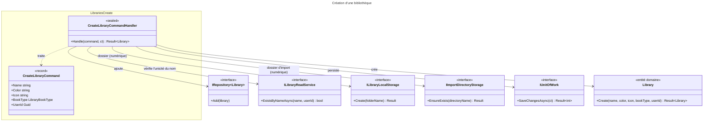

# C4 Code Level : Libraries/Create

## Vue d'ensemble

- **Nom** : Application.Libraries.Create
- **Description** : Commande et handler de création d'une bibliothèque. Vérifie l'unicité du nom pour l'utilisateur, valide la création via l'entité `Library`, crée les dossiers de stockage et d'import pour une bibliothèque numérique, puis persiste.
- **Emplacement relatif** : [Application/Libraries/Create](../Application/Libraries/Create)
- **Langage** : C# (.NET 10), espace de noms `Application.Libraries.Create`
- **Objectif** : Créer une bibliothèque pour un utilisateur, avec son espace de stockage physique lorsqu'elle est de type numérique.

## Éléments de code

### Commandes

#### `CreateLibraryCommand`

```csharp
public record CreateLibraryCommand(
    string Name,
    string Color,
    string Icon,
    LibraryBookType BookType,
    Guid UserId
) : ICommand<Library>;
```

- **Description** : Commande (record) portant les attributs de la bibliothèque et son propriétaire. Retourne l'entité `Library` créée.
- **Emplacement** : `Application/Libraries/Create/CreateLibraryCommand.cs:6-12`
- **Dépendances** : `Application.Abstractions.Messaging.ICommand<TResponse>`, `Domain.Libraries.Library`, `Domain.Libraries.LibraryBookType`

### Handlers

#### `CreateLibraryCommandHandler`

```csharp
public sealed class CreateLibraryCommandHandler(
    IRepository<Library, Guid> libraryRepository,
    IUnitOfWork unitOfWork,
    ILibraryReadService libraryReadService,
    ILibraryLocalStorage libraryLocalStorage,
    IImportDirectoryStorage importDirectoryStorage)
    : ICommandHandler<CreateLibraryCommand, Library>
{
    public async Task<Result<Library>> Handle(CreateLibraryCommand request, CancellationToken cancellationToken);
}
```

- **Description** : Orchestre la création en six étapes :
  1. `Guard.Against.Null(request)` (ligne 14).
  2. Unicité du nom pour l'utilisateur via `ExistsByNameAsync` ; retourne `LibrariesError.Duplicate` (lignes 17-20).
  3. Création de l'entité via `Library.Create` ; propage l'erreur de validation du domaine (lignes 23-27).
  4. Si `BookType == Digital` uniquement (lignes 32-45) :
     - `libraryLocalStorage.Create(library.RelativePath)` ; `LibrariesError.FolderNotCreated` en cas d'échec (lignes 34-38) ;
     - `importDirectoryStorage.EnsureExists(library.ImportDirectoryName)` ; `LibrariesError.FolderNotCreated` en cas d'échec (lignes 40-44).
  5. `libraryRepository.Add(library)` (ligne 47) puis `SaveChangesAsync` (lignes 48-52).
  6. Retourne la bibliothèque (ligne 54).
- **Emplacement** : `Application/Libraries/Create/CreateLibraryCommandHandler.cs:10-56` (classe ligne 10, méthode `Handle` lignes 12-55)
- **Dépendances** :
  - `IRepository<Library, Guid>` : `Add`
  - `IUnitOfWork` : `SaveChangesAsync`
  - `ILibraryReadService` : `ExistsByNameAsync(name, userId, cancellationToken: ...)`
  - `ILibraryLocalStorage` : `Create`
  - `IImportDirectoryStorage` : `EnsureExists`
  - `Library.Create`, `Library.RelativePath`, `Library.ImportDirectoryName` (domaine)
  - `LibrariesError.Duplicate`, `LibrariesError.FolderNotCreated`
  - `Ardalis.GuardClauses`

## Dépendances

### Dépendances internes

- `Application/Interfaces` : `IRepository<TEntity, TEntityId>`, `IUnitOfWork`
- `Application/Libraries` : `ILibraryReadService`, `ILibraryLocalStorage`
- `Application/ImportJobs` : `IImportDirectoryStorage`
- `Application/Abstractions/Messaging` : `ICommand<TResponse>`, `ICommandHandler<TCommand, TResponse>`
- `Domain/Libraries` : `Library`, `LibraryBookType`, `LibrariesError`
- `Domain/Primitives` : `Result<T>`

### Dépendances externes

- `Ardalis.GuardClauses` : `Guard.Against.Null`

## Relations



## Notes

- **Effets de bord avant persistance** : les dossiers sont créés (lignes 34 et 40) avant `SaveChangesAsync` (ligne 48). Si la sauvegarde échoue, les dossiers créés ne sont pas supprimés : aucune compensation n'est prévue.
- **Échec partiel** : si la création du dossier d'import (ligne 40) échoue après celle du dossier de bibliothèque, ce dernier reste en place et aucune erreur n'est nettoyée.
- **Vérification puis action** : l'unicité du nom est testée avant l'insertion sans verrou ; deux créations simultanées peuvent passer le contrôle (la protection finale dépend d'une contrainte d'unicité en base, hors périmètre).
- **Collision de dossiers** : `Library.RelativePath` est le nom en majuscules sans diacritiques (`Domain/Libraries/Library.cs:21`). Deux noms qui ne diffèrent que par la casse ou les accents donnent le même dossier ; la portée réelle de `ExistsByNameAsync` dans `Persistence` est à vérifier.
- Le type de bibliothèque est validé par `Enum.IsDefined` dans `Library.Create`, pas dans le handler.
- `ILibraryReadService.ExistsByNameAsync` est appelé avec `cancellationToken:` nommé, les autres appels du même handler utilisent la position.
