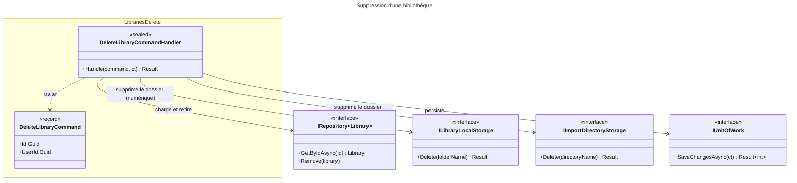

# C4 Code Level : Libraries/Delete

## Vue d'ensemble

- **Nom** : Application.Libraries.Delete
- **Description** : Commande et handler de suppression d'une bibliothèque appartenant à l'utilisateur. Pour une bibliothèque numérique, supprime d'abord le dossier de stockage puis le sous-répertoire d'import, puis retire l'entité et persiste.
- **Emplacement relatif** : [Application/Libraries/Delete](../Application/Libraries/Delete)
- **Langage** : C# (.NET 10), espace de noms `Application.Libraries.Delete`
- **Objectif** : Supprimer une bibliothèque et ses dossiers physiques, avec contrôle de propriété.

## Éléments de code

### Commandes

#### `DeleteLibraryCommand`

```csharp
public record DeleteLibraryCommand(Guid Id, Guid UserId) : ICommand;
```

- **Description** : Commande sans valeur de retour identifiant la bibliothèque et l'utilisateur demandeur.
- **Emplacement** : `Application/Libraries/Delete/DeleteLibraryCommand.cs:5`
- **Dépendances** : `Application.Abstractions.Messaging.ICommand`

### Handlers

#### `DeleteLibraryCommandHandler`

```csharp
public sealed class DeleteLibraryCommandHandler(
    IRepository<Library, Guid> librayRepository,
    IUnitOfWork unitOfWork,
    ILibraryLocalStorage libraryLocalStorage,
    IImportDirectoryStorage importDirectoryStorage)
    : ICommandHandler<DeleteLibraryCommand>
{
    public async Task<Result> Handle(DeleteLibraryCommand request, CancellationToken cancellationToken);
}
```

- **Description** : Supprime la bibliothèque en quatre étapes :
  1. Si la requête est nulle, retourne `LibrariesError.ValidationError` (lignes 13-16).
  2. Chargement ; `LibrariesError.NotFound` si absente ou non possédée par `UserId` (lignes 18-23).
  3. Si `BookType == Digital` (lignes 26-35) :
     - `libraryLocalStorage.Delete(library.RelativePath)` ; `LibrariesError.FolderNotDeleted` en cas d'échec (lignes 28-32) ;
     - `importDirectoryStorage.Delete(library.ImportDirectoryName)` (ligne 34). Le résultat n'est pas consulté.
  4. `Remove` puis `SaveChangesAsync` (lignes 37-42) ; retourne `Result.Success()` (ligne 44).
- **Emplacement** : `Application/Libraries/Delete/DeleteLibraryCommandHandler.cs:9-46` (classe ligne 9, méthode `Handle` lignes 11-45)
- **Dépendances** :
  - `IRepository<Library, Guid>` : `GetByIdAsync`, `Remove`
  - `IUnitOfWork` : `SaveChangesAsync`
  - `ILibraryLocalStorage` : `Delete`
  - `IImportDirectoryStorage` : `Delete`
  - `LibrariesError.ValidationError`, `NotFound`, `FolderNotDeleted`

## Dépendances

### Dépendances internes

- `Application/Interfaces` : `IRepository<TEntity, TEntityId>`, `IUnitOfWork`
- `Application/Libraries` : `ILibraryLocalStorage`
- `Application/ImportJobs` : `IImportDirectoryStorage`
- `Application/Abstractions/Messaging` : `ICommand`, `ICommandHandler<TCommand>`
- `Domain/Libraries` : `Library`, `LibraryBookType`, `LibrariesError`
- `Domain/Primitives` : `Result`

### Dépendances externes

- Aucune.

## Relations



## Notes

- **Ordre des effets de bord** : les dossiers sont supprimés (lignes 28 et 34) avant `SaveChangesAsync` (ligne 38). Si la sauvegarde échoue, la bibliothèque existe en base mais ses dossiers ont disparu, sans compensation.
- **Résultat ignoré** : `importDirectoryStorage.Delete` (ligne 34) n'est pas vérifié. Un échec de suppression du dossier d'import est silencieux, alors que celui du dossier de bibliothèque (ligne 28) bloque l'opération.
- **Contenu de la bibliothèque** : le handler ne vérifie ni la présence de livres ni celle de tâches d'import actives dans la bibliothèque. Le comportement dépend de la configuration de suppression en cascade côté `Persistence` (hors périmètre).
- **Nommage** : le paramètre du constructeur s'appelle `librayRepository` (faute de frappe ligne 9).
- La bibliothèque physique n'est pas touchée pour les bibliothèques de type `Physical` : seule l'entité est retirée.
