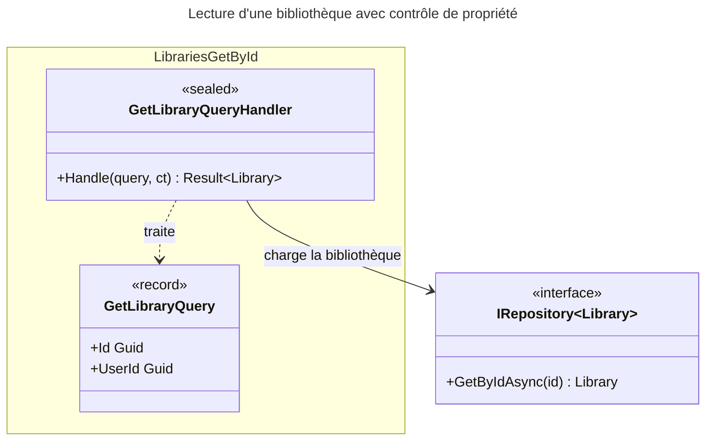

# C4 Code Level : Libraries/GetById

## Vue d'ensemble

- **Nom** : Application.Libraries.GetById
- **Description** : Requête et handler de lecture d'une bibliothèque par son identifiant, avec contrôle de propriété.
- **Emplacement relatif** : [Application/Libraries/GetById](../Application/Libraries/GetById)
- **Langage** : C# (.NET 10), espace de noms `Application.Libraries.GetById`
- **Objectif** : Fournir une bibliothèque à son propriétaire ; sert notamment de contrôle d'accès pour les autres cas d'usage.

## Éléments de code

### Requêtes

#### `GetLibraryQuery`

```csharp
public record GetLibraryQuery(Guid Id, Guid UserId) : IQuery<Library>;
```

- **Description** : Requête (record) identifiant la bibliothèque et l'utilisateur demandeur ; retourne l'entité `Library`.
- **Emplacement** : `Application/Libraries/GetById/GetLibraryQuery.cs:6`
- **Dépendances** : `Application.Abstractions.Messaging.IQuery<TResponse>`, `Domain.Libraries.Library`

### Handlers

#### `GetLibraryQueryHandler`

```csharp
public sealed class GetLibraryQueryHandler(IRepository<Library, Guid> libraryRepository)
    : IQueryHandler<GetLibraryQuery, Library>
{
    public async Task<Result<Library>> Handle(GetLibraryQuery request, CancellationToken cancellationToken);
}
```

- **Description** : Lit la bibliothèque :
  1. Si la requête est nulle, retourne `LibrariesError.ValidationError` (lignes 12-15).
  2. Chargement ; `LibrariesError.NotFound` si absente (lignes 17-21).
  3. Contrôle de propriété ; `LibrariesError.NotFound` si `UserId` ne correspond pas (lignes 23-26).
  4. Retourne la bibliothèque (ligne 28).
- **Emplacement** : `Application/Libraries/GetById/GetLibraryQueryHandler.cs:8-30` (méthode `Handle` lignes 10-29)
- **Dépendances** :
  - `IRepository<Library, Guid>` : `GetByIdAsync(id)`
  - `LibrariesError.ValidationError`, `LibrariesError.NotFound`

## Dépendances

### Dépendances internes

- `Application/Interfaces` : `IRepository<TEntity, TEntityId>`
- `Application/Abstractions/Messaging` : `IQuery<TResponse>`, `IQueryHandler<TQuery, TResponse>`
- `Domain/Libraries` : `Library`, `LibrariesError`
- `Domain/Primitives` : `Result<T>`

### Dépendances externes

- Aucune.

## Relations



## Notes

- Une bibliothèque absente et une bibliothèque d'un autre utilisateur renvoient le même `LibrariesError.NotFound`, ce qui évite de confirmer son existence.
- `IRepository.GetByIdAsync` est appelé sans `CancellationToken` (ligne 17).
- Ce handler est le seul de ce dossier à ne pas être une commande ; il ne modifie pas l'état.
