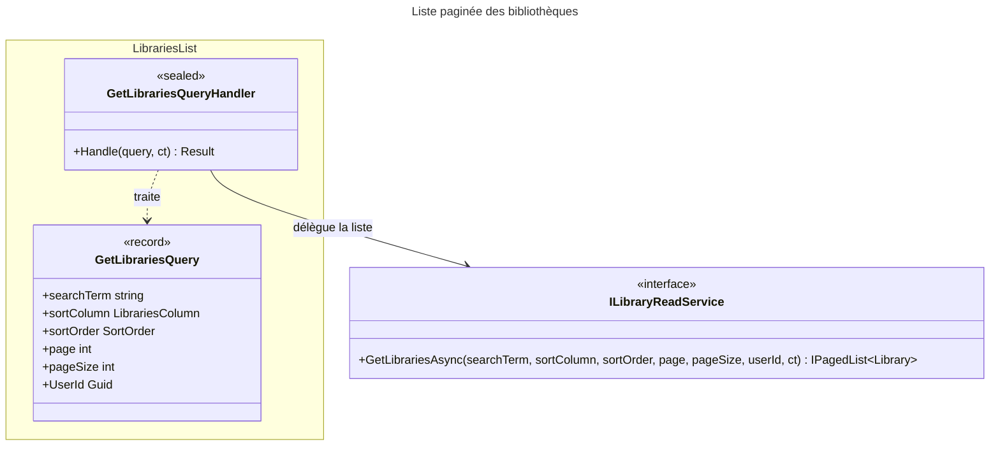

# C4 Code Level : Libraries/List

## Vue d'ensemble

- **Nom** : Application.Libraries.List
- **Description** : Requête et handler de liste paginée des bibliothèques d'un utilisateur, avec recherche textuelle et tri. Le handler délègue l'ensemble de la requête au service de lecture.
- **Emplacement relatif** : [Application/Libraries/List](../Application/Libraries/List)
- **Langage** : C# (.NET 10), espace de noms `Application.Libraries.List`
- **Objectif** : Alimenter la page de liste des bibliothèques de l'utilisateur.

## Éléments de code

### Requêtes

#### `GetLibrariesQuery`

```csharp
public record GetLibrariesQuery(
    string? searchTerm,
    LibrariesColumn? sortColumn,
    SortOrder? sortOrder,
    int page,
    int pageSize,
    Guid UserId
) : IQuery<IPagedList<Library>>;
```

- **Description** : Requête (record) de liste paginée. `searchTerm` filtre les noms, `sortColumn` et `sortOrder` définissent le tri, `page` et `pageSize` la pagination, `UserId` restreint à l'utilisateur.
- **Emplacement** : `Application/Libraries/List/GetLibrariesQuery.cs:8-15`
- **Dépendances** : `Application.Abstractions.Messaging.IQuery<TResponse>`, `Application.Interfaces.IPagedList<T>`, `Domain.Libraries.Library`, `Domain.Libraries.LibrariesColumn`, `Domain.Primitives.SortOrder`

### Handlers

#### `GetLibrariesQueryHandler`

```csharp
public sealed class GetLibrariesQueryHandler(ILibraryReadService libraryReadService)
    : IQueryHandler<GetLibrariesQuery, IPagedList<Library>>
{
    public async Task<Result<IPagedList<Library>>> Handle(GetLibrariesQuery request, CancellationToken cancellationToken);
}
```

- **Description** : Vérifie que la requête n'est pas nulle (sinon `LibrariesError.ValidationError`, lignes 14-17), puis appelle `GetLibrariesAsync` avec tous les paramètres (ligne 19) et retourne le résultat en `Result.Success` (ligne 21).
- **Emplacement** : `Application/Libraries/List/GetLibrariesQueryHandler.cs:10-23` (méthode `Handle` lignes 12-22 ; commentaire de provenance ligne 6)
- **Dépendances** :
  - `ILibraryReadService` : `GetLibrariesAsync(searchTerm, sortColumn, sortOrder, page, pageSize, userId, ct)`
  - `LibrariesError.ValidationError`

## Dépendances

### Dépendances internes

- `Application/Libraries` : `ILibraryReadService`
- `Application/Interfaces` : `IPagedList<T>`
- `Application/Abstractions/Messaging` : `IQuery<TResponse>`, `IQueryHandler<TQuery, TResponse>`
- `Domain/Libraries` : `Library`, `LibrariesColumn`, `LibrariesError`
- `Domain/Primitives` : `Result<T>`, `SortOrder`

### Dépendances externes

- Aucune.

## Relations



## Notes

- Le handler ne valide pas `page` ni `pageSize` (valeurs nulles, négatives ou nulles) : cette responsabilité est reportée sur le service de lecture.
- Le handler ne contrôle pas que `UserId` est non vide, contrairement à `GetLibrarySummariesQueryHandler`.
- Incohérence de nommage : `searchTerm` et `sortColumn` sont en camelCase, `UserId` en PascalCase. Le handler utilise `request.searchTerm` (ligne 19).
- Le commentaire de la ligne 6 indique une source externe (une vidéo). La provenance et la licence de ce code doivent être vérifiées.
- La règle de CLAUDE.md sur le tri déterministe (clé de départage unique) s'applique à la requête SQL du service de lecture, hors de ce périmètre : ce n'est pas vérifiable ici.
