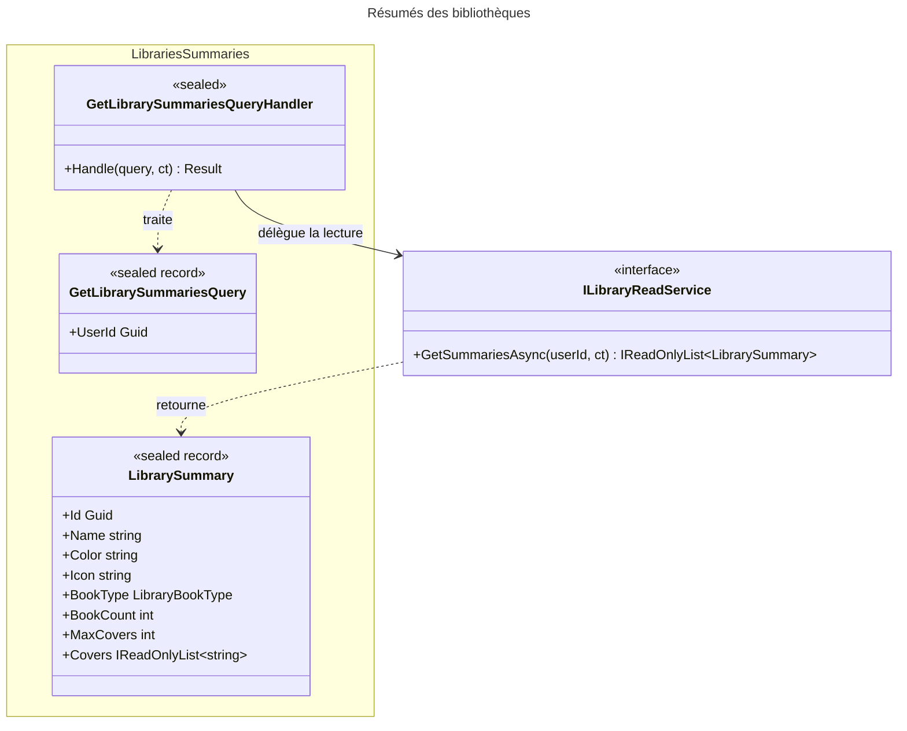

# C4 Code Level : Libraries/Summaries

## Vue d'ensemble

- **Nom** : Application.Libraries.Summaries
- **Description** : Requête et handler de résumés de bibliothèques (nom, couleur, icône, type, nombre de livres et dernières couvertures) destinés à la navigation et à la page des bibliothèques. Contient aussi le type de résumé `LibrarySummary`.
- **Emplacement relatif** : [Application/Libraries/Summaries](../Application/Libraries/Summaries)
- **Langage** : C# (.NET 10), espace de noms `Application.Libraries.Summaries`
- **Objectif** : Fournir en une seule requête les données d'affichage de toutes les bibliothèques d'un utilisateur, sans charger les entités complètes.

## Éléments de code

### Requêtes

#### `GetLibrarySummariesQuery`

```csharp
public sealed record GetLibrarySummariesQuery(Guid UserId) : IQuery<IReadOnlyList<LibrarySummary>>;
```

- **Description** : Requête (record scellé) pour l'utilisateur demandeur ; retourne la liste des résumés.
- **Emplacement** : `Application/Libraries/Summaries/GetLibrarySummariesQuery.cs:5`
- **Dépendances** : `Application.Abstractions.Messaging.IQuery<TResponse>`, `LibrarySummary`

### Handlers

#### `GetLibrarySummariesQueryHandler`

```csharp
public sealed class GetLibrarySummariesQueryHandler(ILibraryReadService libraryReadService)
    : IQueryHandler<GetLibrarySummariesQuery, IReadOnlyList<LibrarySummary>>
{
    public async Task<Result<IReadOnlyList<LibrarySummary>>> Handle(GetLibrarySummariesQuery request, CancellationToken cancellationToken);
}
```

- **Description** : Valide la requête puis délègue la lecture.
  1. Si la requête est nulle ou si `UserId == Guid.Empty`, retourne `LibrariesError.ValidationError` (lignes 12-15).
  2. Appelle `GetSummariesAsync(UserId, ct)` (ligne 17) et retourne le résultat en `Result.Success` (ligne 19).
- **Emplacement** : `Application/Libraries/Summaries/GetLibrarySummariesQueryHandler.cs:7-21` (méthode `Handle` lignes 10-20)
- **Dépendances** :
  - `ILibraryReadService` : `GetSummariesAsync(userId, ct)`
  - `LibrariesError.ValidationError`

### Types de résultat

#### `LibrarySummary`

```csharp
public sealed record LibrarySummary(
    Guid Id,
    string Name,
    string Color,
    string Icon,
    LibraryBookType BookType,
    int BookCount)
{
    public const int MaxCovers = 3;
    public IReadOnlyList<string> Covers { get; init; } = [];
}
```

- **Description** : Vue légère d'une bibliothèque : de quoi l'afficher et établir un lien. `BookCount` est le nombre de livres. `Covers` contient les URL d'image des derniers livres ayant une couverture, du plus récent au plus ancien, dans la limite de `MaxCovers`.
- **Emplacement** : `Application/Libraries/Summaries/LibrarySummary.cs:5-19` (`MaxCovers` ligne 15, `Covers` ligne 18)
- **Dépendances** : `Domain.Libraries.LibraryBookType`

## Dépendances

### Dépendances internes

- `Application/Libraries` : `ILibraryReadService`
- `Application/Abstractions/Messaging` : `IQuery<TResponse>`, `IQueryHandler<TQuery, TResponse>`
- `Domain/Libraries` : `LibraryBookType`, `LibrariesError`
- `Domain/Primitives` : `Result<T>`

### Dépendances externes

- BCL : `IReadOnlyList<T>`

## Relations



## Notes

- Les résumés sont triés par nom et sont fournis sans pagination : la liste complète des bibliothèques de l'utilisateur est retournée.
- `Covers` est une propriété `init` et non un paramètre positionnel : elle ne fait pas partie du constructeur, mais participe à l'égalité d'enregistrement.
- Le contrat « au plus `MaxCovers` couvertures, les plus récentes d'abord » est documenté dans le code mais son application relève du service de lecture (hors périmètre).
- La règle de tri déterministe de CLAUDE.md (clé de départage) concerne la requête de lecture, hors de ce périmètre.
