# C4 Code Level : Libraries/Update

## Vue d'ensemble

- **Nom** : Application.Libraries.Update
- **Description** : Commande et handler de mise à jour d'une bibliothèque : couleur, icône, ordre de tri par défaut des livres et, optionnellement, nom. Un changement de nom déplace les dossiers de stockage et d'import pour une bibliothèque numérique, avec restauration en cas d'échec partiel.
- **Emplacement relatif** : [Application/Libraries/Update](../Application/Libraries/Update)
- **Langage** : C# (.NET 10), espace de noms `Application.Libraries.Update`
- **Objectif** : Permettre à l'utilisateur propriétaire de modifier sa bibliothèque, en gardant le système de fichiers cohérent avec le nom.

## Éléments de code

### Commandes

#### `UpdateLibraryCommand`

```csharp
public record UpdateLibraryCommand(
    Guid Id,
    string? Name,
    string Color,
    string Icon,
    Guid UserId,
    BookSortOrder? DefaultBookSortOrder = null
) : ICommand<Library>;
```

- **Description** : Commande (record) de mise à jour. `Name` nul signifie « ne pas renommer » ; `DefaultBookSortOrder` nul signifie « ne pas changer le tri ».
- **Emplacement** : `Application/Libraries/Update/UpdateLibraryCommand.cs:6-13`
- **Dépendances** : `Application.Abstractions.Messaging.ICommand<TResponse>`, `Domain.Libraries.Library`, `Domain.Libraries.BookSortOrder`

### Handlers

#### `UpdateLibraryCommandHandler`

```csharp
public sealed class UpdateLibraryCommandHandler(
    IRepository<Library, Guid> libraryRepository,
    IUnitOfWork unitOfWork,
    ILibraryReadService libraryReadService,
    ILibraryLocalStorage libraryLocalStorage,
    IImportDirectoryStorage importDirectoryStorage)
    : ICommandHandler<UpdateLibraryCommand, Library>
{
    public async Task<Result<Library>> Handle(UpdateLibraryCommand request, CancellationToken cancellationToken);

    private async Task<Result> ApplyNameUpdateAsync(
        Library library, Guid libraryId, string name, Guid userId, CancellationToken cancellationToken);
}
```

- **Description** : `Handle` suit cet ordre :
  1. Requête nulle : `LibrariesError.ValidationError` (lignes 13-16).
  2. Chargement ; `LibrariesError.NotFound` si absente ou non possédée (lignes 18-23).
  3. Couleur et icône via `Library.Update(color, icon)` ; erreur de domaine propagée (lignes 26-30). Ces champs sont modifiés en mémoire.
  4. Si `DefaultBookSortOrder` est fourni, `UpdateDefaultBookSortOrder` (lignes 33-40).
  5. Si `Name` est fourni, `ApplyNameUpdateAsync` (lignes 43-50).
  6. `Update` puis `SaveChangesAsync` (lignes 52-57) ; retourne la bibliothèque (ligne 59).

  `ApplyNameUpdateAsync` (lignes 62-96) :
  - unicité du nom en excluant la bibliothèque courante, `LibrariesError.Duplicate` (lignes 64-67) ;
  - mémorisation des chemins d'origine (lignes 69-70) ;
  - `library.UpdateName(name)`, validation du domaine (lignes 72-76) ;
  - si `Digital` : `libraryLocalStorage.Move(originPath, library.RelativePath)` (ligne 81), `LibrariesError.FolderNotMoved` en cas d'échec ;
  - si `Digital` : `importDirectoryStorage.Move(originImportDirName, library.ImportDirectoryName)` (ligne 87) ; en cas d'échec, tentative de retour arrière `libraryLocalStorage.Move(library.RelativePath, originPath)` (ligne 90) puis `LibrariesError.FolderNotMoved` (ligne 91).

- **Emplacement** : `Application/Libraries/Update/UpdateLibraryCommandHandler.cs:9-97` (classe ligne 9, `Handle` lignes 11-60, `ApplyNameUpdateAsync` lignes 62-96)
- **Dépendances** :
  - `IRepository<Library, Guid>` : `GetByIdAsync`, `Update`
  - `IUnitOfWork` : `SaveChangesAsync`
  - `ILibraryReadService` : `ExistsByNameAsync(name, userId, libraryId, ct)`
  - `ILibraryLocalStorage` : `Move`
  - `IImportDirectoryStorage` : `Move`
  - `Library` : `Update`, `UpdateName`, `UpdateDefaultBookSortOrder`, `RelativePath`, `ImportDirectoryName`
  - `LibrariesError` : `ValidationError`, `NotFound`, `Duplicate`, `FolderNotMoved`

## Dépendances

### Dépendances internes

- `Application/Interfaces` : `IRepository<TEntity, TEntityId>`, `IUnitOfWork`
- `Application/Libraries` : `ILibraryReadService`, `ILibraryLocalStorage`
- `Application/ImportJobs` : `IImportDirectoryStorage`
- `Application/Abstractions/Messaging` : `ICommand<TResponse>`, `ICommandHandler<TCommand, TResponse>`
- `Domain/Libraries` : `Library`, `LibraryBookType`, `BookSortOrder`, `LibrariesError`
- `Domain/Primitives` : `Result`, `Result<T>`

### Dépendances externes

- Aucune.

## Relations

```mermaid
---
title: Mise à jour d'une bibliothèque et déplacement des dossiers
---
classDiagram
    namespace LibrariesUpdate {
        class UpdateLibraryCommand {
            <<record>>
            +Id Guid
            +Name string
            +Color string
            +Icon string
            +UserId Guid
            +DefaultBookSortOrder BookSortOrder
        }
        class UpdateLibraryCommandHandler {
            <<sealed>>
            +Handle(command, ct) Result~Library~
            -ApplyNameUpdateAsync(library, libraryId, name, userId, ct) Result
        }
    }

    class IRepository~Library~ {
        <<interface>>
        +GetByIdAsync(id) Library
        +Update(library)
    }
    class ILibraryReadService {
        <<interface>>
        +ExistsByNameAsync(name, userId, excludeId) bool
    }
    class ILibraryLocalStorage {
        <<interface>>
        +Move(origine, destination) Result
    }
    class IImportDirectoryStorage {
        <<interface>>
        +Move(origine, destination) Result
    }
    class Library {
        <<entité domaine>>
        +Update(color, icon) Result
        +UpdateName(name) Result
        +UpdateDefaultBookSortOrder(sortOrder) Result
    }
    class IUnitOfWork {
        <<interface>>
        +SaveChangesAsync(ct) Result~int~
    }

    UpdateLibraryCommandHandler ..> UpdateLibraryCommand : traite
    UpdateLibraryCommandHandler --> IRepository~Library~ : charge et met à jour
    UpdateLibraryCommandHandler --> ILibraryReadService : unicité du nouveau nom
    UpdateLibraryCommandHandler --> Library : valide et applique les changements
    UpdateLibraryCommandHandler --> ILibraryLocalStorage : déplace le dossier (renommage)
    UpdateLibraryCommandHandler --> IImportDirectoryStorage : déplace le dossier d'import (renommage)
    UpdateLibraryCommandHandler --> IUnitOfWork : persiste
```



## Notes

- **Validations avant effets de bord** (CLAUDE.md) : couleur, icône, ordre de tri et nom sont validés par le domaine avant tout déplacement de dossier (`UpdateName` ligne 72, déplacement ligne 81).
- **Modifications en mémoire** : `Library.Update` (ligne 26) modifie la couleur et l'icône avant la validation du nom. Si le nom est refusé, l'entité suivie reste modifiée en mémoire mais n'est pas sauvegardée, car le handler retourne sans appeler `SaveChangesAsync`.
- **Échec après déplacement** : si `SaveChangesAsync` échoue (ligne 53) après les déplacements de dossiers, les dossiers restent renommés alors que la base conserve l'ancien nom. Aucune compensation n'est prévue. Le chemin de fichier d'un livre (`DigitalBook.FilePath`) est alors incohérent avec le dossier réel.
- **Retour arrière non vérifié** : le résultat du déplacement de restauration (ligne 90) est ignoré. Si la restauration échoue, la bibliothèque et son dossier d'import peuvent être dans des emplacements différents sans signal.
- **Renommage sans changement** : le contrôle d'unicité exclut la bibliothèque courante (`libraryId`, ligne 64), donc renommer avec le même nom ne déclenche pas de doublon.
- **Type de bibliothèque** : le type (numérique ou physique) n'est pas modifiable par cette commande ; les déplacements ne concernent que les bibliothèques numériques.
