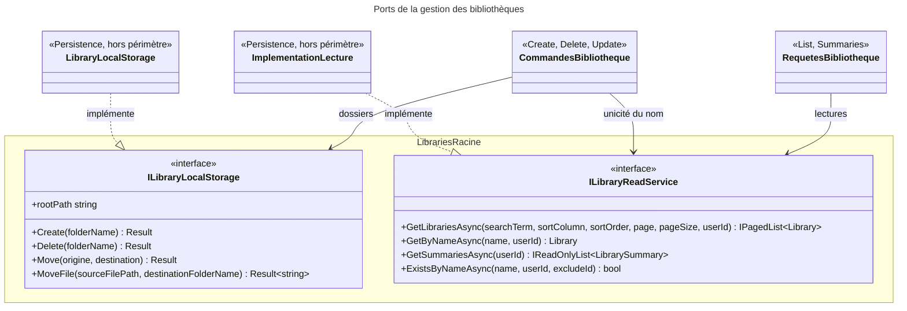

# C4 Code Level : Libraries (racine)

## Vue d'ensemble

- **Nom** : Application.Libraries (racine)
- **Description** : Contrats partagés par la gestion des bibliothèques : port de stockage des dossiers de bibliothèque, port de lecture (requêtes de liste, de recherche par nom, de résumés et d'existence). Ce dossier ne contient aucun handler ; ceux-ci vivent dans les sous-dossiers `Create`, `Delete`, `GetById`, `List`, `Summaries` et `Update`.
- **Emplacement relatif** : [Application/Libraries](../Application/Libraries)
- **Langage** : C# (.NET 10), espace de noms `Application.Libraries`
- **Objectif** : Définir les ports (interfaces) qui séparent la logique applicative du système de fichiers et des requêtes de lecture, dont les implémentations se trouvent dans `Persistence`.

## Éléments de code

### Interfaces

#### `ILibraryLocalStorage`

```csharp
public interface ILibraryLocalStorage
{
    string rootPath { get; init; }
    Result Create(string folderName);
    Result Delete(string folderName);
    Result Move(string originFolderName, string destinationFolderName);
    Result<string> MoveFile(string sourceFilePath, string destinationFolderName);
}
```

- **Description** : Port d'accès au système de fichiers des dossiers de bibliothèque numérique.
  - `rootPath` : racine absolue du stockage des bibliothèques (propriété d'initialisation).
  - `Create` : crée le dossier d'une bibliothèque.
  - `Delete` : supprime le dossier d'une bibliothèque.
  - `Move` : renomme le dossier d'une bibliothèque (changement de nom).
  - `MoveFile` : déplace un fichier livre vers le dossier d'une autre bibliothèque et retourne son nouveau chemin absolu.
- **Emplacement** : `Application/Libraries/ILibraryLocalStorage.cs:5-14` (`rootPath` ligne 7, `MoveFile` ligne 13)
- **Implémentation connue** : `Persistence/LocalStorage/LibraryLocalStorage.cs` (`LibraryLocalStorage`, hors périmètre)
- **Dépendances** : `Domain.Primitives` (`Result`, `Result<T>`)

#### `ILibraryReadService`

```csharp
public interface ILibraryReadService
{
    Task<IPagedList<Library>> GetLibrariesAsync(
        string? searchTerm, LibrariesColumn? sortColumn, SortOrder? sortOrder,
        int page, int pageSize, Guid userId, CancellationToken cancellationToken = default);

    Task<Library?> GetByNameAsync(
        string name, Guid userId, CancellationToken cancellationToken = default);

    Task<IReadOnlyList<LibrarySummary>> GetSummariesAsync(
        Guid userId, CancellationToken cancellationToken = default);

    Task<bool> ExistsByNameAsync(
        string name, Guid userId, Guid? excludeId = null, CancellationToken cancellationToken = default);
}
```

- **Description** : Port de lecture des bibliothèques, optimisé pour les requêtes (pas de changement d'état).
  - `GetLibrariesAsync` : liste paginée, filtrable par `searchTerm` et triable par `LibrariesColumn` et `SortOrder`.
  - `GetByNameAsync` : recherche une bibliothèque de l'utilisateur par son nom exact.
  - `GetSummariesAsync` : toutes les bibliothèques de l'utilisateur triées par nom, avec leur nombre de livres et leurs dernières couvertures.
  - `ExistsByNameAsync` : vérifie l'unicité du nom pour l'utilisateur, en excluant éventuellement une bibliothèque (`excludeId`, utilisé lors d'une mise à jour).
- **Emplacement** : `Application/Libraries/ILibraryReadService.cs:8-34` (`GetLibrariesAsync` lignes 10-17, `GetByNameAsync` lignes 19-22, `GetSummariesAsync` lignes 24-27, `ExistsByNameAsync` lignes 29-33)
- **Implémentation connue** : service de lecture dans `Persistence` (hors périmètre, non vérifiée dans ce périmètre)
- **Dépendances** : `Application.Interfaces.IPagedList<T>`, `Application.Libraries.Summaries.LibrarySummary`, `Domain.Libraries.Library`, `Domain.Libraries.LibrariesColumn`, `Domain.Primitives.SortOrder`

## Dépendances

### Dépendances internes

- `Application/Interfaces` : `IPagedList<T>`
- `Application/Libraries/Summaries` : `LibrarySummary`
- `Domain/Libraries` : `Library`, `LibrariesColumn`
- `Domain/Primitives` : `Result`, `Result<T>`, `SortOrder`
- Utilisateurs internes : `Create`, `Delete` et `Update` (via `ILibraryLocalStorage`) ; `Create` et `Update` (unicité du nom via `ILibraryReadService`) ; `List` et `Summaries` (via `ILibraryReadService`) ; `GetById` n'utilise pas ces ports et passe directement par `IRepository<Library, Guid>`
- `Application/ImportJobs` : `IImportDirectoryStorage` (utilisé avec `ILibraryLocalStorage` par les commandes de création, suppression et mise à jour)

### Dépendances externes

- Aucune bibliothèque externe directe dans ce dossier.

## Relations



## Notes

- `ILibraryReadService` est un port de lecture : son usage dans une commande (unicité du nom) reste une lecture, sans effet de bord.
- Le nommage de `rootPath` (camelCase en propriété publique, contrairement au reste de l'API en PascalCase) est une incohérence de style à relever.
- Les interfaces de stockage ne lèvent pas d'exception pour les cas connus : les erreurs de `LibraryLocalStorageError` (dossier inexistant, dossier déjà existant, chemin invalide) sont remontées sous forme de `Result`.
