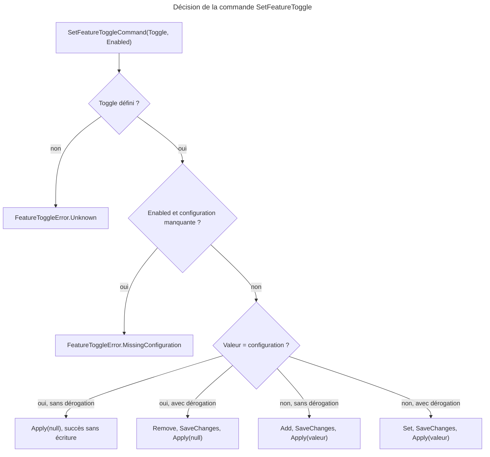
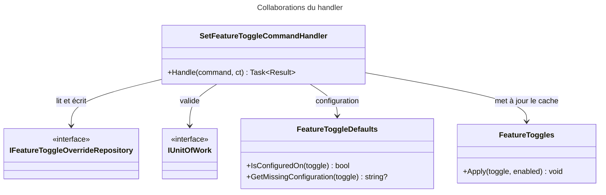

# C4 Code Level : Application.Settings.SetFeatureToggle

## Vue d'ensemble

- **Nom** : Application.Settings.SetFeatureToggle : commande de changement d'une bascule
- **Description** : Commande CQRS et handler qui enregistrent la valeur choisie par un administrateur dans la page Réglages. Si la valeur correspond à la configuration, la dérogation est supprimée et la fonctionnalité suit à nouveau la configuration.
- **Emplacement** : [Application/Settings/SetFeatureToggle/](../Application/Settings/SetFeatureToggle/)
- **Langage** : C# (.NET 10), CQRS avec `Result`
- **Objectif** : Persister la dérogation dans la base, puis mettre à jour le cache en mémoire `FeatureToggles` seulement si la sauvegarde a réussi.

## Éléments de code

### Commandes

#### SetFeatureToggleCommand

- **Type** : record public, implémente `ICommand`
- **Signature** : `public record SetFeatureToggleCommand(FeatureToggle Toggle, bool Enabled) : ICommand;`
- **Description** : Demande de fixer la fonctionnalité `Toggle` à `Enabled`.
- **Emplacement** : [SetFeatureToggleCommand.cs](../Application/Settings/SetFeatureToggle/SetFeatureToggleCommand.cs) ligne 6
- **Dépendances** : `Application.Abstractions.Messaging.ICommand`, `Domain.Settings.FeatureToggle`.

### Handlers

#### SetFeatureToggleCommandHandler

- **Type** : classe publique sealed, implémente `ICommandHandler<SetFeatureToggleCommand>`, constructeur primaire
- **Signature** :

```csharp
public sealed class SetFeatureToggleCommandHandler(
    IFeatureToggleOverrideRepository repository,
    IUnitOfWork unitOfWork,
    FeatureToggleDefaults defaults,
    FeatureToggles featureToggles) : ICommandHandler<SetFeatureToggleCommand>
{
    public Task<Result> Handle(SetFeatureToggleCommand command, CancellationToken cancellationToken);
}
```

- **Description** : Traite la commande dans cet ordre :
  1. Garde `Guard.Against.Null(command)`, puis rejet de la valeur `Toggle` si elle n'est pas définie (`FeatureToggleError.Unknown`).
  2. Si l'utilisateur active la fonctionnalité (`Enabled` vrai) et qu'il manque une configuration (`GetMissingConfiguration`), renvoie `FeatureToggleError.MissingConfiguration(detail)`.
  3. Compare la valeur demandée à la configuration. Quatre cas :
     - valeur égale à la configuration, pas de dérogation : aucune écriture, `Apply(toggle, null)` puis succès ;
     - valeur égale à la configuration, dérogation existante : suppression de la dérogation ;
     - valeur différente, pas de dérogation : ajout d'une dérogation ;
     - valeur différente, dérogation existante : mise à jour de la dérogation.
  4. `SaveChangesAsync`. En cas d'échec, l'erreur est renvoyée et le cache n'est pas modifié.
  5. `featureToggles.Apply(toggle, followsConfiguration ? null : Enabled)` puis succès.
- **Emplacement** : [SetFeatureToggleCommandHandler.cs](../Application/Settings/SetFeatureToggle/SetFeatureToggleCommandHandler.cs) lignes 7-60 (`Handle` lignes 17-59 ; garde lignes 19-23 ; contrôle de configuration lignes 25-28 ; écriture lignes 30-49 ; cache lignes 51-58)
- **Dépendances** : `IFeatureToggleOverrideRepository`, `IUnitOfWork`, `FeatureToggleDefaults`, `FeatureToggles`, `Ardalis.GuardClauses`, `Domain.Settings.FeatureToggleError`, `Domain.Settings.FeatureToggleOverride`.

## Dépendances

### Internes

- `Application.Interfaces` : `IFeatureToggleOverrideRepository`, `IUnitOfWork`.
- `Application.Settings` : `FeatureToggleDefaults`, `FeatureToggles`.
- `Application.Abstractions.Messaging` : `ICommand`, `ICommandHandler<TCommand>`.

### Externes

- **Ardalis.GuardClauses** : `Guard.Against.Null`.
- **Domain** : `Result`, `FeatureToggleError`, `FeatureToggleOverride.Create` et `Set`, `FeatureToggle`.

## Relations





## Notes

- **Ordre des effets** : le cache en mémoire est mis à jour après la sauvegarde réussie. Une erreur de base laisse donc l'état en mémoire inchangé, conformément à la règle « validations avant effets de bord » du `CLAUDE.md`.
- **Cas sans écriture** : si la valeur demandée est déjà la configuration et qu'aucune dérogation n'existe, le handler ne fait aucun appel au dépôt, seulement `Apply(toggle, null)`.
- **Fonctionnalité sans clé** : `FeatureToggleDefaults.GetMissingConfiguration` ne vérifie que l'activation (`Enabled` vrai). Désactiver une fonctionnalité est donc toujours possible, même mal configurée.
- **Portée globale** : la commande ne reçoit aucun identifiant d'utilisateur. Une bascule est donc globale à l'application, et le handler ne contient aucun contrôle d'accès.
