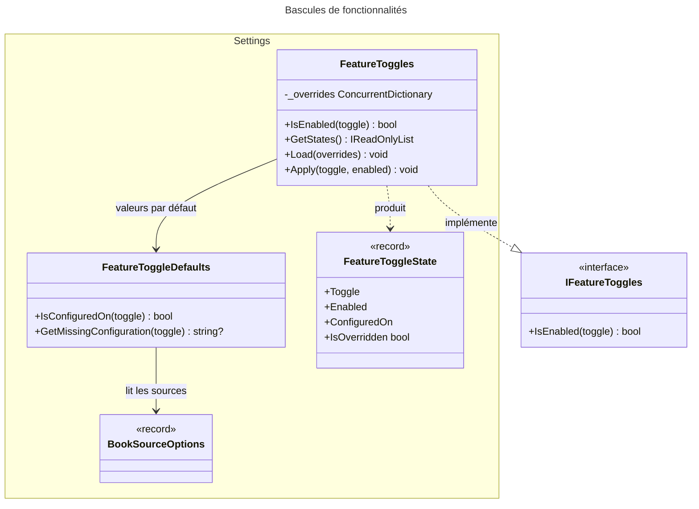
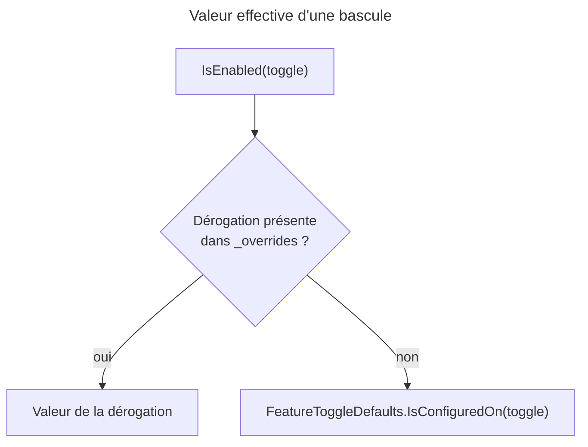

# C4 Code Level : Application.Settings

## Vue d'ensemble

- **Nom** : Application.Settings : bascules de fonctionnalités et configuration des sources
- **Description** : Gère l'activation des fonctionnalités optionnelles (import de flux, lecture OCR de l'ISBN, catalogues de métadonnées). Une bascule suit la configuration (`appsettings`, variables d'environnement) tant qu'un administrateur n'a pas choisi une valeur dans la page Réglages, qui prime alors.
- **Emplacement** : [Application/Settings/](../Application/Settings/) (sous-répertoire [SetFeatureToggle/](../Application/Settings/SetFeatureToggle/) documenté à part)
- **Langage** : C# (.NET 10), `ConcurrentDictionary`, `IOptions<T>`
- **Objectif** : Fournir en mémoire, sans accès base de données, l'état effectif de chaque fonctionnalité, et calculer la configuration manquante avant d'activer une fonctionnalité.

## Éléments de code

### Classes et records

#### BookSourceOptions

- **Type** : record public sealed (positionnel)
- **Signature** :

```csharp
public sealed record BookSourceOptions(
    IOptions<BnfCatalogueSettings> Bnf,
    IOptions<GoogleBooksSettings> GoogleBooks,
    IOptions<OpenLibrarySettings> OpenLibrary,
    IOptions<BubbleSettings> Bubble,
    IOptions<BedethequeSettings> Bedetheque);
```

- **Description** : Regroupe les options des cinq sources de recherche par ISBN. Lu par `FeatureToggleDefaults` pour connaître l'activation configurée de chaque source.
- **Emplacement** : [BookSourceOptions.cs](../Application/Settings/BookSourceOptions.cs) lignes 4-12
- **Dépendances** : `Application.ComicInfoSearch` (les cinq `*Settings`), `Microsoft.Extensions.Options.IOptions<T>`.

#### FeatureToggleState

- **Type** : record public sealed
- **Signature** :

```csharp
public sealed record FeatureToggleState(FeatureToggle Toggle, bool Enabled, bool ConfiguredOn)
{
    public bool IsOverridden { get; }  // Enabled != ConfiguredOn
}
```

- **Description** : État d'une fonctionnalité : valeur effective (`Enabled`), valeur de la configuration (`ConfiguredOn`) et indication de dérogation (`IsOverridden`). Produit par `FeatureToggles.GetStates`, destiné à l'affichage des réglages.
- **Emplacement** : [FeatureToggleState.cs](../Application/Settings/FeatureToggleState.cs) lignes 5-8 (`IsOverridden` ligne 7)
- **Dépendances** : `Domain.Settings.FeatureToggle`.

### Services

#### FeatureToggles

- **Type** : classe publique sealed (singleton), implémente `IFeatureToggles`, constructeur primaire `FeatureToggleDefaults defaults`
- **Signature** :

```csharp
public sealed class FeatureToggles(FeatureToggleDefaults defaults) : IFeatureToggles
{
    public bool IsEnabled(FeatureToggle toggle);
    public IReadOnlyList<FeatureToggleState> GetStates();
    public void Load(IEnumerable<FeatureToggleOverride> overrides);
    public void Apply(FeatureToggle toggle, bool? enabled);
}
```

- **Description** :
  - `IsEnabled` : valeur de la dérogation si elle existe, sinon la valeur de configuration. Lecture sans accès base de données.
  - `GetStates` : état de toutes les valeurs de `FeatureToggle`, dans l'ordre de l'énumération.
  - `Load` : remplace toutes les dérogations, au démarrage.
  - `Apply` : pose une dérogation (`true` / `false`) ou la retire (`null`, la fonctionnalité suit alors la configuration).
- **Emplacement** : [FeatureToggles.cs](../Application/Settings/FeatureToggles.cs) lignes 10-42 (`IsEnabled` lignes 14-15 ; `GetStates` lignes 17-18 ; `Load` lignes 20-28 ; `Apply` lignes 31-41). Champ privé `_overrides` ligne 12.
- **Dépendances** : `FeatureToggleDefaults`, `FeatureToggleOverride` (`Domain.Settings`), `ConcurrentDictionary`.

#### FeatureToggleDefaults

- **Type** : classe publique sealed (singleton), constructeur primaire
- **Signature** :

```csharp
public sealed class FeatureToggleDefaults(
    IOptions<FeedImportSettings> feedImport,
    IOptions<MinifluxSettings> miniflux,
    IOptions<IsbnOcrSettings> isbnOcr,
    BookSourceOptions bookSources)
{
    public bool IsConfiguredOn(FeatureToggle toggle);
    public string? GetMissingConfiguration(FeatureToggle toggle);
}
```

- **Description** :
  - `IsConfiguredOn` : valeur de configuration de chaque fonctionnalité. `FeedImport` suit `FeedImport:Enabled`, `IsbnOcr` suit `IsbnOcr:Enabled`, les sources suivent leur `Enabled`. `Bubble` exige en plus une clé API. Une valeur inconnue donne `false`.
  - `GetMissingConfiguration` : explique ce qui manque pour activer une fonctionnalité, ou renvoie `null`. Vérifie pour `FeedImport` l'e-mail utilisateur, l'URL Miniflux (http ou https absolue), la clé API et le nom de catégorie ; pour `IsbnOcr` le chemin de Tesseract ; pour `Bubble` la clé API.
- **Emplacement** : [FeatureToggleDefaults.cs](../Application/Settings/FeatureToggleDefaults.cs) lignes 11-59 (`IsConfiguredOn` lignes 17-27 ; `GetMissingConfiguration` lignes 30-36 ; `GetFeedImportMissingConfiguration` lignes 38-58)
- **Dépendances** : `FeedImportSettings`, `MinifluxSettings` (`Application.FeedImports`), `IsbnOcrSettings` (`Application.Books.IsbnScan`), `BookSourceOptions`, `FeatureToggle`.

## Dépendances

### Internes

- `Application.Settings.SetFeatureToggle` : `SetFeatureToggleCommandHandler` consomme `FeatureToggleDefaults` et `FeatureToggles`.
- `Application.Interfaces` : `IFeatureToggles` (implémenté par `FeatureToggles`).
- `Application.ComicInfoSearch` : `BnfCatalogueSettings`, `GoogleBooksSettings`, `OpenLibrarySettings`, `BubbleSettings`, `BedethequeSettings` (via `BookSourceOptions`).
- `Application.FeedImports` : `FeedImportSettings`, `MinifluxSettings`.
- `Application.Books.IsbnScan` : `IsbnOcrSettings`.
- `Domain.Settings` : `FeatureToggle`, `FeatureToggleOverride`, `FeatureToggleError` (utilisé par le handler).

### Externes

- `Microsoft.Extensions.Options` : `IOptions<T>`.
- `System.Collections.Concurrent` : `ConcurrentDictionary`.

## Relations





## Notes

- **Mémoire partagée** : `FeatureToggles` est un singleton chargé au démarrage. Avec plusieurs instances, les autres ne voient pas une modification (commentaire `ponytail:` ligne 9 du fichier).
- **Pas d'accès base** : `IsEnabled` ne lit que le dictionnaire. Le handler de `SetFeatureToggle` met à jour la base puis appelle `Apply`.
- **Ajouter une fonctionnalité** : ajouter la valeur à `FeatureToggle`, sa ligne dans `IsConfiguredOn` et, si elle exige une configuration, sa ligne dans `GetMissingConfiguration` (commentaire lignes 8-10 de `FeatureToggleDefaults`).
- **Cohérence avec la configuration** : `FeatureToggleState.IsOverridden` est vrai quand la valeur effective diffère de la configuration. Le handler supprime toute dérogation identique à la configuration, donc ce drapeau reste exact.
- **Persistance** : le commentaire de `FeatureToggle` (Domain) demande de ne jamais renommer une valeur, car les dérogations sont stockées par nom.
