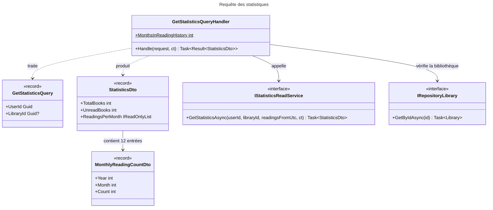
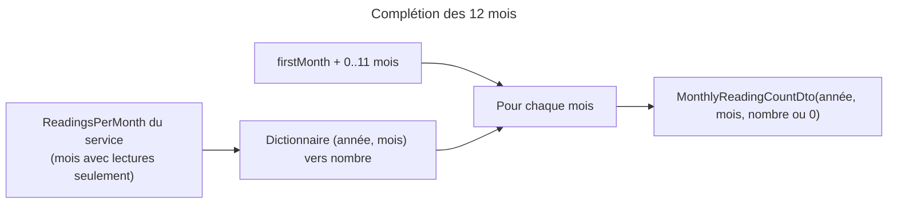

# C4 Code Level : Application.Statistics.Get

## Vue d'ensemble

- **Nom** : Application.Statistics.Get : requête des statistiques de lecture
- **Description** : Requête CQRS qui renvoie les statistiques d'un utilisateur (livres, séries, bibliothèques, lectures, pages, stockage numérique, lectures par mois sur 12 mois), éventuellement limitées à une bibliothèque.
- **Emplacement** : [Application/Statistics/Get/](../Application/Statistics/Get/)
- **Langage** : C# (.NET 10), CQRS avec `Result<T>`
- **Objectif** : Valider la demande, vérifier qu'une bibliothèque appartient à l'utilisateur, calculer les données via `IStatisticsReadService`, puis compléter les 12 mois de la période avec des zéros.

## Éléments de code

### Requête

#### GetStatisticsQuery

- **Type** : record public, implémente `IQuery<StatisticsDto>`
- **Signature** : `public record GetStatisticsQuery(Guid UserId, Guid? LibraryId = null) : IQuery<StatisticsDto>;`
- **Description** : Demande les statistiques de `UserId`, globales (`LibraryId` nul) ou pour une bibliothèque.
- **Emplacement** : [GetStatisticsQuery.cs](../Application/Statistics/Get/GetStatisticsQuery.cs) ligne 5
- **Dépendances** : `Application.Abstractions.Messaging.IQuery<TResponse>`, `StatisticsDto`.

### Données de sortie

#### StatisticsDto

- **Type** : record public sealed (propriétés `init`)
- **Signature** :

```csharp
public sealed record StatisticsDto
{
    public int TotalBooks { get; init; }
    public int TotalSeries { get; init; }
    public int TotalLibraries { get; init; }
    public int ReadBooks { get; init; }
    public int UnreadBooks { get; }                 // TotalBooks - ReadBooks
    public int TotalReadings { get; init; }
    public double? AverageRating { get; init; }
    public long TotalPages { get; init; }
    public long DigitalStorageBytes { get; init; }
    public IReadOnlyList<MonthlyReadingCountDto> ReadingsPerMonth { get; init; } = [];
}
```

- **Description** : Résultat de la requête. `UnreadBooks` est calculé. `AverageRating` est `null` sans note. `ReadingsPerMonth` contient une entrée par mois, une fois complété par le handler.
- **Emplacement** : [StatisticsDto.cs](../Application/Statistics/Get/StatisticsDto.cs) lignes 3-15 (`UnreadBooks` ligne 9 ; `ReadingsPerMonth` ligne 14)
- **Dépendances** : `MonthlyReadingCountDto`.

#### MonthlyReadingCountDto

- **Type** : record public sealed
- **Signature** : `public sealed record MonthlyReadingCountDto(int Year, int Month, int Count);`
- **Description** : Nombre de lectures terminées pendant un mois donné.
- **Emplacement** : [MonthlyReadingCountDto.cs](../Application/Statistics/Get/MonthlyReadingCountDto.cs) ligne 3

### Handler

#### GetStatisticsQueryHandler

- **Type** : classe publique sealed, implémente `IQueryHandler<GetStatisticsQuery, StatisticsDto>`, constructeur primaire
- **Signature** :

```csharp
public sealed class GetStatisticsQueryHandler(
    IStatisticsReadService statisticsReadService,
    IRepository<Library, Guid> libraryRepository,
    TimeProvider timeProvider) : IQueryHandler<GetStatisticsQuery, StatisticsDto>
{
    public const int MonthsInReadingHistory = 12;

    public Task<Result<StatisticsDto>> Handle(GetStatisticsQuery request, CancellationToken cancellationToken);
}
```

- **Description** :
  1. `Guard.Against.Null(request)`.
  2. Si `UserId` ou `LibraryId` est `Guid.Empty`, renvoie `StatisticsError.BadRequest`.
  3. Si une bibliothèque est demandée, la charge : absente ou appartenant à un autre utilisateur, renvoie `LibrariesError.NotFound`.
  4. Calcule `firstMonth` : premier jour du mois courant moins 11 mois, à partir de `TimeProvider.GetUtcNow()`.
  5. Appelle `IStatisticsReadService.GetStatisticsAsync(userId, libraryId, firstMonth, ct)`.
  6. Renvoie la statistique avec `ReadingsPerMonth` complété par `FillMissingMonths`.
- **Emplacement** : [GetStatisticsQueryHandler.cs](../Application/Statistics/Get/GetStatisticsQueryHandler.cs) lignes 10-60 (constante `MonthsInReadingHistory` ligne 15 ; `Handle` lignes 17-46 ; `FillMissingMonths` lignes 48-59)
- **Dépendances** : `IStatisticsReadService`, `IRepository<Library, Guid>`, `TimeProvider`, `StatisticsError.BadRequest`, `LibrariesError.NotFound`, `Ardalis.GuardClauses`.

## Dépendances

### Internes

- `Application.Interfaces` : `IStatisticsReadService` (lecture des agrégats, implémenté hors Application), `IRepository<TEntity, TEntityId>` (pour `Library`).
- `Application.Abstractions.Messaging` : `IQuery<T>`, `IQueryHandler<TQuery, TResponse>`.
- `Application.Statistics.Get` : `StatisticsDto` et `MonthlyReadingCountDto` sont utilisés par `IStatisticsReadService`.

### Externes

- **Domain** : `Library` (`Domain.Libraries`), `StatisticsError` (`Domain.Statistics`), `LibrariesError` (`Domain.Libraries`), `Result<T>` (`Domain.Primitives`).
- **Ardalis.GuardClauses** : garde de nullité.
- **System** : `TimeProvider` (horloge injectable, testable).

## Relations





## Notes

- **Contrôle d'accès** : la vérification `library.UserId != request.UserId` (ligne 29) est le seul contrôle d'appartenance. Les totaux globaux se limitent à l'utilisateur via `UserId` transmis au service.
- **Appel sans jeton** : `libraryRepository.GetByIdAsync(libraryId)` (ligne 28) n'est pas appelé avec le `CancellationToken`, contrairement à `IStatisticsReadService`. Une annulation n'interrompt donc pas cette lecture.
- **Horloge** : `TimeProvider` permet de figer la période dans les tests. La période est alignée sur le premier jour du mois, en UTC.
- **Tests** : le comportement de complétion (`FillMissingMonths`) est privé : il est vérifié par les résultats de `Handle`.
