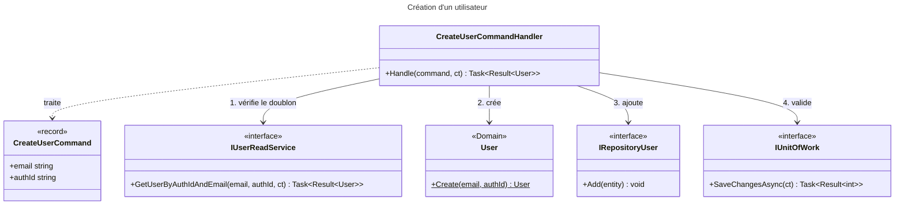
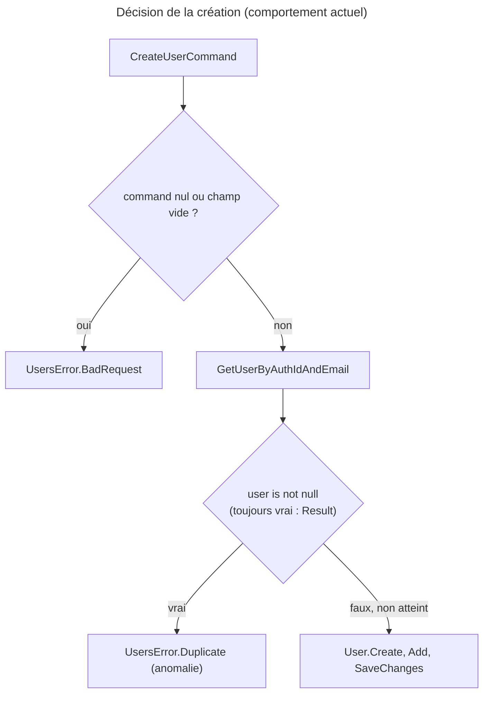

# C4 Code Level : Application.Users.Create

## Vue d'ensemble

- **Nom** : Application.Users.Create : création d'un utilisateur
- **Description** : Commande CQRS et handler qui créent un utilisateur à partir de son e-mail et de son identifiant d'authentification, après avoir vérifié qu'il n'existe pas déjà.
- **Emplacement** : [Application/Users/Create/](../Application/Users/Create/)
- **Langage** : C# (.NET 10), CQRS avec `Result<T>`
- **Objectif** : Créer l'utilisateur interne à la première connexion, en évitant les doublons.

## Éléments de code

### Commandes

#### CreateUserCommand

- **Type** : record public, implémente `ICommand<User>`
- **Signature** : `public record CreateUserCommand(string email, string authId) : ICommand<User>;`
- **Description** : Demande de création d'un utilisateur. Les paramètres sont nommés en minuscules, ce qui crée des propriétés publiques `email` et `authId`.
- **Emplacement** : [CreateUserCommand.cs](../Application/Users/Create/CreateUserCommand.cs) ligne 6
- **Dépendances** : `Application.Abstractions.Messaging.ICommand<TResponse>`, `Domain.Users.User`.

### Handlers

#### CreateUserCommandHandler

- **Type** : classe publique sealed, implémente `ICommandHandler<CreateUserCommand, User>`, constructeur primaire
- **Signature** :

```csharp
public sealed class CreateUserCommandHandler(
    IRepository<User, Guid> userRepository,
    IUnitOfWork unitOfWork,
    IUserReadService userReadService) : ICommandHandler<CreateUserCommand, User>
{
    public Task<Result<User>> Handle(CreateUserCommand command, CancellationToken cancellationToken);
}
```

- **Description** : Traite la commande dans cet ordre :
  1. `command is null` : renvoie `UsersError.BadRequest`.
  2. E-mail ou identifiant d'authentification vide : `UsersError.BadRequest`.
  3. Recherche par `GetUserByAuthIdAndEmail` ; si le résultat n'est pas `null`, renvoie `UsersError.Duplicate`.
  4. Crée l'entité via `User.Create(email, authId)`, l'ajoute au dépôt et valide avec `IUnitOfWork.SaveChangesAsync`. En cas d'échec, renvoie l'erreur de sauvegarde.
  5. Renvoie le nouvel utilisateur.
- **Emplacement** : [CreateUserCommandHandler.cs](../Application/Users/Create/CreateUserCommandHandler.cs) lignes 8-41 (`Handle` lignes 10-40 ; contrôle d'entrée lignes 12-21 ; contrôle de doublon lignes 23-28 ; création et sauvegarde lignes 30-39)
- **Dépendances** : `IRepository<User, Guid>`, `IUnitOfWork`, `IUserReadService`, `User.Create`, `UsersError.BadRequest`, `UsersError.Duplicate`.

> **Anomalie (vérifiée)** : la ligne 25 teste `user is not null`, mais `GetUserByAuthIdAndEmail` renvoie un `Result<User>`, toujours non nul. Quand l'utilisateur n'existe pas, l'implémentation renvoie `UsersError.NotFound` sous forme de `Result` en échec ([UserReadService.cs](../Persistence/Queries/UserReadService.cs) lignes 50-52). La condition est donc vraie pour tout utilisateur : le handler renvoie `UsersError.Duplicate` pour chaque nouvelle création, et l'utilisateur n'est jamais créé. La condition attendue est `if (existing.IsSuccess)` (ou une distinction explicite entre `NotFound` et les autres erreurs). Les tests unitaires ne détectent pas cette anomalie : ils simulent la présence d'un utilisateur avec `Returns(user)` (ligne 88 de `tests/Application.UnitTests/Users/CreateUserCommandTests.cs`), donc une réussite implicite, et non un `UsersError.NotFound`.

## Dépendances

### Internes

- `Application.Interfaces` : `IRepository<TEntity, TEntityId>` (pour `User`), `IUnitOfWork`.
- `Application.Users` : `IUserReadService`.
- `Application.Abstractions.Messaging` : `ICommand<TResponse>`, `ICommandHandler<TCommand, TResponse>`.

### Externes

- **Domain** : `User` et `User.Create` (`Domain.Users`), `UsersError` (`Domain.Users`), `Result<TValue>` (`Domain.Primitives`).
- **System** : `Guid`, `CancellationToken`, `Task`.

## Relations





## Notes

- **Correction attendue** : tester `IsSuccess` sur le `Result` renvoyé par `GetUserByAuthIdAndEmail`, et ne renvoyer `Duplicate` que pour un succès. Un `UsersError.BadRequest` renvoyé par le service de lecture doit être propagé, et non interprété comme un doublon.
- **Commentaire trompeur** : le commentaire ligne 23 dit « même e-mail ou même AuthId », alors que le service de lecture exige les deux à la fois (`Where(u => u.Email == email && u.AuthId == authId)` dans `UserReadService`).
- **Validation d'entrée** : les lignes 12-21 valident l'entrée avant tout appel au dépôt, conformément au `CLAUDE.md`. `string.IsNullOrEmpty` n'attrape pas les chaînes composées d'espaces.
- **Ordre des effets** : aucun effet de bord avant la validation, ce qui respecte la règle du `CLAUDE.md`.
